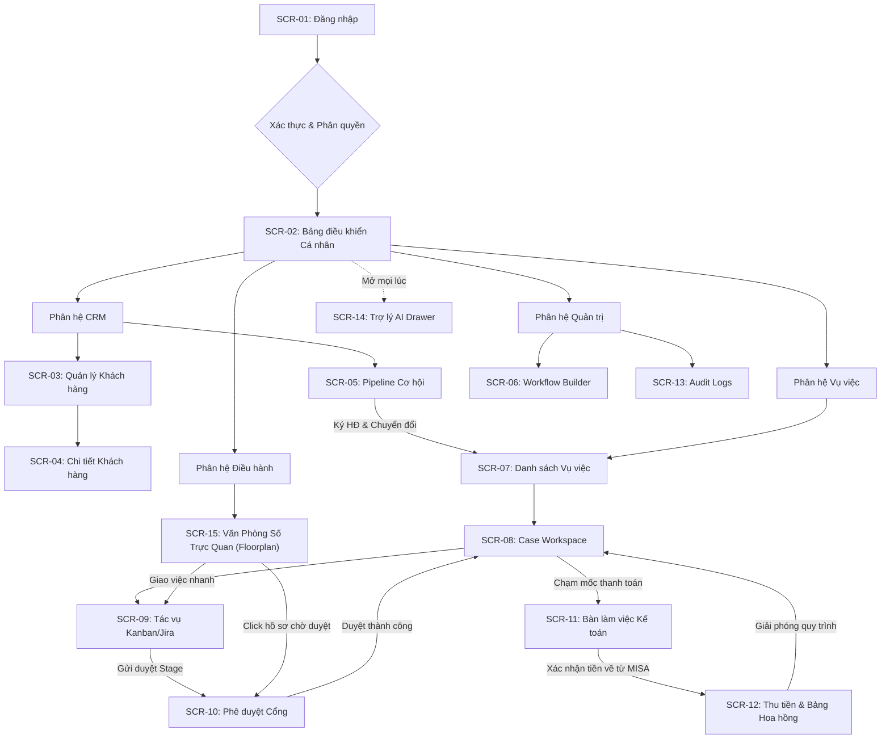

# 03. DANH SÁCH MÀN HÌNH, THIẾT KẾ GIAO DIỆN & TRẠNG THÁI (SCREENS & UI)

## 1. BẢNG KIỂM KÊ MÀN HÌNH (SCREEN INVENTORY TABLE)

| Mã màn hình | Tên màn hình | Đối tượng sử dụng | Design Status | Code Status | Đường dẫn file mã nguồn dự kiến | Tiêu chuẩn Nghiệm thu (DoD) |
| :--- | :--- | :--- | :---: | :---: | :--- | :--- |
| **SCR-01** | Đăng nhập Hệ thống | Mọi nhân sự | Ready | Pending | `frontend/src/app/(auth)/login/page.tsx` | Nhập Email & Mật khẩu nội bộ, xác thực JWT, nhớ phiên, hiển thị lỗi khi sai mật khẩu. |
| **SCR-02** | Bảng điều khiển Cá nhân (Personal Dashboard) | Mọi nhân sự | **Prototype Ready** | Pending | `frontend/src/app/(dashboard)/page.tsx` | Hiển thị tóm tắt công việc cá nhân, deadline 3 ngày tới, thông báo mới nhất, bộ đếm vụ việc. Đã có trong `storybook.html`. |
| **SCR-03** | Quản lý Khách hàng & Hồ sơ CRM | Sales, Partner, Lawyer | Ready | Pending | `frontend/src/app/(dashboard)/crm/clients/page.tsx` | Danh sách khách hàng kèm phân trang, tìm kiếm MST/Tên, phân loại nhóm, timeline tương tác. |
| **SCR-04** | Chi tiết Khách hàng (Client Detail View) | Sales, Partner, Lawyer | Ready | Pending | `frontend/src/app/(dashboard)/crm/clients/[id]/page.tsx` | Chi tiết thông tin liên hệ, lịch sử cuộc gọi/email, danh sách vụ việc lịch sử của khách hàng. |
| **SCR-05** | Đường ống Cơ hội (Opportunities Pipeline) | Sales, Partner | Ready | Pending | `frontend/src/app/(dashboard)/crm/opportunities/page.tsx` | Kanban pipeline theo giai đoạn tiếp cận, ước lượng giá trị, nút 1 chạm chuyển đổi thành Case. |
| **SCR-06** | Trình Thiết kế Quy trình (Workflow Builder) | Super Admin | **Prototype Ready** | Pending | `frontend/src/app/(dashboard)/admin/workflows/page.tsx` | Kéo thả Stage, cấu hình Task mặc định, phân nhánh điều kiện, cấu hình Approval Gate & Dynamic Fields. Đã có trong `storybook.html`. |
| **SCR-07** | Danh sách Vụ việc Pháp lý (Case List) | Partner, Supervisor, Lawyer | Ready | Pending | `frontend/src/app/(dashboard)/cases/page.tsx` | Bảng dữ liệu lọc theo Need-to-know, bộ lọc Lĩnh vực/Trạng thái/Luật sư phụ trách, nút tạo Case mới. |
| **SCR-08** | Không gian Làm việc Vụ việc (Case Workspace) | Partner, Supervisor, Lawyer | **Prototype Ready** | Pending | `frontend/src/app/(dashboard)/cases/[id]/page.tsx` | Header tiến độ, render form trường động JSONB, cây văn bản đính kèm, lịch sử chuyển stage. Đã có trong `storybook.html`. |
| **SCR-09** | Bảng Tác vụ Lai (Kanban & Jira View) | Supervisor, Lawyer, Assistant | **Prototype Ready** | Pending | `frontend/src/app/(dashboard)/cases/[id]/tasks/page.tsx` | Chuyển đổi Kanban/List view, kéo thả cập nhật trạng thái, kiểm tra Task Dependency chặn hoàn thành. Đã có trong `storybook.html`. |
| **SCR-10** | Hộp thoại Phê duyệt Cổng (Approval Modal) | Supervisor, Partner | **Prototype Ready** | Pending | `frontend/src/components/cases/ApprovalModal.tsx` | Hiển thị hồ sơ cần duyệt, nút Chấp thuận / Trả về kèm lý do bằng văn bản, ký duyệt điện tử nội bộ. Đã có trong `storybook.html`. |
| **SCR-11** | Bàn làm việc Kế toán (MISA Accounting Inbox) | Accountant, Partner | **Prototype Ready** | Pending | `frontend/src/app/(dashboard)/accounting/inbox/page.tsx` | Danh sách tác vụ thu tiền/xuất hóa đơn đang chờ, form nhập Số HĐ/Mã GD ngân hàng, nút Xác nhận. Đã có trong `storybook.html`. |
| **SCR-12** | Quản lý Đợt thu & Hoa hồng (Billing & Commissions) | Partner, Accountant, Sales | **Prototype Ready** | Pending | `frontend/src/app/(dashboard)/finance/commissions/page.tsx` | Bảng kê đợt thu theo vụ việc, bảng phân bổ hoa hồng thực thu (Cash-basis) theo nhân sự từng tháng. Đã có trong `storybook.html`. |
| **SCR-13** | Nhật ký Kiểm toán (System Audit Logs) | Super Admin | Ready | Pending | `frontend/src/app/(dashboard)/admin/audit-logs/page.tsx` | Bảng log bất biến, lọc theo Actor/Target/Thời gian, hiển thị chi tiết diff dữ liệu trước/sau khi sửa. |
| **SCR-14** | Khung Trợ lý AI (AI Assistant Drawer) | Mọi nhân sự | Ready | Pending | `frontend/src/components/ai/AiChatDrawer.tsx` | Drawer trượt từ cạnh phải, chat tra cứu vụ việc/task/deadline, phản hồi có kèm liên kết điều hướng. |
| **SCR-15** | Văn Phòng Số Trực Quan (Virtual Office Floorplan) | Managing Partner, Supervisor | **Ready (Spec)** | Pending | `frontend/src/app/(dashboard)/operations/floorplan/page.tsx` | Mô phỏng 2.5D bàn ghế nhân sự phòng ban, chỉ số task đang làm/chờ/nghỉ ngơi, xếp hàng trước bàn Trưởng phòng duyệt hồ sơ, Side Drawer & WebSockets real-time. |

---

## 2. SƠ ĐỒ ĐIỀU HƯỚNG MÀN HÌNH (SCREEN FLOWCHART)



---

## 3. THIẾT KẾ BỐ CỤC CHUNG (MASTER SHELL LAYOUT)
- **TopBar:** 
  - Logo Hãng luật ASL LAW & nhãn chi nhánh.
  - Thanh tìm kiếm nhanh toàn hệ thống (Global Search: tìm Case ID, Tên thân chủ, Tên văn bản).
  - Nút Quick Action `+`: Tạo nhanh Khách hàng mới, Cơ hội mới, hoặc Ghi chú.
  - Chuông thông báo (Notification Center): Bắt sự kiện thời gian thực qua WebSockets/SSE.
  - Nút kích hoạt Trợ lý ảo AI (Biểu tượng Sparkle mở Drawer cạnh phải).
  - Menu người dùng: Ảnh đại diện, Tên hiển thị, Vai trò hiện tại, Đổi mật khẩu, Đăng xuất.
- **Collapsible Sidebar:**
  - Mục chính: Bàn làm việc (Dashboard), Khách hàng (CRM), Vụ việc & Tác vụ (Cases), Tài chính & Kế toán (Finance/MISA), Báo cáo & Thống kê.
  - Mục Quản trị (Dành riêng cho Super Admin): Workflow Builder, Quản lý Nhân sự & Phòng ban, Nhật ký Kiểm toán (Audit Logs).
  - Có thể thu nhỏ (Collapsed icon-only mode) để mở rộng diện tích màn hình làm việc hồ sơ.

---

## 4. TIÊU CHUẨN 4 TRẠNG THÁI GIAO DIỆN (UI 4-STATES)

1. **Trạng thái Trống (Empty State):**
   - Áp dụng khi chưa có dữ liệu (chưa có Case, chưa có Task, chưa có Khách hàng).
   - Hiển thị hình minh họa đồ họa thanh lịch, tiêu đề thân thiện kèm mô tả nguyên nhân và nút kêu gọi hành động (Call-to-Action - CTA) rõ ràng (Ví dụ: *"Chưa có vụ việc nào được gán cho bạn. Bấm '+ Tiếp nhận Vụ việc' để bắt đầu"*).
2. **Trạng thái Đang tải (Loading State):**
   - Không sử dụng màn hình trắng hoặc biểu tượng quay vòng đơn điệu che phủ toàn trang.
   - Bắt buộc áp dụng **Skeleton Loaders** mô phỏng chính xác cấu trúc dữ liệu của bảng biểu, thẻ Kanban hoặc form nhập liệu để người dùng không bị gián đoạn trải nghiệm thị giác.
3. **Trạng thái Thành công (Success State):**
   - Phản hồi tức thì bằng Toast Notification ở góc phải màn hình (thời gian hiển thị 3-4s) đối với các hành động thông thường (Lưu dữ liệu, Chuyển cột Kanban).
   - Hiển thị Modal chúc mừng và tóm tắt thông tin đối với các cột mốc lớn (Chuyển đổi thành công Cơ hội thành Case mới, Hoàn tất phê duyệt cổng, Xác nhận thanh toán từ MISA).
4. **Trạng thái Lỗi (Error State):**
   - *Lỗi Form nhập liệu:* Hiển thị thông báo màu đỏ dưới chân từng trường thông tin không hợp lệ kèm chỉ dẫn khắc phục.
   - *Lỗi Vi phạm Quy tắc Nghiệp vụ (Guard Error):* Toast cảnh báo màu cam kèm giải thích chi tiết (Ví dụ: *"Không thể hoàn thành Task này do Task 'Xác nhận ủy quyền' tiên quyết chưa được duyệt"*).
   - *Lỗi Hệ thống (500/Mất mạng):* Card thông báo lỗi thân thiện kèm nút "Thử lại ngay" (Retry).

---

## 5. QUY TẮC FORM VALIDATION
- Mọi form nhập liệu đều phải được validate 2 lớp: Phía Client bằng **Zod Schema (React Hook Form)** và Phía Server bằng **Pydantic v2 Schema (FastAPI)**.
- Các quy tắc bắt buộc:
  - Mã số thuế (MST Doanh nghiệp): Đúng 10 hoặc 13 chữ số, kiểm tra định dạng chuẩn Việt Nam.
  - CCCD/Hộ chiếu: Kiểm tra độ dài 9-12 ký tự, không chứa ký tự đặc biệt.
  - Số điện thoại: Định dạng số điện thoại Việt Nam chuẩn (bắt đầu bằng 03, 05, 07, 08, 09...).
  - Địa chỉ Email: Kiểm tra định dạng RFC 5322.
  - Giá trị hợp đồng & Tỷ lệ hoa hồng: Số tiền > 0; Tỷ lệ hoa hồng nằm trong khoảng từ `0.00%` đến `100.00%`, tổng các tỷ lệ thành phần không vượt quá 100%.

---

## 6. THÔNG SỐ THIẾT KẾ & BẢNG MÀU THƯƠNG HIỆU ASL LAW (DESIGN TOKENS)

### Thông số Thiết kế Toàn hệ thống (Design Tokens)
- **Phong cách thị giác:** Modern 3D Glassmorphism / Frosted Glass with Specular Edge Highlights (Kính mờ viền sáng nổi bật, hiệu ứng chiều sâu 3D).
- **Bảng màu chủ đạo (Chuẩn hóa theo Logo ASL LAW):**
  - *Primary Deep Navy:* `#002D54` (Màu xanh đậm chủ đạo theo logo, sang trọng, uy quyền vững chắc).
  - *Secondary Cerulean Blue:* `#0082B4` (Màu xanh lam sáng từ khung L-bracket của logo, biểu trưng cho sự hiện đại, công nghệ).
  - *Accent Sun Orange:* `#FF7A00` (Màu cam ấm từ quả cầu mặt trời của logo, dùng cho các nút CTA, hạn chót khẩn cấp, task cấp bách và điểm nhấn thương hiệu).
  - *Success Emerald:* `#059669` (Tiền về, mở khóa quy trình, hoàn tất nhiệm vụ).
  - *Surface Material:* Nền kính mờ `rgba(255, 255, 255, 0.82)` với `backdrop-filter: blur(20px)` và viền sáng phản chiếu `border: 1px solid rgba(255, 255, 255, 0.95)`.
  - *Background Canvas:* `#F4F8FA` kết hợp quầng sáng gradient radial xanh lam và cam mềm mại.
- **Typography:** Plus Jakarta Sans kết hợp JetBrains Mono cho các mã code vụ việc và số liệu tài chính.

### Prompt Thiết kế cho Google Stitch (Mẫu Màn hình SCR-08: Case Workspace)
```text
Design a modern, high-density Enterprise Legal Case Workspace for a top-tier law firm ERP. 
Layout: 
- Top Header: Case Title ("Tranh chấp Sở hữu Trí tuệ - Nhãn hiệu ASL-2026"), Case Code, Client Name, Lead Partner Avatar, Progress Bar (65%), Current Stage Badge ("Giai đoạn: Thẩm định nội dung"), and Action Buttons ("Gửi Cấp trên Duyệt", "+ Thêm Tài liệu").
- Main Body Split View: 
  - Left Panel (60%): Dynamic Legal Custom Fields Form rendered with clean grouped cards (Application Number, Filing Date, Priority Date, Class Codes) using Slate 900 typography and subtle borders. Below the form, an interactive Jira/Kanban hybrid task list with status badges and dependency locks.
  - Right Panel (40%): Activity timeline showing recent lawyer actions, document version tree with download icons, and an alert box for the next billing milestone ("Đợt 2: Đang chờ Kế toán đối soát MISA").
Color Palette: Dark Slate, Accent Warm Amber, Emerald Green, Clean White backgrounds with subtle borders (Tailwind Slate-200). High accessibility, clear visual hierarchy, professional desktop-first responsiveness.
```
