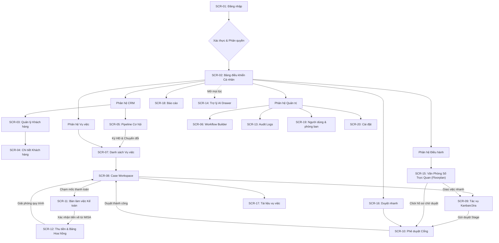

# 03. DANH SÁCH MÀN HÌNH, THIẾT KẾ GIAO DIỆN & TRẠNG THÁI (SCREENS & UI)

## 1. BẢNG KIỂM KÊ MÀN HÌNH (SCREEN INVENTORY TABLE)

Cột "Vai trò" dùng 4 vai trò hệ thống (DEC-01). Cột "Prototype" là trang tham chiếu trong `prototype/` (mở kèm `?role=`). Mã `SCR-xx` chỉ dùng trong tài liệu, **không** hiển thị trên giao diện.

| Mã | Tên màn hình | Vai trò | Prototype | Code Status (FE = frontend, BE = backend) | Đường dẫn mã nguồn dự kiến | Tiêu chuẩn Nghiệm thu (DoD) |
| :--- | :--- | :--- | :--- | :---: | :--- | :--- |
| **SCR-01** | Đăng nhập & xác thực 2FA | Mọi nhân sự | `auth/login.html` (cần sửa theo DEC-02) | FE ✓ · BE ✓ | `frontend/src/app/(auth)/login/page.tsx` | Email + mật khẩu nội bộ; bước TOTP chỉ hiện khi tài khoản bật 2FA; buộc đổi mật khẩu khi `must_reset_password`; khoá tạm sau 5 lần sai; **không** có SSO. |
| **SCR-02** | Bàn làm việc cá nhân | Mọi nhân sự | `dashboard/index.html` | FE ✓ · BE một phần (`/me/tasks`) | `frontend/src/app/(dashboard)/page.tsx` | Việc của tôi, hạn 3 ngày tới, thông báo mới, bộ đếm vụ việc — nội dung khác nhau theo vai trò. |
| **SCR-03** | Danh sách khách hàng | Quản lý, Luật sư, Kế toán (xem) | `crm/customers.html`, `crm/list.html` | FE ✓ · BE ✓ | `frontend/src/app/(dashboard)/crm/clients/page.tsx` | Phân trang, tìm theo tên/MST, lọc nhóm; tạo mới chặn trùng MST/CCCD; cảnh báo xung đột lợi ích. |
| **SCR-04** | Chi tiết khách hàng | Quản lý, Luật sư | `crm/detail.html`, `crm/edit.html` | FE ✓ · BE ✓ | `frontend/src/app/(dashboard)/crm/clients/[id]/page.tsx` | Thông tin liên hệ, dòng thời gian tương tác, danh sách vụ việc (chỉ hiện vụ việc người xem có quyền). |
| **SCR-05** | Pipeline cơ hội | Quản lý, Luật sư | `crm/index.html`, `crm/create-lead.html` | FE ✓ · BE ✓ | `frontend/src/app/(dashboard)/crm/opportunities/page.tsx` | Kanban theo giai đoạn, giá trị dự kiến, người mang khách về; nút chuyển đổi chỉ bật khi `WON`. |
| **SCR-06** | Trình thiết kế quy trình | Quản trị viên | `workflows/*.html` | FE ✓ · BE ✓ | `frontend/src/app/(dashboard)/admin/workflows/page.tsx` | Chọn chế độ Khung cứng/Linh hoạt; stage, task mẫu (SLA ngày làm việc, trọng số, task kích hoạt đợt thu), phụ thuộc, cổng duyệt, trường động; phát hành phiên bản. |
| **SCR-07** | Danh sách vụ việc | Quản lý, Luật sư, Kế toán (phạm vi `progress`) | `cases/index.html`, `cases/create.html` | FE ✓ · BE ✓ | `frontend/src/app/(dashboard)/cases/page.tsx` | Chỉ liệt kê vụ việc trong phạm vi Need-to-know; lọc lĩnh vực/trạng thái/người phụ trách. |
| **SCR-08** | Không gian vụ việc | Quản lý, Luật sư được gán; Kế toán chỉ thấy tab tài chính | `cases/detail.html`, `cases/edit.html` | FE ✓ · BE ✓ | `frontend/src/app/(dashboard)/cases/[id]/page.tsx` | Header tiến độ + cờ chặn stage, trường động, tài liệu, lịch sử stage; ẩn mọi hành động chuyên môn với Kế toán. |
| **SCR-09** | Bảng tác vụ Kanban/Danh sách | Quản lý, Luật sư | `tasks/index.html`, `tasks/list.html`, `tasks/detail.html`, `tasks/create.html` | FE ✓ · BE ✓ | `frontend/src/app/(dashboard)/cases/[id]/tasks/page.tsx` | Kéo thả có guard phụ thuộc; task bổ sung có nhãn riêng; nút "Đề xuất bổ sung" chỉ hiện với template Linh hoạt. |
| **SCR-10** | Hộp thoại phê duyệt | Quản lý, Luật sư là Supervisor/Case Manager | (trong `cases/detail.html`, `approvals/index.html`) | FE ✓ · BE ✓ | `frontend/src/components/cases/approval-modal.tsx` | Duyệt / trả về kèm lý do bắt buộc; dùng chung cho task, cổng giai đoạn, yêu cầu bổ sung. |
| **SCR-11** | Bàn làm việc Kế toán | Kế toán | `accounting/index.html`, `accounting/detail.html`, `accounting/create-invoice.html` | FE ✓ · BE chờ | `frontend/src/app/(dashboard)/accounting/inbox/page.tsx` | Đợt thu chờ xác nhận; nhập số HĐ, mã GD ngân hàng, số tiền thực về; hỗ trợ thu một phần; chặn bấm đúp. |
| **SCR-12** | Đợt thu & sổ hoa hồng | Quản lý, Kế toán, Luật sư (của mình) | `finance/index.html`, `finance/detail.html` | FE ✓ · BE chờ | `frontend/src/app/(dashboard)/finance/commissions/page.tsx` | Đợt thu theo vụ việc, sổ hoa hồng theo nhân sự/kỳ, quỹ thực hiện đang dồn. |
| **SCR-13** | Nhật ký kiểm toán | Quản trị viên | `audit-logs/index.html` | FE ✓ · BE ✓ | `frontend/src/app/(dashboard)/admin/audit-logs/page.tsx` | Lọc Actor/Hành động/Đối tượng/Thời gian, xem diff trước/sau, trạng thái chuỗi băm toàn vẹn. |
| **SCR-14** | Trợ lý AI | Mọi nhân sự | `ai-assistant/index.html` | FE ✓ · BE chờ | `frontend/src/components/ai/ai-chat-drawer.tsx` | Drawer cạnh phải; câu trả lời có link điều hướng; chỉ trả dữ liệu trong phạm vi người hỏi. |
| **SCR-15** | Văn phòng số trực quan | Quản lý | `operations/floorplan.html` | FE ✓ · BE chờ | `frontend/src/app/(dashboard)/operations/floorplan/page.tsx` | Xem `features/virtual-office-floorplan.md`. |
| **SCR-16** | Duyệt nhanh | Quản lý, Luật sư là Supervisor/Case Manager | `approvals/index.html` | FE ✓ · BE ✓ | `frontend/src/app/(dashboard)/approvals/page.tsx` | Hàng đợi `approval_requests` đang chờ người xem duyệt, lọc theo loại; mở SCR-10. |
| **SCR-17** | Tài liệu vụ việc | Theo `02` Phân hệ 9 | `documents/index.html`, `documents/detail.html`, `documents/create.html` | FE ✓ · BE chờ | `frontend/src/app/(dashboard)/documents/page.tsx` | Cây 4 thư mục, phiên bản, trạng thái quét virus; tải xuống ghi audit. |
| **SCR-18** | Báo cáo & thống kê | Quản lý, Kế toán, Luật sư (của mình) | `reports/index.html` | FE ✓ · BE chờ | `frontend/src/app/(dashboard)/reports/page.tsx` | Báo cáo theo `02` Phân hệ 10; xuất Excel. |
| **SCR-19** | Người dùng & phòng ban | Quản trị viên (Quản lý chỉ xem) | `users/*.html` | FE ✓ · BE nghiệm thu | `frontend/src/app/(dashboard)/admin/users/page.tsx` | Tạo/khoá tài khoản (thu hồi mọi phiên ngay), gán phòng ban, đặt Giám đốc/Trưởng phòng, reset 2FA có ghi audit. |
| **SCR-20** | Cài đặt | Quản trị viên; mục "Tài khoản của tôi" cho mọi người | `settings/index.html` | FE ✓ · BE một phần (ngày nghỉ) | `frontend/src/app/(dashboard)/settings/page.tsx` | Ngày nghỉ lễ, mặc định tỷ lệ hoa hồng theo loại vụ việc, kênh thông báo; cá nhân: đổi mật khẩu, bật 2FA, liên kết Telegram. |

**Ngoài Phase 1 (DEC-04):** `timesheet/*.html` (Chấm công) và `client-portal/index.html` (Cổng khách hàng) — giữ file, ẩn khỏi menu.

---

## 2. SƠ ĐỒ ĐIỀU HƯỚNG MÀN HÌNH (SCREEN FLOWCHART)



---

## 3. THIẾT KẾ BỐ CỤC CHUNG (MASTER SHELL LAYOUT)
- **TopBar:** 
  - Logo Hãng luật ASL LAW & nhãn chi nhánh.
  - Thanh tìm kiếm nhanh toàn hệ thống (Global Search: tìm Case ID, Tên thân chủ, Tên văn bản).
  - Nút Quick Action `+`: Tạo nhanh Khách hàng mới, Cơ hội mới, hoặc Ghi chú.
  - Chuông thông báo (Notification Center): Bắt sự kiện thời gian thực qua WebSockets/SSE.
  - Nút kích hoạt Trợ lý ảo AI (Biểu tượng Sparkle mở Drawer cạnh phải).
  - Menu người dùng: Ảnh đại diện, Tên hiển thị, Vai trò hiện tại, Đổi mật khẩu, Bảo mật 2FA, Đăng xuất.
- **Collapsible Sidebar:** menu khác nhau theo 4 vai trò (DEC-01); chỉ hiện mục người dùng có quyền.
  - Mục chính: Bàn làm việc, Duyệt nhanh, Khách hàng & Cơ hội, Vụ việc & Tác vụ, Tài liệu, Tài chính & Kế toán, Báo cáo, Văn phòng số (Quản lý).
  - Mục Quản trị (Quản trị viên): Workflow Builder, Người dùng & Phòng ban, Cài đặt, Nhật ký Kiểm toán.
  - Header luôn hiển thị **đúng người đang đăng nhập** và vai trò của họ.
  - Có thể thu nhỏ (Collapsed icon-only mode) để mở rộng diện tích màn hình làm việc hồ sơ.

---

## 4. TIÊU CHUẨN 4 TRẠNG THÁI GIAO DIỆN (UI 4-STATES)

1. **Trạng thái Trống (Empty State):**
   - Áp dụng khi chưa có dữ liệu (chưa có Case, chưa có Task, chưa có Khách hàng).
   - Hiển thị hình minh họa đồ họa thanh lịch, tiêu đề thân thiện kèm mô tả nguyên nhân và nút kêu gọi hành động (Call-to-Action - CTA) rõ ràng (Ví dụ: *"Chưa có vụ việc nào được gán cho bạn. Bấm '+ Tiếp nhận Vụ việc' để bắt đầu"*).
2. **Trạng thái Đang tải (Loading State):**
   - Không sử dụng màn hình trắng hoặc biểu tượng quay vòng đơn điệu che phủ toàn trang.
   - Bắt buộc áp dụng **Skeleton Loaders** mô phỏng chính xác cấu trúc dữ liệu của bảng biểu, thẻ Kanban hoặc form nhập liệu để người dùng không bị gián đoạn trải nghiệm thị giác.
3. **Trạng thái Thành công (Success State):**
   - Phản hồi tức thì bằng Toast Notification ở góc phải màn hình (thời gian hiển thị 3-4s) đối với các hành động thông thường (Lưu dữ liệu, Chuyển cột Kanban).
   - Hiển thị Modal chúc mừng và tóm tắt thông tin đối với các cột mốc lớn (Chuyển đổi thành công Cơ hội thành Case mới, Hoàn tất phê duyệt cổng, Xác nhận thanh toán từ MISA).
4. **Trạng thái Lỗi (Error State):**
   - *Lỗi Form nhập liệu:* Hiển thị thông báo màu đỏ dưới chân từng trường thông tin không hợp lệ kèm chỉ dẫn khắc phục.
   - *Lỗi Vi phạm Quy tắc Nghiệp vụ (Guard Error):* Toast cảnh báo màu cam kèm giải thích chi tiết (Ví dụ: *"Không thể hoàn thành Task này do Task 'Xác nhận ủy quyền' tiên quyết chưa được duyệt"*).
   - *Lỗi Hệ thống (500/Mất mạng):* Card thông báo lỗi thân thiện kèm nút "Thử lại ngay" (Retry).

---

### Tiêu chuẩn khả dụng & hiển thị
- Đạt **WCAG 2.1 AA** ở cả Light và Dark mode: chữ thường ≥ 4.5:1, chữ lớn ≥ 3:1 — áp dụng cả chữ nhỏ 10–12px (nhãn nhóm menu, đơn vị tiền, huy hiệu).
- Bố cục dùng được ở **375px, 1024px, 1440px**: không cuộn ngang trang; bảng rộng cuộn trong khung riêng; trên điện thoại sidebar đóng mặc định.
- Giao diện ẩn hoàn toàn (không chỉ vô hiệu hoá) các hành động người dùng không có quyền.

---

## 5. QUY TẮC FORM VALIDATION
- Mọi form nhập liệu đều phải được validate 2 lớp: Phía Client bằng **Zod Schema (React Hook Form)** và Phía Server bằng **Pydantic v2 Schema (FastAPI)**.
- Các quy tắc bắt buộc:
  - Mã số thuế (MST Doanh nghiệp): Đúng 10 hoặc 13 chữ số, kiểm tra định dạng chuẩn Việt Nam.
  - CCCD: đúng 12 chữ số. Hộ chiếu: 8–9 ký tự chữ và số. Không chứa ký tự đặc biệt.
  - Số điện thoại: Định dạng số điện thoại Việt Nam chuẩn (bắt đầu bằng 03, 05, 07, 08, 09...).
  - Địa chỉ Email: Kiểm tra định dạng RFC 5322.
  - Giá trị hợp đồng & Tỷ lệ hoa hồng: Số tiền > 0, tối đa 2 chữ số thập phân, xử lý bằng `Decimal` (không dùng `number` của JS cho phép tính tiền); Tỷ lệ hoa hồng từ `0.00%` đến `100.00%`, tổng các tỷ lệ thành phần không vượt quá 100%; tổng các đợt thu không vượt giá trị hợp đồng.

---

## 6. THÔNG SỐ THIẾT KẾ & BẢNG MÀU THƯƠNG HIỆU ASL LAW (DESIGN TOKENS)

### Thông số Thiết kế Toàn hệ thống (Design Tokens)
- **Phong cách thị giác:** Modern 3D Glassmorphism / Frosted Glass with Specular Edge Highlights (Kính mờ viền sáng nổi bật, hiệu ứng chiều sâu 3D).
- **Bảng màu chủ đạo (Chuẩn hóa theo Logo ASL LAW):**
  - *Primary Deep Navy:* `#002D54` (Màu xanh đậm chủ đạo theo logo, sang trọng, uy quyền vững chắc).
  - *Secondary Cerulean Blue:* `#0082B4` (Màu xanh lam sáng từ khung L-bracket của logo, biểu trưng cho sự hiện đại, công nghệ).
  - *Accent Sun Orange:* `#FF7A00` (Màu cam ấm từ quả cầu mặt trời của logo, dùng cho các nút CTA, hạn chót khẩn cấp, task cấp bách và điểm nhấn thương hiệu).
  - *Success Emerald:* `#059669` (Tiền về, mở khóa quy trình, hoàn tất nhiệm vụ).
  - *Surface Material:* Nền kính mờ `rgba(255, 255, 255, 0.82)` với `backdrop-filter: blur(20px)` và viền sáng phản chiếu `border: 1px solid rgba(255, 255, 255, 0.95)`.
  - *Background Canvas:* `#F4F8FA` kết hợp quầng sáng gradient radial xanh lam và cam mềm mại.
- **Typography:** Plus Jakarta Sans kết hợp JetBrains Mono cho các mã code vụ việc và số liệu tài chính.

### Prompt Thiết kế cho Google Stitch (Mẫu Màn hình SCR-08: Case Workspace)
```text
Design a modern, high-density Enterprise Legal Case Workspace for a top-tier law firm ERP. 
Layout: 
- Top Header: Case Title ("Tranh chấp Sở hữu Trí tuệ - Nhãn hiệu ASL-2026"), Case Code, Client Name, Lead Partner Avatar, Progress Bar (65%), Current Stage Badge ("Giai đoạn: Thẩm định nội dung"), and Action Buttons ("Gửi Cấp trên Duyệt", "+ Thêm Tài liệu").
- Main Body Split View: 
  - Left Panel (60%): Dynamic Legal Custom Fields Form rendered with clean grouped cards (Application Number, Filing Date, Priority Date, Class Codes) using Slate 900 typography and subtle borders. Below the form, an interactive Jira/Kanban hybrid task list with status badges and dependency locks.
  - Right Panel (40%): Activity timeline showing recent lawyer actions, document version tree with download icons, and an alert box for the next billing milestone ("Đợt 2: Đang chờ Kế toán đối soát MISA").
Color Palette: Dark Slate, Accent Warm Amber, Emerald Green, Clean White backgrounds with subtle borders (Tailwind Slate-200). High accessibility, clear visual hierarchy, professional desktop-first responsiveness.
```
