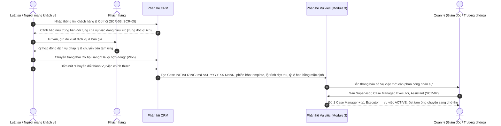
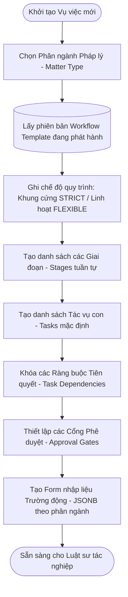
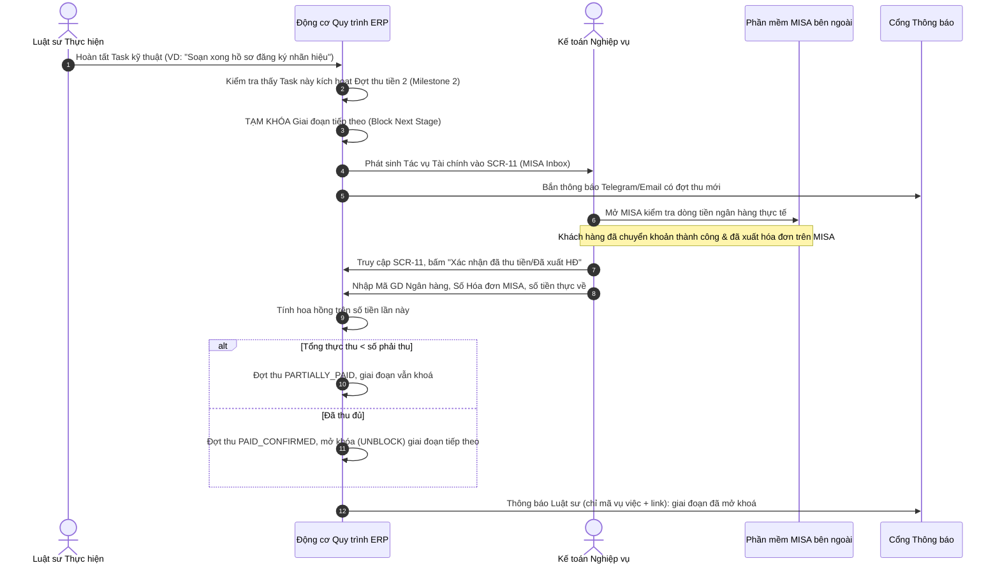
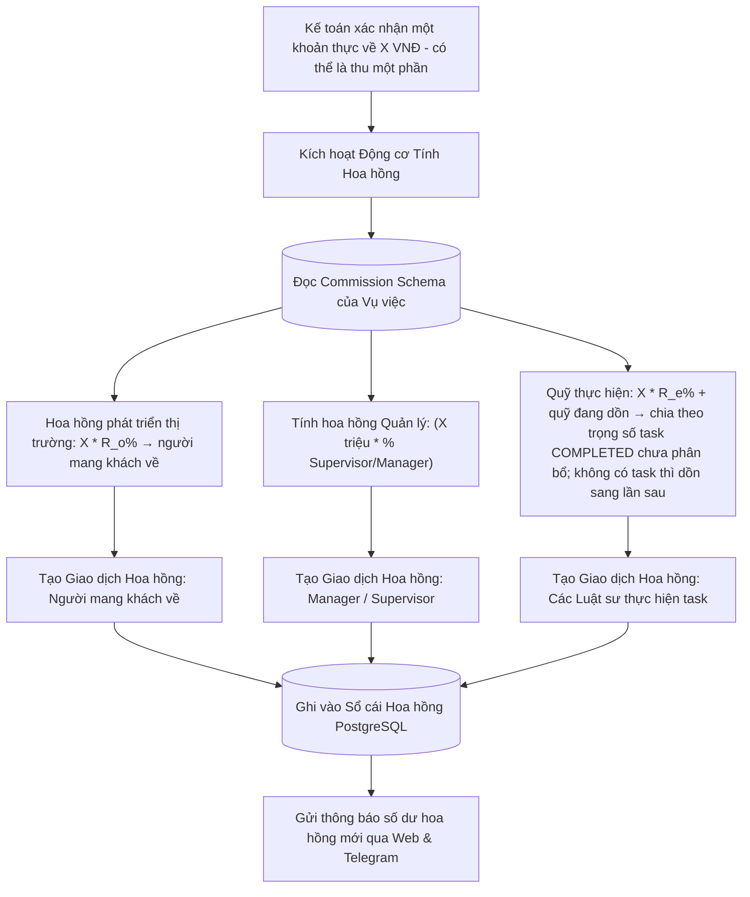
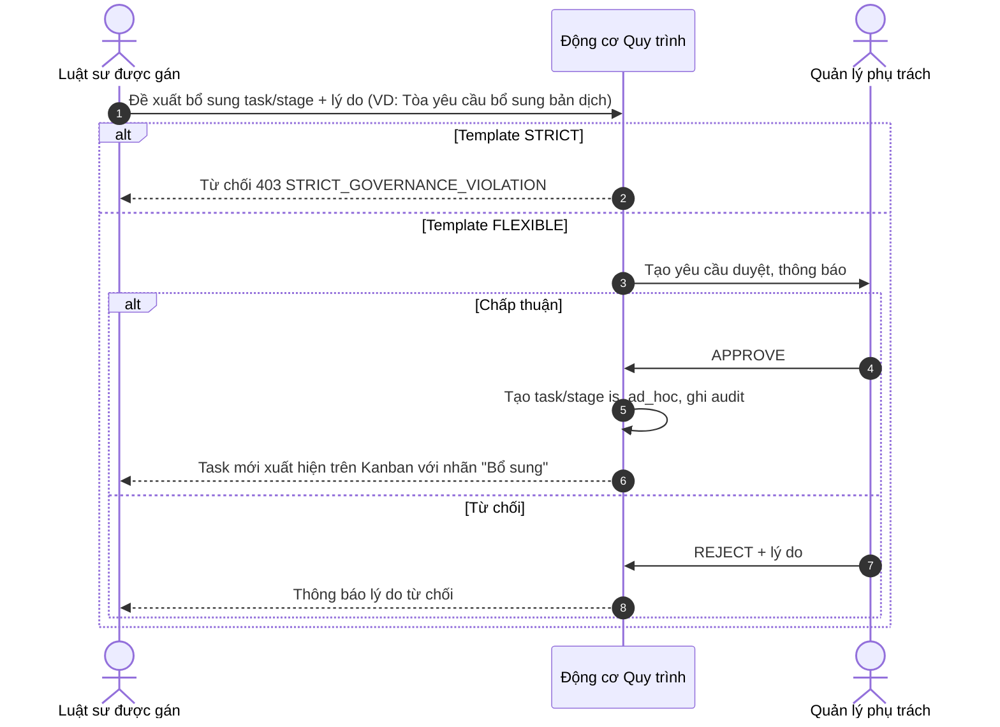

# 04. CÁC LUỒNG NGƯỜI DÙNG CHI TIẾT (USER FLOWS & STATE MACHINES)

## 1. LUỒNG 1: TỪ KHÁCH HÀNG TIỀM NĂNG TỚI KHỞI TẠO VỤ VIỆC (LEAD-TO-CASE CONVERSION)

---

## 2. LUỒNG 2: THIẾT LẬP VỤ VIỆC & ÁP DỤNG QUY TRÌNH ĐỘNG (STRICT WORKFLOW INSTANTIATION)

---

## 3. LUỒNG 3: THỰC HIỆN TÁC VỤ & KIỂM SOÁT PHỤ THUỘC (TASK EXECUTION & DEPENDENCY ENFORCEMENT)

1. **Truy cập:** Luật sư phụ trách (`EXECUTOR`) truy cập vào **SCR-09 (Bảng tác vụ Kanban)** của vụ việc.
2. **Kiểm tra Ràng buộc Tiên quyết (Pre-condition Guard):**
   - Nếu Luật sư muốn kéo Task B từ `Chưa bắt đầu` sang `Đang làm`, hệ thống kiểm tra `case_task_dependencies` và trạng thái stage (stage chờ duyệt/chờ thu tiền thì bị khoá).
   - Nếu Task A tiên quyết chưa đạt trạng thái `Đã hoàn thành`, hệ thống từ chối hành động và hiển thị cảnh báo: *"Không thể bắt đầu Task B. Bạn phải hoàn tất và được nghiệm thu Task A trước!"*.
3. **Thực hiện & Đính kèm Văn bản:**
   - Luật sư thực hiện công việc, tải tài liệu dự thảo (.docx, .pdf) lên mục Tệp đính kèm.
   - Nhấn nút "Gửi Phê duyệt" -> Trạng thái Task chuyển sang `Chờ phê duyệt`.
4. **Phê duyệt:**
   - `CASE_MANAGER` hoặc `SUPERVISOR` nhận thông báo chuông.
   - Truy cập **SCR-10 (Modal Phê duyệt)** để đọc tài liệu:
     - Nếu *Chấp thuận*: Task chuyển thành `Đã hoàn thành`, giải phóng các Task phụ thuộc tiếp theo.
     - Nếu *Từ chối / Yêu cầu sửa*: Nhập phản hồi lý do (bắt buộc), Task quay về trạng thái `Đang làm`.
     - Người duyệt không được là người gửi duyệt.

---

## 4. LUỒNG 4: PHỐI HỢP KẾ TOÁN MISA & MỞ KHÓA QUY TRÌNH (MISA HUMAN-IN-THE-LOOP FLOW)

---

## 5. LUỒNG 5: CHIẾT TÍNH HOA HỒNG TỰ ĐỘNG THEO DÒNG TIỀN THỰC THU (CASH-BASIS COMMISSION)

---

## 6. LUỒNG 6: CẢNH BÁO ĐA KÊNH & TRỢ LÝ ẢO AI (ALERTS & AI ASSISTANT)

1. **Quét định kỳ (Background Scanner):**
   - Celery Beat kích hoạt worker mỗi 30 phút, quét `case_tasks` của vụ việc `ACTIVE`.
   - Tìm Task còn ≤ 24 giờ làm việc tới `due_at` hoặc đã quá hạn mà chưa `COMPLETED` (quy tắc leo thang ở `12` §4.2).
2. **Đẩy cảnh báo 1 chiều kèm Deep-link:**
   - Hệ thống tạo bản ghi thông báo nội bộ và đẩy qua WebSockets tới chuông trên Web App.
   - Gửi tin nhắn tự động qua **Telegram Bot** và **Zalo OA**:
     - *Nội dung (tối thiểu hoá — DEC-03):* `"[HẠN CHÓT] ASL-2026-TM-0045 · Nộp bản giải trình · hạn 17:00 28/10 (còn 4 giờ). Xử lý: https://erp.asllaw.vn/cases/8f3a…/tasks/t402"` — không có tên khách hàng hay tên vụ việc.
3. **Tương tác qua Trợ lý AI (SCR-14):**
   - Luật sư mở khung AI Chat Drawer, gõ câu hỏi: *"Hôm nay tôi có những task nào cần hoàn thành trước 17h?"*.
   - Trợ lý AI thực thi Tool Calling `get_urgent_tasks(days_ahead=0)` trong phạm vi quyền của người hỏi; dữ liệu định danh khách hàng được thay bằng mã giả trước khi gửi lên LLM; câu trả lời kèm link điều hướng tới từng task.

---

## 7. LUỒNG 7: BỔ SUNG TASK NGOÀI QUY TRÌNH MẪU (WORKFLOW CHANGE REQUEST — DEC-07)

---

## 8. LUỒNG 8: ĐĂNG NHẬP & XÁC THỰC 2 LỚP (DEC-02)

1. Nhập email + mật khẩu nội bộ.
2. Tài khoản chuyển từ hệ thống cũ (`must_reset_password`) → bắt buộc đặt mật khẩu mới trước khi vào hệ thống.
3. Vai trò Quản trị viên / Quản lý / Kế toán chưa bật 2FA → bắt buộc quét mã QR bằng ứng dụng xác thực, nhập mã 6 số để kích hoạt, lưu 10 mã khôi phục.
4. Tài khoản đã bật 2FA → nhập mã 6 số (hoặc mã khôi phục).
5. Sai mật khẩu/mã quá 5 lần trong 15 phút → khoá 30 phút, thông báo Quản trị viên.
