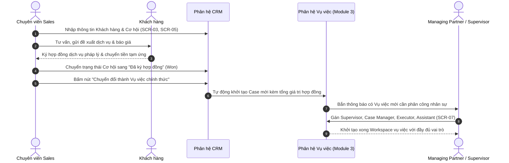
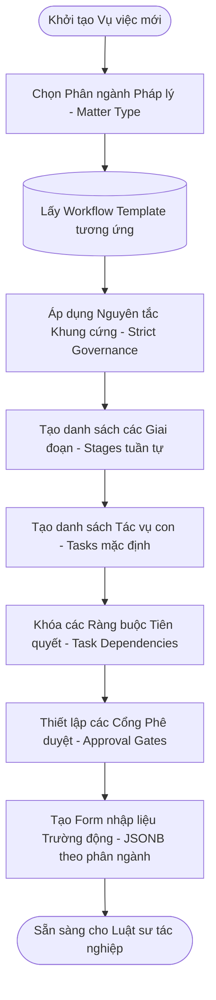
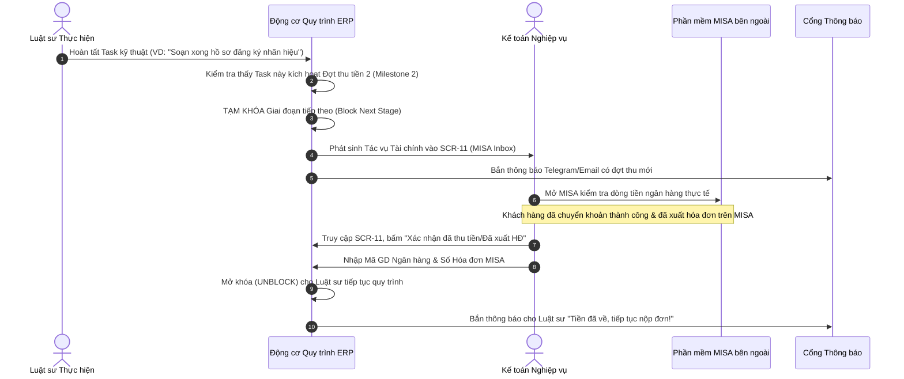
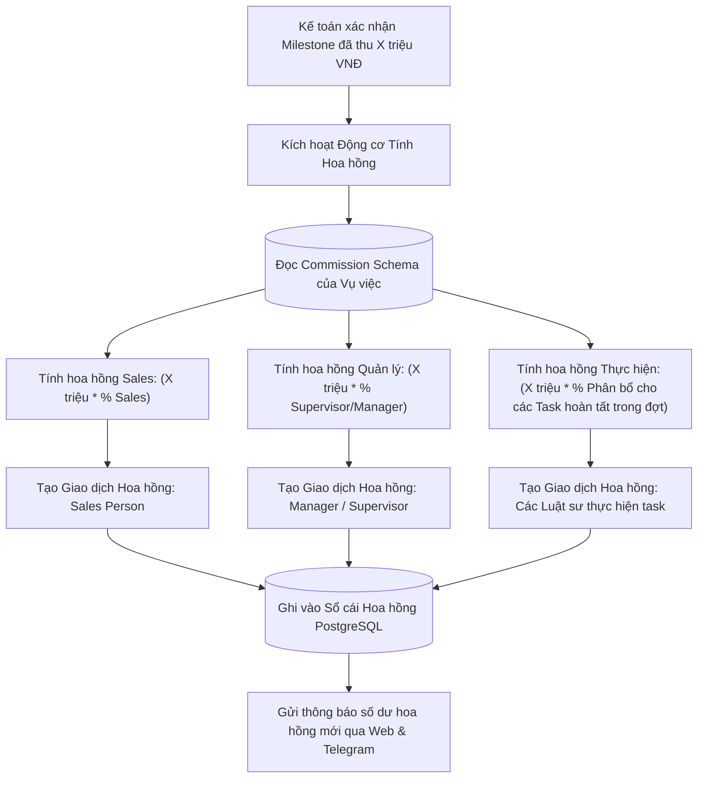

# 04. CÁC LUỒNG NGƯỜI DÙNG CHI TIẾT (USER FLOWS & STATE MACHINES)

## 1. LUỒNG 1: TỪ KHÁCH HÀNG TIỀM NĂNG TỚI KHỞI TẠO VỤ VIỆC (LEAD-TO-CASE CONVERSION)

---

## 2. LUỒNG 2: THIẾT LẬP VỤ VIỆC & ÁP DỤNG QUY TRÌNH ĐỘNG (STRICT WORKFLOW INSTANTIATION)

---

## 3. LUỒNG 3: THỰC HIỆN TÁC VỤ & KIỂM SOÁT PHỤ THUỘC (TASK EXECUTION & DEPENDENCY ENFORCEMENT)

1. **Truy cập:** Luật sư phụ trách (`EXECUTOR`) truy cập vào **SCR-09 (Bảng tác vụ Kanban)** của vụ việc.
2. **Kiểm tra Ràng buộc Tiên quyết (Pre-condition Guard):**
   - Nếu Luật sư muốn kéo Task B từ `Chưa bắt đầu` sang `Đang làm`, hệ thống tự động kiểm tra bảng `TaskDependencies`.
   - Nếu Task A tiên quyết chưa đạt trạng thái `Đã hoàn thành`, hệ thống từ chối hành động và hiển thị cảnh báo: *"Không thể bắt đầu Task B. Bạn phải hoàn tất và được nghiệm thu Task A trước!"*.
3. **Thực hiện & Đính kèm Văn bản:**
   - Luật sư thực hiện công việc, tải tài liệu dự thảo (.docx, .pdf) lên mục Tệp đính kèm.
   - Nhấn nút "Gửi Phê duyệt" -> Trạng thái Task chuyển sang `Chờ phê duyệt`.
4. **Phê duyệt:**
   - `CASE_MANAGER` hoặc `SUPERVISOR` nhận thông báo chuông.
   - Truy cập **SCR-10 (Modal Phê duyệt)** để đọc tài liệu:
     - Nếu *Chấp thuận*: Task chuyển thành `Đã hoàn thành`, giải phóng các Task phụ thuộc tiếp theo.
     - Nếu *Từ chối / Yêu cầu sửa*: Nhập phản hồi lý do, Task quay về trạng thái `Đang làm`.

---

## 4. LUỒNG 4: PHỐI HỢP KẾ TOÁN MISA & MỞ KHÓA QUY TRÌNH (MISA HUMAN-IN-THE-LOOP FLOW)

---

## 5. LUỒNG 5: CHIẾT TÍNH HOA HỒNG TỰ ĐỘNG THEO DÒNG TIỀN THỰC THU (CASH-BASIS COMMISSION)

---

## 6. LUỒNG 6: CẢNH BÁO ĐA KÊNH & TRỢ LÝ ẢO AI (ALERTS & AI ASSISTANT)

1. **Quét định kỳ (Background Scanner):**
   - Celery Worker chạy ngầm mỗi 30 phút, quét bảng `CaseTasks` và `Cases`.
   - Tìm kiếm các Task có `due_date - now() <= 24 hours` hoặc đã quá hạn mà chưa `COMPLETED`.
2. **Đẩy cảnh báo 1 chiều kèm Deep-link:**
   - Hệ thống tạo bản ghi thông báo nội bộ và đẩy qua WebSockets tới chuông trên Web App.
   - Gửi tin nhắn tự động qua **Telegram Bot** và **Zalo OA**:
     - *Nội dung:* `"[CẢNH BÁO HẠN CHÓT] Task 'Nộp bản giải trình SHTT' cho vụ việc ASL-2026-09 sẽ hết hạn trong 4 giờ nữa. Bấm vào liên kết sau để xử lý: https://erp.asllaw.vn/cases/102/tasks/504"`
3. **Tương tác qua Trợ lý AI (SCR-14):**
   - Luật sư mở khung AI Chat Drawer, gõ câu hỏi: *"Hôm nay tôi có những task nào cần hoàn thành trước 17h?"*.
   - Trợ lý AI thực thi Tool Calling `get_user_tasks(user_id, deadline_before="2026-10-27T17:00:00")`, định dạng câu trả lời ngắn gọn kèm link điều hướng trực tiếp tới từng task.
