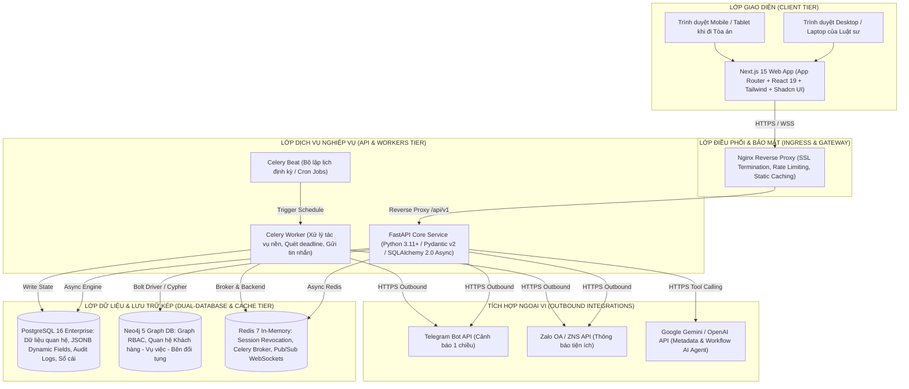
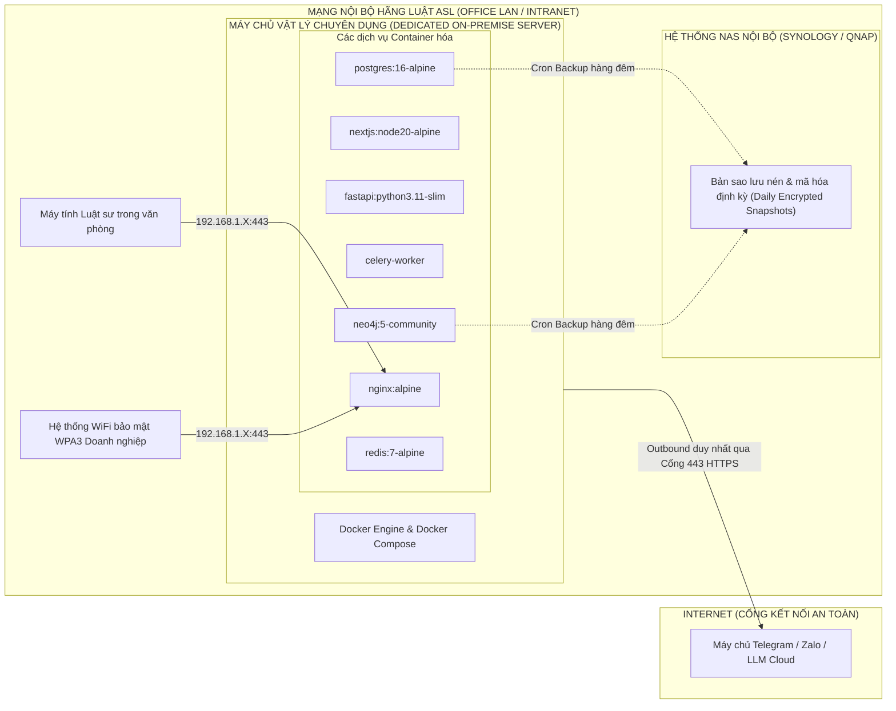

# 05. KIẾN TRÚC KỸ THUẬT & HẠ TẦNG HỆ THỐNG (SYSTEM ARCHITECTURE)

## 1. SƠ ĐỒ KIẾN TRÚC TỔNG THỂ (HIGH-LEVEL ARCHITECTURE)

---

## 2. PHÂN TÍCH CHI TIẾT CÁC THÀNH PHẦN KIẾN TRÚC

### 2.1. Lớp Giao diện (Frontend Tier) - Next.js 15
- **Công nghệ:** Next.js 15 (App Router), React 19, TypeScript, Tailwind CSS, Shadcn UI / Radix Primitives, Lucide Icons, TanStack React Table & React Query.
- **Đặc điểm kiến trúc:**
  - *Server-Side Rendering (SSR) & Server Components:* Tối ưu hóa tải trang nhanh, bảo mật token và giảm tải bundle size cho trình duyệt.
  - *Client Components có chọn lọc:* Chỉ sử dụng ở các màn hình tương tác cao như Bảng Kanban kéo thả (`@hello-pangea/dnd`), Trình kéo thả Workflow Template (`React Flow`), và Khung chat AI Drawer.
  - *Quản lý trạng thái:* Zustand cho UI state cục bộ (trạng thái mở đóng Sidebar, filter table) và TanStack Query cho Server cache & đồng bộ dữ liệu.

### 2.2. Lớp Backend Nghiệp vụ - FastAPI (Python 3.11+)
- **Công nghệ:** FastAPI, Pydantic v2 (Serialization & Validation tốc độ cao), SQLAlchemy 2.0 (Async ORM), Alembic (Quản lý Database Migration), Neo4j Python Driver (Cypher query async).
- **Mô hình Clean Architecture phân tầng:**
  - `routers/`: Định nghĩa các HTTP Endpoints, nhận request và validate đầu vào bằng Pydantic schemas.
  - `services/`: Chứa toàn bộ Business Logic (Tính toán hoa hồng, kiểm tra Task Dependency, chuyển đổi Stage, điều phối MISA inbox).
  - `repositories/`: Giao tiếp trực tiếp với cơ sở dữ liệu PostgreSQL và Neo4j.
  - `guards/`: Lớp Middleware kiểm tra phân quyền Need-to-know dựa trên đồ thị Neo4j trước khi cho phép truy cập tài nguyên.

### 2.3. Lớp Lưu trữ Dữ liệu Kép (Dual-Database Tier)
- **PostgreSQL 16:**
  - Đóng vai trò Single Source of Truth (SSOT) cho dữ liệu nghiệp vụ: Người dùng, Khách hàng, Bảng báo giá, Vụ việc, Tác vụ, Đợt thanh toán, Hóa đơn, Giao dịch hoa hồng.
  - Cột `JSONB` được đánh chỉ mục GIN (Generalized Inverted Index) để lưu trữ linh hoạt các Trường dữ liệu động (Dynamic Form Fields) do Admin cấu hình riêng cho từng phân ngành pháp lý.
  - Phân vùng (Partitioning) bảng `AuditLogs` theo tháng/quý để tối ưu tốc độ truy vấn khi dữ liệu nhật ký tăng lên hàng triệu bản ghi.
- **Neo4j 5 (Graph Database):**
  - Chuyên trách giải quyết bài toán phân quyền phức tạp và kiểm tra xung đột lợi ích (Conflict of Interest).
  - Khai thác sức mạnh của đồ thị (Graph Traversal) để trả lời tức thời câu hỏi: *"Người dùng U có thuộc chuỗi quyền hạn được xem Hồ sơ Vụ việc C hay không?"* chỉ với một truy vấn Cypher ngắn gọn, thay vì phải chạy hàng loạt phép JOIN phức tạp và nặng nề trên bảng quan hệ RDBMS.

---

## 3. HẠ TẦNG TRIỂN KHAI VẬT LÝ TẠI VĂN PHÒNG (ON-PREMISE INFRASTRUCTURE)

### 3.1. Chiến lược Bảo mật Hạ tầng On-Premise
- **Chặn toàn bộ Inbound từ Internet:** Máy chủ ERP vật lý được đặt trong dải IP nội bộ, không mở Port Forwarding ra ngoài Internet công cộng. Nhân sự truy cập từ bên ngoài văn phòng (khi đi tòa án hoặc gặp thân chủ) bắt buộc phải kết nối qua mạng riêng ảo **VPN nội bộ của ASL Law (WireGuard / OpenVPN)**.
- **Kênh Outbound có kiểm soát:** Chỉ mở kết nối outbound HTTPS từ container FastAPI/Celery tới các IP/Domain định danh của Telegram Bot API, Zalo Developer API và Google Gemini/OpenAI API.
- **Chính sách Sao lưu Dự phòng (Disaster Recovery & Backup):**
  - Chạy script sao lưu tự động (Automated Backup Script) vào lúc 02:00 sáng mỗi ngày.
  - Xuất bản `pg_dump` nén của PostgreSQL và snapshot của Neo4j, mã hóa bằng khóa AES-256 và đẩy sang ổ cứng mạng NAS biệt lập tại văn phòng.
