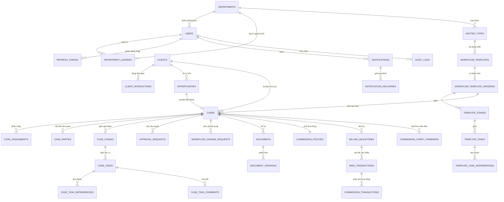
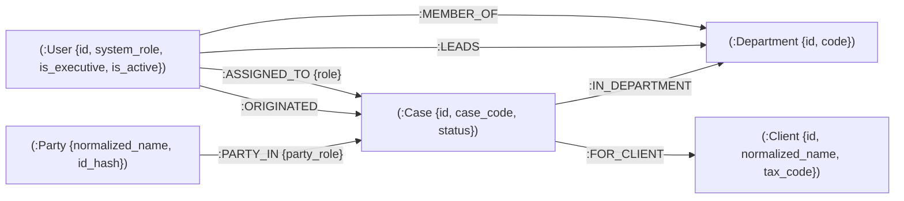

# 06. THIẾT KẾ CƠ SỞ DỮ LIỆU & QUAN HỆ ĐỒ THỊ (DATABASE SCHEMA & ERD)

> Cập nhật 30/10/2026 theo `14-decisions.md` (DEC-01 → DEC-08) và báo cáo `qa/reports/QA-REPORT-20261030-2318.md` (D2, D5, B1–B5, S5, S6).

## 0. NGUYÊN TẮC CHUNG

- **PostgreSQL là nguồn sự thật duy nhất.** Neo4j là *bản chiếu* phục vụ kiểm quyền và kiểm tra xung đột lợi ích; luôn dựng lại được từ PostgreSQL (xem §4).
- **Tiền:** `NUMERIC(15,2)` trong DB, `Decimal` trong Python, chuỗi trong JSON (xem `07`). Không dùng `float` ở bất kỳ tầng nào.
- **Khoá chính:** `UUID` (`gen_random_uuid()`), trừ `audit_logs`.
- **Thời gian:** `TIMESTAMPTZ`, lưu UTC, hiển thị `Asia/Ho_Chi_Minh`.
- **Enum:** lưu `VARCHAR` + `CHECK (... IN (...))` để migration dễ mở rộng.
- **Dữ liệu chuyển từ hệ thống cũ (DEC-05):** các bảng nghiệp vụ có cột `legacy_id VARCHAR(64) NULL UNIQUE`; nguồn gốc ghi trong `legacy_import_records`.
- **Hai user DB tách biệt:**
  - `asl_owner` — chủ sở hữu schema, chỉ dùng khi chạy Alembic.
  - `asl_app` — ứng dụng dùng lúc chạy. **Chỉ `INSERT`, `SELECT`** trên `audit_logs`, `misa_transactions`, `commission_transactions`; không có `DELETE` trên mọi bảng tài chính.

---

## 1. SƠ ĐỒ THỰC THỂ QUAN HỆ (ERD)



---

## 2. ĐẶC TẢ BẢNG POSTGRESQL

Quy ước chung không nhắc lại ở từng bảng: mọi bảng nghiệp vụ có `id UUID PK`, `created_at TIMESTAMPTZ DEFAULT NOW()`; bảng có sửa đổi có thêm `updated_at`.

### 2.1. Người dùng, phòng ban & phiên đăng nhập

#### `users`
| Cột | Kiểu | Ràng buộc | Mô tả |
| :--- | :--- | :--- | :--- |
| `email` | `VARCHAR(255)` | UNIQUE, NOT NULL | Email công vụ `@asllaw.vn` |
| `password_hash` | `VARCHAR(255)` | NOT NULL | Argon2id |
| `must_reset_password` | `BOOLEAN` | DEFAULT `FALSE` | `TRUE` với mọi tài khoản chuyển từ hệ thống cũ (DEC-05) |
| `full_name` | `VARCHAR(150)` | NOT NULL | |
| `title` | `VARCHAR(100)` | NULL | Chức danh hiển thị (VD "Giám đốc", "Trưởng ban SHTT", "Luật sư cấp cao") — **không** dùng để phân quyền |
| `phone_number` | `VARCHAR(20)` | NULL | |
| `system_role` | `VARCHAR(20)` | NOT NULL, CHECK IN (`ADMIN`,`MANAGER`,`ACCOUNTANT`,`ATTORNEY`) | 4 vai trò hệ thống (DEC-01) |
| `is_executive` | `BOOLEAN` | DEFAULT `FALSE`, CHECK (`NOT is_executive OR system_role = 'MANAGER'`) | Giám đốc: `MANAGER` có phạm vi **mọi phòng ban** |
| `department_id` | `UUID` | FK `departments`, NULL | Phòng ban công tác |
| `totp_secret_enc` | `BYTEA` | NULL | Bí mật TOTP, mã hoá AES-256-GCM (DEC-02) |
| `totp_enabled` | `BOOLEAN` | DEFAULT `FALSE` | Bắt buộc `TRUE` với `ADMIN`, `MANAGER`, `ACCOUNTANT` sau lần đăng nhập đầu |
| `tokens_valid_after` | `TIMESTAMPTZ` | DEFAULT `NOW()` | Token phát hành trước mốc này bị từ chối — dùng để thu hồi **mọi** phiên khi khoá tài khoản |
| `is_active` | `BOOLEAN` | DEFAULT `TRUE` | |
| `telegram_chat_id` | `VARCHAR(100)` | NULL | |
| `zalo_user_id` | `VARCHAR(100)` | NULL | |
| `legacy_id` | `VARCHAR(64)` | NULL, UNIQUE | |

#### `departments`
| Cột | Kiểu | Ràng buộc | Mô tả |
| :--- | :--- | :--- | :--- |
| `name` | `VARCHAR(100)` | NOT NULL | Ban Dân sự, Ban SHTT, Ban Doanh nghiệp… |
| `code` | `VARCHAR(20)` | UNIQUE, NOT NULL | `DEPT_IP`, `DEPT_CIVIL` |

#### `department_leaders`
Trưởng phòng quản lý phòng ban nào. Một người có thể quản lý nhiều phòng; Giám đốc (`is_executive`) không cần dòng ở đây.

| Cột | Kiểu | Ràng buộc |
| :--- | :--- | :--- |
| `user_id` | `UUID` | FK `users`, PK (cùng `department_id`) |
| `department_id` | `UUID` | FK `departments` |

CHECK qua trigger: `users.system_role = 'MANAGER'`.

#### `refresh_tokens`
| Cột | Kiểu | Ràng buộc | Mô tả |
| :--- | :--- | :--- | :--- |
| `id` | `UUID` | PK | Chính là `jti` của refresh token |
| `user_id` | `UUID` | FK `users`, NOT NULL | |
| `family_id` | `UUID` | NOT NULL, INDEX | Chuỗi xoay vòng; phát hiện dùng lại token cũ → thu hồi cả chuỗi |
| `expires_at` | `TIMESTAMPTZ` | NOT NULL | 7 ngày |
| `revoked_at` | `TIMESTAMPTZ` | NULL | |
| `replaced_by` | `UUID` | NULL | Token kế tiếp sau khi xoay vòng |
| `ip_address` | `INET` | NULL | |
| `user_agent` | `TEXT` | NULL | |

#### `holidays`
Ngày nghỉ lễ để tính SLA theo ngày làm việc (BR `12` §4.2).

| Cột | Kiểu | Ràng buộc |
| :--- | :--- | :--- |
| `date` | `DATE` | PK |
| `name` | `VARCHAR(100)` | NOT NULL |

### 2.2. CRM

#### `clients`
| Cột | Kiểu | Ràng buộc | Mô tả |
| :--- | :--- | :--- | :--- |
| `client_type` | `VARCHAR(20)` | CHECK IN (`ENTERPRISE`,`INDIVIDUAL`,`FOREIGN`) | `FOREIGN` cho khách/đối tác nước ngoài |
| `name` | `VARCHAR(255)` | NOT NULL | |
| `normalized_name` | `VARCHAR(255)` | NOT NULL, INDEX | Tên bỏ dấu, viết thường, bỏ tiền tố "Công ty TNHH/CP" — dùng kiểm tra xung đột lợi ích |
| `tax_code` | `VARCHAR(14)` | NULL, UNIQUE | MST doanh nghiệp 10 hoặc 13 số |
| `identity_no_enc` | `BYTEA` | NULL | CCCD/hộ chiếu cá nhân, mã hoá AES-256-GCM |
| `identity_no_hash` | `CHAR(64)` | NULL, UNIQUE | HMAC-SHA256 của CCCD để chặn trùng mà không lưu bản rõ |
| `representative_name` | `VARCHAR(150)` | NULL | |
| `phone` | `VARCHAR(30)` | NOT NULL | |
| `email` | `VARCHAR(255)` | NULL | |
| `address` | `TEXT` | NOT NULL | |
| `category_group` | `VARCHAR(20)` | DEFAULT `'NEW'`, CHECK IN (`NEW`,`POTENTIAL`,`RETURNING`,`STRATEGIC`,`VIP`) | |
| `created_by` | `UUID` | FK `users` | |
| `legacy_id` | `VARCHAR(64)` | NULL, UNIQUE | |

CHECK: `ENTERPRISE` phải có `tax_code`; `INDIVIDUAL` phải có `identity_no_hash`.

#### `client_interactions`
Dòng thời gian tương tác (SCR-04).

| Cột | Kiểu | Ràng buộc |
| :--- | :--- | :--- |
| `client_id` | `UUID` | FK `clients`, NOT NULL, INDEX |
| `kind` | `VARCHAR(20)` | CHECK IN (`CALL`,`MEETING`,`EMAIL`,`NOTE`) |
| `summary` | `TEXT` | NOT NULL |
| `occurred_at` | `TIMESTAMPTZ` | NOT NULL |
| `created_by` | `UUID` | FK `users` |

#### `opportunities`
| Cột | Kiểu | Ràng buộc | Mô tả |
| :--- | :--- | :--- | :--- |
| `client_id` | `UUID` | FK `clients`, NOT NULL | |
| `title` | `VARCHAR(255)` | NOT NULL | |
| `lead_source` | `VARCHAR(20)` | CHECK IN (`WEBSITE`,`HOTLINE`,`FACEBOOK`,`REFERRAL`,`PARTNER`,`OTHER`) | |
| `expected_value` | `NUMERIC(15,2)` | DEFAULT `0`, CHECK `>= 0` | |
| `probability_pct` | `SMALLINT` | CHECK `0..100` | |
| `stage` | `VARCHAR(20)` | CHECK IN (`NEW_LEAD`,`PROPOSAL_SENT`,`NEGOTIATION`,`WON`,`LOST`) | `WON` = đã ký hợp đồng |
| `lost_reason` | `TEXT` | NULL | Bắt buộc khi `LOST` |
| `originator_id` | `UUID` | FK `users`, NOT NULL | **Người mang khách về** — hưởng hoa hồng phát triển thị trường, vai trò bất kỳ (DEC-01) |
| `converted_case_id` | `UUID` | FK `cases`, NULL, UNIQUE | Một cơ hội chỉ chuyển đổi một lần |

### 2.3. Workflow template (có phiên bản)

#### `matter_types`
| Cột | Kiểu | Ràng buộc | Mô tả |
| :--- | :--- | :--- | :--- |
| `department_id` | `UUID` | FK `departments`, NOT NULL | |
| `name` | `VARCHAR(150)` | NOT NULL | Đăng ký nhãn hiệu, Tranh chấp đất đai… |
| `code` | `VARCHAR(4)` | UNIQUE, NOT NULL, CHECK `^[A-Z]{2,4}$` | Dùng trong mã vụ việc (`TM`, `LD`, `MA`) |
| `custom_fields_schema` | `JSONB` | DEFAULT `'[]'` | Định nghĩa trường động |
| `default_originator_rate` | `NUMERIC(5,2)` | NOT NULL, DEFAULT `0`, CHECK `0..100` | Mặc định cho `commission_policies.originator_rate` khi chuyển đổi |
| `default_management_rate` | `NUMERIC(5,2)` | NOT NULL, DEFAULT `0`, CHECK `0..100` | |
| `default_supervisor_share_pct` | `NUMERIC(5,2)` | NOT NULL, DEFAULT `50`, CHECK `0..100` | |
| `default_execution_rate` | `NUMERIC(5,2)` | NOT NULL, DEFAULT `0`, CHECK `0..100` | |

CHECK: `default_originator_rate + default_management_rate + default_execution_rate <= 100`. Thêm bằng `backend/alembic/versions/003_matter_type_commission_defaults.sql` (idempotent, `ADD COLUMN IF NOT EXISTS`) và revision Alembic chạy file đó (TSK-05).

#### `workflow_templates`
| Cột | Kiểu | Ràng buộc | Mô tả |
| :--- | :--- | :--- | :--- |
| `matter_type_id` | `UUID` | FK `matter_types`, NOT NULL | |
| `name` | `VARCHAR(150)` | NOT NULL | |
| `mode` | `VARCHAR(10)` | CHECK IN (`STRICT`,`FLEXIBLE`), NOT NULL | DEC-07 |
| `is_active` | `BOOLEAN` | DEFAULT `TRUE` | Mỗi `matter_type` có tối đa một template active (partial unique index) |

#### `workflow_template_versions`
Template **bất biến sau khi phát hành**. Sửa template = tạo phiên bản mới; vụ việc đang chạy giữ phiên bản cũ.

| Cột | Kiểu | Ràng buộc |
| :--- | :--- | :--- |
| `template_id` | `UUID` | FK `workflow_templates`, NOT NULL |
| `version_no` | `INTEGER` | NOT NULL, UNIQUE cùng `template_id` |
| `status` | `VARCHAR(10)` | CHECK IN (`DRAFT`,`PUBLISHED`,`RETIRED`) |
| `published_by` | `UUID` | FK `users`, NULL |
| `published_at` | `TIMESTAMPTZ` | NULL |

#### `template_stages`
| Cột | Kiểu | Ràng buộc |
| :--- | :--- | :--- |
| `template_version_id` | `UUID` | FK, NOT NULL |
| `name` | `VARCHAR(150)` | NOT NULL |
| `order_index` | `SMALLINT` | NOT NULL, UNIQUE cùng `template_version_id` |
| `requires_approval` | `BOOLEAN` | DEFAULT `FALSE` |

#### `template_tasks`
| Cột | Kiểu | Ràng buộc | Mô tả |
| :--- | :--- | :--- | :--- |
| `template_stage_id` | `UUID` | FK, NOT NULL | |
| `title` | `VARCHAR(255)` | NOT NULL | |
| `order_index` | `SMALLINT` | NOT NULL, DEFAULT `0` | Thứ tự task trong stage (theo thứ tự trong payload lưu cây); đọc `ORDER BY order_index` — migration `004_task_order_index.sql` |
| `description` | `TEXT` | NULL | |
| `default_case_role` | `VARCHAR(20)` | CHECK IN (`CASE_MANAGER`,`EXECUTOR`,`ASSISTANT`) | Ai trong vụ việc được gán mặc định |
| `sla_business_days` | `SMALLINT` | NULL, CHECK `> 0` | Hạn tương đối, tính theo ngày làm việc |
| `complexity_weight` | `SMALLINT` | DEFAULT `1`, CHECK `1..4` | Trọng số W chia hoa hồng thực hiện |
| `requires_approval` | `BOOLEAN` | DEFAULT `TRUE` | Task phải qua `WAITING_APPROVAL` trước khi `COMPLETED` |
| `triggers_milestone_order` | `SMALLINT` | NULL | Hoàn thành task này → đợt thu thứ N chuyển `AWAITING_PAYMENT` |

#### `template_task_dependencies`
`(template_task_id, depends_on_template_task_id)` PK; CHECK không tự phụ thuộc; kiểm tra không tạo chu trình khi phát hành.

### 2.4. Vụ việc

#### `cases`
| Cột | Kiểu | Ràng buộc | Mô tả |
| :--- | :--- | :--- | :--- |
| `case_code` | `VARCHAR(20)` | UNIQUE, NOT NULL | **Định dạng duy nhất:** `ASL-YYYY-XX-NNNN` (XX = `matter_types.code`, NNNN = số thứ tự theo năm + mã) |
| `title` | `VARCHAR(255)` | NOT NULL | |
| `client_id` | `UUID` | FK `clients`, NOT NULL | |
| `opportunity_id` | `UUID` | FK `opportunities`, NULL | NULL nếu tạo trực tiếp hoặc vụ việc cũ |
| `matter_type_id` | `UUID` | FK, NOT NULL | |
| `department_id` | `UUID` | FK `departments`, NOT NULL | Sao chép từ `matter_types` lúc tạo — gốc của kiểm quyền theo phòng ban |
| `template_version_id` | `UUID` | FK, NULL | NULL chỉ khi `is_legacy` |
| `workflow_mode` | `VARCHAR(10)` | CHECK IN (`STRICT`,`FLEXIBLE`) | Sao chép từ template lúc tạo |
| `contract_value` | `NUMERIC(15,2)` | NOT NULL, CHECK `> 0` | |
| `status` | `VARCHAR(20)` | CHECK IN (`INITIALIZING`,`ACTIVE`,`PAUSED`,`CLOSED`,`TERMINATED`) | Vòng đời; trạng thái chờ duyệt/chờ tiền nằm ở `case_stages.status` (xem `12` §1.2) |
| `current_stage_id` | `UUID` | FK `case_stages`, NULL | |
| `custom_data` | `JSONB` | DEFAULT `'{}'`, GIN index | |
| `due_date` | `DATE` | NULL | |
| `closed_at` | `TIMESTAMPTZ` | NULL | |
| `termination_reason` | `TEXT` | NULL | Bắt buộc khi `TERMINATED` |
| `is_legacy` | `BOOLEAN` | DEFAULT `FALSE` | Vụ việc lịch sử từ hệ thống cũ: **chỉ đọc**, không áp guard workflow |
| `created_by` | `UUID` | FK `users` | |
| `legacy_id` | `VARCHAR(64)` | NULL, UNIQUE | |

#### `case_code_sequences`
Sinh mã không trùng khi nhiều người tạo cùng lúc (`SELECT … FOR UPDATE`).

| Cột | Kiểu | Ràng buộc |
| :--- | :--- | :--- |
| `year` | `SMALLINT` | PK (cùng `matter_code`) |
| `matter_code` | `VARCHAR(4)` | |
| `last_no` | `INTEGER` | NOT NULL |

#### `case_assignments`
| Cột | Kiểu | Ràng buộc | Mô tả |
| :--- | :--- | :--- | :--- |
| `case_id` | `UUID` | FK, NOT NULL | |
| `user_id` | `UUID` | FK, NOT NULL | |
| `role_in_case` | `VARCHAR(20)` | CHECK IN (`SUPERVISOR`,`CASE_MANAGER`,`EXECUTOR`,`ASSISTANT`) | Vai trò **trong vụ việc**, khác `users.system_role` |
| `assigned_at` | `TIMESTAMPTZ` | DEFAULT `NOW()` | |
| `unassigned_at` | `TIMESTAMPTZ` | NULL | Gỡ phân công không xoá dòng (giữ lịch sử cho hoa hồng & audit) |

Partial unique: `(case_id, user_id, role_in_case) WHERE unassigned_at IS NULL`. Mỗi vụ việc active có đúng 1 `CASE_MANAGER` và tối đa 1 `SUPERVISOR`.

#### `case_parties`
Các bên của vụ việc — đầu vào kiểm tra xung đột lợi ích (`12` §4.1).

| Cột | Kiểu | Ràng buộc |
| :--- | :--- | :--- |
| `case_id` | `UUID` | FK, NOT NULL |
| `party_role` | `VARCHAR(20)` | CHECK IN (`OPPOSING`,`RELATED`) |
| `name` | `VARCHAR(255)` | NOT NULL |
| `normalized_name` | `VARCHAR(255)` | NOT NULL, INDEX |
| `tax_code_or_id_hash` | `CHAR(64)` | NULL, INDEX |

#### `case_stages`
| Cột | Kiểu | Ràng buộc | Mô tả |
| :--- | :--- | :--- | :--- |
| `case_id` | `UUID` | FK, NOT NULL | |
| `template_stage_id` | `UUID` | FK, NULL | NULL nếu là stage bổ sung |
| `name` | `VARCHAR(150)` | NOT NULL | |
| `order_index` | `SMALLINT` | NOT NULL | |
| `requires_approval` | `BOOLEAN` | NOT NULL | |
| `status` | `VARCHAR(20)` | CHECK IN (`LOCKED`,`ACTIVE`,`WAITING_APPROVAL`,`WAITING_PAYMENT`,`COMPLETED`) | |
| `blocking_milestone_id` | `UUID` | FK `billing_milestones`, NULL | Stage chỉ mở khi đợt thu này `PAID_CONFIRMED` |
| `is_ad_hoc` | `BOOLEAN` | DEFAULT `FALSE` | Stage bổ sung qua yêu cầu đã duyệt |
| `change_request_id` | `UUID` | FK, NULL | CHECK: `is_ad_hoc` ⇔ `change_request_id IS NOT NULL` |
| `started_at`, `completed_at` | `TIMESTAMPTZ` | NULL | |

#### `case_tasks`
| Cột | Kiểu | Ràng buộc | Mô tả |
| :--- | :--- | :--- | :--- |
| `case_id` | `UUID` | FK, NOT NULL, INDEX | |
| `stage_id` | `UUID` | FK `case_stages`, NOT NULL | |
| `template_task_id` | `UUID` | FK, NULL | |
| `title` | `VARCHAR(255)` | NOT NULL | |
| `order_index` | `SMALLINT` | NOT NULL, DEFAULT `0` | Sao từ `template_tasks.order_index` khi sinh vụ việc; task bổ sung xếp cuối stage — migration `004_task_order_index.sql` |
| `description` | `TEXT` | NULL | |
| `assigned_to` | `UUID` | FK `users`, NULL | Phải là người đang được phân công vào vụ việc |
| `status` | `VARCHAR(20)` | DEFAULT `'TODO'`, CHECK IN (`TODO`,`IN_PROGRESS`,`WAITING_APPROVAL`,`COMPLETED`) | |
| `complexity_weight` | `SMALLINT` | NOT NULL, CHECK `1..4` | Sao chép từ template |
| `requires_approval` | `BOOLEAN` | NOT NULL | |
| `triggers_milestone_id` | `UUID` | FK `billing_milestones`, NULL | |
| `due_at` | `TIMESTAMPTZ` | NULL | Tính từ `sla_business_days` trừ ngày nghỉ |
| `started_at`, `completed_at` | `TIMESTAMPTZ` | NULL | |
| `is_ad_hoc` | `BOOLEAN` | DEFAULT `FALSE` | |
| `change_request_id` | `UUID` | FK, NULL | CHECK như `case_stages` |

#### `case_task_dependencies`
`(case_task_id, depends_on_task_id)` PK, cả hai FK `case_tasks`; CHECK khác nhau; cùng `case_id` (trigger).

#### `case_task_comments`
| Cột | Kiểu | Ràng buộc |
| :--- | :--- | :--- |
| `task_id` | `UUID` | FK, NOT NULL, INDEX |
| `author_id` | `UUID` | FK `users` |
| `body` | `TEXT` | NOT NULL |

#### `approval_requests`
Một bảng cho mọi loại phê duyệt — nguồn dữ liệu của Duyệt nhanh, Modal phê duyệt và hàng đợi Văn phòng số.

| Cột | Kiểu | Ràng buộc | Mô tả |
| :--- | :--- | :--- | :--- |
| `case_id` | `UUID` | FK, NOT NULL, INDEX | |
| `subject_type` | `VARCHAR(20)` | CHECK IN (`TASK`,`STAGE_GATE`,`CHANGE_REQUEST`) | |
| `subject_id` | `UUID` | NOT NULL | Task / stage / change request |
| `requested_by` | `UUID` | FK `users`, NOT NULL | |
| `status` | `VARCHAR(20)` | CHECK IN (`PENDING`,`APPROVED`,`REJECTED`,`CANCELLED`) | |
| `decided_by` | `UUID` | FK `users`, NULL | |
| `decision_comment` | `TEXT` | NULL | Bắt buộc khi `REJECTED` |
| `requested_at`, `decided_at` | `TIMESTAMPTZ` | | |

Partial unique: `(subject_type, subject_id) WHERE status = 'PENDING'`.

#### `workflow_change_requests` (DEC-07)
| Cột | Kiểu | Ràng buộc | Mô tả |
| :--- | :--- | :--- | :--- |
| `case_id` | `UUID` | FK, NOT NULL | Chỉ cho vụ việc `workflow_mode = 'FLEXIBLE'` |
| `kind` | `VARCHAR(20)` | CHECK IN (`ADD_TASK`,`ADD_STAGE`) | |
| `proposal` | `JSONB` | NOT NULL | Nội dung task/stage đề xuất (tiêu đề, stage đích, người thực hiện, hạn, trọng số) |
| `reason` | `TEXT` | NOT NULL | |
| `requested_by` | `UUID` | FK, NOT NULL | |
| `status` | `VARCHAR(20)` | CHECK IN (`PENDING`,`APPROVED`,`REJECTED`,`CANCELLED`) | |
| `approval_request_id` | `UUID` | FK, NOT NULL | |

### 2.5. Tài liệu vụ việc (DEC-04)

#### `documents`
| Cột | Kiểu | Ràng buộc | Mô tả |
| :--- | :--- | :--- | :--- |
| `case_id` | `UUID` | FK, NOT NULL, INDEX | |
| `folder` | `VARCHAR(30)` | CHECK IN (`LEGAL_CONTRACTS`,`CLIENT_SUBMISSIONS`,`OFFICIAL_FILINGS`,`INTERNAL_DRAFTS`) | Khớp cây thư mục NAS (`08` §5) |
| `title` | `VARCHAR(255)` | NOT NULL | |
| `task_id` | `UUID` | FK `case_tasks`, NULL | Gắn với task nếu là tệp đính kèm |
| `current_version_id` | `UUID` | FK, NULL | |
| `is_archived` | `BOOLEAN` | DEFAULT `FALSE` | Không xoá cứng; lưu trữ có ghi audit |
| `created_by` | `UUID` | FK | |

#### `document_versions`
| Cột | Kiểu | Ràng buộc | Mô tả |
| :--- | :--- | :--- | :--- |
| `document_id` | `UUID` | FK, NOT NULL | |
| `version_no` | `INTEGER` | NOT NULL, UNIQUE cùng `document_id` | |
| `storage_path` | `TEXT` | NOT NULL | Đường dẫn tương đối trong NAS, không lộ ra API |
| `original_filename` | `VARCHAR(255)` | NOT NULL | |
| `mime_type` | `VARCHAR(100)` | NOT NULL | Chỉ cho phép danh sách trắng (`10` §2.7) |
| `size_bytes` | `BIGINT` | NOT NULL, CHECK `<= 52428800` | Tối đa 50 MB |
| `sha256` | `CHAR(64)` | NOT NULL | |
| `scan_status` | `VARCHAR(10)` | CHECK IN (`PENDING`,`CLEAN`,`INFECTED`) | Chỉ tải xuống được khi `CLEAN` |
| `uploaded_by` | `UUID` | FK | |

### 2.6. Tài chính, MISA & hoa hồng (DEC-06)

#### `commission_policies`
Tỷ lệ hoa hồng của từng vụ việc, khởi tạo từ mặc định của `matter_types` khi chuyển đổi, Quản lý được chỉnh trước đợt thu đầu tiên.

| Cột | Kiểu | Ràng buộc | Mô tả |
| :--- | :--- | :--- | :--- |
| `case_id` | `UUID` | FK, UNIQUE, NOT NULL | |
| `originator_rate` | `NUMERIC(5,2)` | CHECK `0..100` | R_sales |
| `management_rate` | `NUMERIC(5,2)` | CHECK `0..100` | R_mgmt |
| `supervisor_share_pct` | `NUMERIC(5,2)` | CHECK `0..100` | Phần của Supervisor trong quỹ quản lý; phần còn lại cho Case Manager |
| `execution_rate` | `NUMERIC(5,2)` | CHECK `0..100` | R_exec |
| `approved_by` | `UUID` | FK `users`, NULL | |
| `locked_at` | `TIMESTAMPTZ` | NULL | Khoá khi có lần xác nhận thu tiền đầu tiên |

CHECK: `originator_rate + management_rate + execution_rate <= 100`.

#### `billing_milestones`
| Cột | Kiểu | Ràng buộc | Mô tả |
| :--- | :--- | :--- | :--- |
| `case_id` | `UUID` | FK, NOT NULL | |
| `order_index` | `SMALLINT` | NOT NULL, UNIQUE cùng `case_id` | |
| `name` | `VARCHAR(150)` | NOT NULL | |
| `amount` | `NUMERIC(15,2)` | NOT NULL, CHECK `> 0` | Số phải thu |
| `received_total` | `NUMERIC(15,2)` | DEFAULT `0` | Tổng đã thực thu (cộng dồn các lần xác nhận) |
| `status` | `VARCHAR(20)` | CHECK IN (`PENDING`,`AWAITING_PAYMENT`,`PARTIALLY_PAID`,`PAID_CONFIRMED`,`CANCELLED`) | Xem `12` §1.4 |
| `requested_at` | `TIMESTAMPTZ` | NULL | Lúc chuyển `AWAITING_PAYMENT` (phát tác vụ cho Kế toán) |
| `cancelled_reason` | `TEXT` | NULL | |

CHECK tổng `amount` các đợt không vượt `cases.contract_value` (trigger).

#### `misa_transactions`
Mỗi lần Kế toán xác nhận một khoản tiền về. **Chỉ INSERT.** Một đợt thu có thể có nhiều dòng (thu nhiều lần).

| Cột | Kiểu | Ràng buộc | Mô tả |
| :--- | :--- | :--- | :--- |
| `milestone_id` | `UUID` | FK, NOT NULL, INDEX | |
| `accountant_id` | `UUID` | FK `users`, NOT NULL | |
| `misa_invoice_no` | `VARCHAR(100)` | NOT NULL | |
| `bank_ref_code` | `VARCHAR(100)` | **UNIQUE**, NOT NULL | Chặn ghi nhận một giao dịch ngân hàng hai lần |
| `idempotency_key` | `UUID` | **UNIQUE**, NOT NULL | Từ header `Idempotency-Key` |
| `received_amount` | `NUMERIC(15,2)` | NOT NULL, CHECK `> 0` | |
| `notes` | `TEXT` | NULL | |
| `confirmed_at` | `TIMESTAMPTZ` | DEFAULT `NOW()` | |

#### `commission_transactions`
Sổ cái hoa hồng. **Chỉ INSERT**, trừ cột `payout_status` (cập nhật qua hàm `SECURITY DEFINER` duy nhất, có ghi audit). **Không có bút toán đảo** (DEC-06).

| Cột | Kiểu | Ràng buộc | Mô tả |
| :--- | :--- | :--- | :--- |
| `misa_transaction_id` | `UUID` | FK, NULL | NULL với dòng `LEGACY` |
| `milestone_id` | `UUID` | FK, NULL | |
| `case_id` | `UUID` | FK, NOT NULL, INDEX | |
| `user_id` | `UUID` | FK, NOT NULL, INDEX | |
| `role_type` | `VARCHAR(20)` | CHECK IN (`ORIGINATOR`,`SUPERVISOR`,`CASE_MANAGER`,`EXECUTOR`,`ASSISTANT`) | |
| `task_id` | `UUID` | FK `case_tasks`, NULL | Với hoa hồng thực hiện |
| `base_amount` | `NUMERIC(15,2)` | NOT NULL | Số tiền thực thu làm căn cứ |
| `rate_pct` | `NUMERIC(7,4)` | NOT NULL | Tỷ lệ hiệu dụng sau khi chia trọng số |
| `amount` | `NUMERIC(15,2)` | NOT NULL, CHECK `>= 0` | Đã làm tròn đến đồng |
| `source` | `VARCHAR(10)` | CHECK IN (`SYSTEM`,`LEGACY`) | |
| `payout_status` | `VARCHAR(20)` | DEFAULT `'ACCUMULATED'`, CHECK IN (`ACCUMULATED`,`DISBURSED`) | |

#### `commission_carry_forwards`
Quỹ thực hiện của lần thu không có task nào hoàn thành, dồn sang lần thu kế tiếp có task (`12` §3.3).

| Cột | Kiểu | Ràng buộc |
| :--- | :--- | :--- |
| `case_id` | `UUID` | FK, NOT NULL, INDEX |
| `from_misa_transaction_id` | `UUID` | FK, NOT NULL, UNIQUE |
| `amount` | `NUMERIC(15,2)` | NOT NULL, CHECK `> 0` |
| `consumed_by_misa_transaction_id` | `UUID` | FK, NULL |

### 2.7. Thông báo, sự kiện & chuyển đổi dữ liệu

#### `notifications`
| Cột | Kiểu | Ràng buộc | Mô tả |
| :--- | :--- | :--- | :--- |
| `user_id` | `UUID` | FK, NOT NULL, INDEX | |
| `kind` | `VARCHAR(40)` | NOT NULL | `TASK_DUE_SOON`, `TASK_OVERDUE`, `APPROVAL_REQUESTED`, `PAYMENT_CONFIRMED`… |
| `title` | `VARCHAR(255)` | NOT NULL | |
| `body` | `TEXT` | NOT NULL | Chỉ dùng trong web app; tin gửi ra ngoài dựng lại theo mẫu tối thiểu (DEC-03) |
| `link` | `TEXT` | NOT NULL | Đường dẫn tương đối trong app |
| `read_at` | `TIMESTAMPTZ` | NULL | |

#### `notification_deliveries`
| Cột | Kiểu | Ràng buộc | Mô tả |
| :--- | :--- | :--- | :--- |
| `notification_id` | `UUID` | FK, NOT NULL | |
| `channel` | `VARCHAR(10)` | CHECK IN (`WEB`,`TELEGRAM`,`ZALO`,`EMAIL`) | |
| `dedupe_key` | `VARCHAR(200)` | **UNIQUE** | VD `TASK_OVERDUE:L2:<task_id>:TELEGRAM` — chống gửi trùng |
| `status` | `VARCHAR(10)` | CHECK IN (`PENDING`,`SENT`,`FAILED`) | |
| `attempts` | `SMALLINT` | DEFAULT `0` | |
| `last_error` | `TEXT` | NULL | |
| `sent_at` | `TIMESTAMPTZ` | NULL | |

#### `outbox_events`
Ghi **trong cùng transaction** với thay đổi nghiệp vụ; worker đọc để đồng bộ Neo4j và phát thông báo (S6).

| Cột | Kiểu | Ràng buộc |
| :--- | :--- | :--- |
| `id` | `BIGSERIAL` | PK |
| `event_type` | `VARCHAR(60)` | NOT NULL — `CASE_ASSIGNED`, `CASE_UNASSIGNED`, `DEPARTMENT_LEADER_CHANGED`, `USER_DEACTIVATED`… |
| `payload` | `JSONB` | NOT NULL |
| `created_at` | `TIMESTAMPTZ` | DEFAULT `NOW()` |
| `processed_at` | `TIMESTAMPTZ` | NULL, partial index `WHERE processed_at IS NULL` |
| `attempts` | `SMALLINT` | DEFAULT `0` |

#### `legacy_import_records` (DEC-05)
| Cột | Kiểu | Ràng buộc |
| :--- | :--- | :--- |
| `batch_id` | `UUID` | NOT NULL, INDEX |
| `source_table` | `VARCHAR(100)` | NOT NULL |
| `source_id` | `VARCHAR(64)` | NOT NULL |
| `target_table` | `VARCHAR(100)` | NOT NULL |
| `target_id` | `UUID` | NOT NULL |
| `checksum` | `CHAR(64)` | NOT NULL |

UNIQUE `(source_table, source_id)` — chạy lại ETL không tạo bản ghi trùng.

### 2.8. Nhật ký kiểm toán bất biến (`audit_logs`)

Phân vùng theo tháng (`PARTITION BY RANGE (created_at)`).

| Cột | Kiểu | Ràng buộc | Mô tả |
| :--- | :--- | :--- | :--- |
| `id` | `BIGINT` | GENERATED ALWAYS AS IDENTITY | |
| `created_at` | `TIMESTAMPTZ` | DEFAULT `NOW()`, NOT NULL | **PK = `(id, created_at)`** — bắt buộc chứa khoá phân vùng |
| `actor_type` | `VARCHAR(10)` | CHECK IN (`USER`,`SYSTEM`) | |
| `actor_id` | `UUID` | FK `users`, NULL | NULL khi `SYSTEM` |
| `action` | `VARCHAR(60)` | NOT NULL, INDEX | `VIEW_CASE`, `ACCESS_DENIED`, `APPROVE_GATE`, `CONFIRM_PAYMENT`, `DOWNLOAD_DOCUMENT`, `CHANGE_COMMISSION_POLICY`, `RESET_2FA`… |
| `entity_name` | `VARCHAR(60)` | NOT NULL, INDEX | |
| `entity_id` | `VARCHAR(64)` | NOT NULL | |
| `before_state`, `after_state` | `JSONB` | NULL | Không chứa mật khẩu, bí mật TOTP, CCCD bản rõ |
| `ip_address` | `INET` | NULL | Bắt buộc khi `actor_type = 'USER'` (CHECK) |
| `user_agent` | `TEXT` | NULL | |
| `prev_hash` | `CHAR(64)` | NOT NULL | Băm của dòng trước — chuỗi chứng thực toàn vẹn |
| `row_hash` | `CHAR(64)` | NOT NULL | `sha256(prev_hash ‖ canonical_json(dòng))`; ghi tuần tự bằng `pg_advisory_xact_lock`; "dòng trước" là dòng có `id` lớn nhất (không theo `created_at` — `now()` là giờ bắt đầu transaction nên có thể lệch thứ tự khi ghi đồng thời) |

**Bất biến:** `asl_app` chỉ có `INSERT, SELECT`; thêm trigger `BEFORE UPDATE OR DELETE … RAISE EXCEPTION` để chặn cả khi lỡ cấp quyền. Job hằng đêm kiểm tra chuỗi băm và cảnh báo nếu đứt.

---

## 3. MÔ HÌNH ĐỒ THỊ NEO4J (GRAPH RBAC)

### 3.1. Đỉnh & cạnh



`ASSIGNED_TO.role` dùng đúng giá trị `case_assignments.role_in_case` (`SUPERVISOR`, `CASE_MANAGER`, `EXECUTOR`, `ASSISTANT`). Cạnh chỉ tồn tại khi phân công còn hiệu lực.

### 3.2. Truy vấn sự kiện quyền (Need-to-Know facts)

Cypher **chỉ trả về sự kiện**; quyết định cho phép nằm ở bảng chính sách trong code (`backend/app/guards/access_policy.py`) để test được bằng unit test.

```cypher
MATCH (u:User {id: $user_id})
OPTIONAL MATCH (c:Case {id: $case_id})
RETURN
  c IS NOT NULL                                                     AS case_exists,
  u.is_active                                                       AS active,
  u.system_role                                                     AS system_role,
  u.is_executive                                                    AS is_executive,
  EXISTS { MATCH (u)-[:ASSIGNED_TO]->(c) }                          AS is_assigned,
  EXISTS { MATCH (u)-[:LEADS]->(:Department)<-[:IN_DEPARTMENT]-(c) } AS leads_case_department,
  EXISTS { MATCH (u)-[:ORIGINATED]->(c) }                           AS is_originator
```

### 3.3. Bảng chính sách truy cập vụ việc

Mỗi endpoint vụ việc khai báo một **phạm vi** (`scope`). Guard `verify_need_to_know(user, case_id, scope)` cho phép khi có ít nhất một điều kiện đúng:

| Phạm vi | Dữ liệu | Được phép khi |
| :--- | :--- | :--- |
| `professional` | Hồ sơ, trường động, task, tài liệu chuyên môn, phê duyệt | `is_executive` · `leads_case_department` · `is_assigned` |
| `finance` | Đợt thu, xác nhận MISA, hoa hồng của vụ việc, thư mục `LEGAL_CONTRACTS` | `system_role = ACCOUNTANT` · `is_executive` · `leads_case_department` · được gán `CASE_MANAGER` |
| `progress` | Mã, tên, trạng thái, % tiến độ, tình trạng thu tiền | mọi điều kiện của `professional` · `system_role = ACCOUNTANT` · `is_originator` |
| `admin_meta` | Mã, trạng thái, danh sách phân công (phục vụ hỗ trợ kỹ thuật) | `system_role = ADMIN` |

- `ADMIN` **không** đọc được nội dung chuyên môn hay tài liệu nếu không được phân công — quản trị hệ thống tách khỏi nghiệp vụ.
- Bị từ chối → `403 NEED_TO_KNOW_DENIED` + ghi `audit_logs` (`action = ACCESS_DENIED`).
- Vụ việc `is_legacy`: áp cùng chính sách, nhưng mọi thao tác ghi bị chặn.

### 3.4. Quyền xem Văn phòng số

```cypher
MATCH (u:User {id: $user_id}), (d:Department {id: $dept_id})
RETURN u.is_active AND (u.is_executive OR EXISTS { MATCH (u)-[:LEADS]->(d) }) AS can_view_floorplan
```

### 3.5. Kiểm tra xung đột lợi ích

```cypher
// Khách hàng mới (hoặc bên liên quan mới) có phải là bên đối tụng trong vụ việc đang hiệu lực?
MATCH (p:Party)-[:PARTY_IN {party_role: 'OPPOSING'}]->(c:Case)
WHERE c.status IN ['INITIALIZING', 'ACTIVE', 'PAUSED']
  AND (p.normalized_name = $normalized_name OR (p.id_hash IS NOT NULL AND p.id_hash = $id_hash))
RETURN c.id AS case_id, c.case_code AS case_code
```

---

## 4. ĐỒNG BỘ POSTGRESQL → NEO4J

1. Mọi thay đổi phân công, phòng ban, trạng thái người dùng ghi `outbox_events` trong **cùng transaction** PostgreSQL.
2. Worker `graph_sync` đọc outbox theo thứ tự `id`, áp lên Neo4j (idempotent bằng `MERGE`), đánh dấu `processed_at`.
3. **Thu hồi quyền ưu tiên an toàn:** gỡ phân công / khoá tài khoản cập nhật Neo4j ngay trong request (đồng bộ), outbox chỉ là lưới an toàn. Khoá tài khoản đồng thời đặt `users.tokens_valid_after = NOW()`.
4. Job đối soát hằng đêm so sánh toàn bộ cạnh `ASSIGNED_TO`/`LEADS` với PostgreSQL, sửa lệch và cảnh báo Admin.
5. Lệnh `rebuild-graph` dựng lại toàn bộ đồ thị từ PostgreSQL — dùng khi khôi phục từ backup (`05` §3.2).
