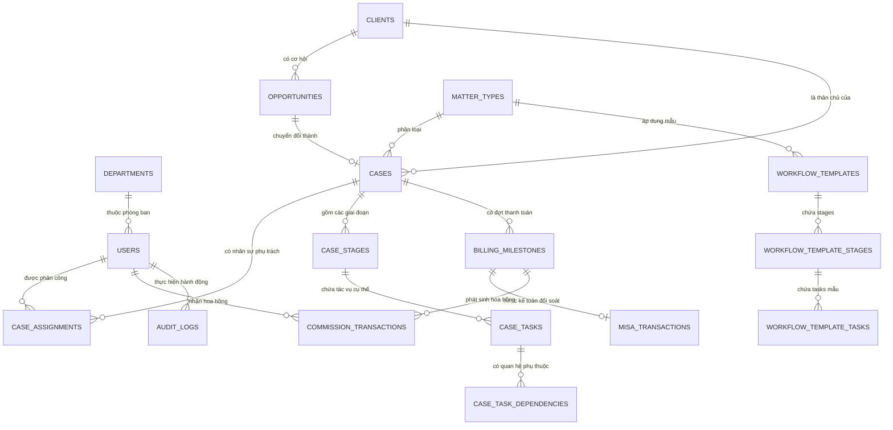

# 06. THIẾT KẾ CƠ SỞ DỮ LIỆU & QUAN HỆ ĐỒ THỊ (DATABASE SCHEMA & ERD)

## 1. SƠ ĐỒ THỰC THỂ QUAN HỆ POSTGRESQL (ERD)



---

## 2. ĐẶC TẢ CẤU TRÚC CÁC BẢNG POSTGRESQL (TABLE DEFINITIONS)

### 2.1. Nhóm Người dùng & Phòng ban (Users & Departments)

#### Bảng `users`
| Tên cột | Kiểu dữ liệu | Ràng buộc | Mô tả |
| :--- | :--- | :--- | :--- |
| `id` | `UUID` | PK, Default `gen_random_uuid()` | Khóa chính định danh người dùng |
| `email` | `VARCHAR(255)` | UNIQUE, NOT NULL | Địa chỉ email đăng nhập công vụ |
| `password_hash` | `VARCHAR(255)` | NOT NULL | Mật khẩu băm bằng thuật toán Argon2id |
| `full_name` | `VARCHAR(150)` | NOT NULL | Họ và tên đầy đủ |
| `phone_number` | `VARCHAR(20)` | NULL | Số điện thoại liên lạc |
| `system_role` | `VARCHAR(50)` | NOT NULL | Vai trò hệ thống: `SUPER_ADMIN`, `PARTNER`, `SUPERVISOR`, `LAWYER`, `ASSISTANT`, `ACCOUNTANT`, `SALES` |
| `is_active` | `BOOLEAN` | Default `TRUE` | Trạng thái hoạt động tài khoản |
| `telegram_chat_id` | `VARCHAR(100)` | NULL | Chat ID để bot Telegram gửi cảnh báo |
| `zalo_user_id` | `VARCHAR(100)` | NULL | ID định danh nhận tin Zalo OA |
| `created_at` | `TIMESTAMPTZ` | Default `NOW()` | Thời gian tạo tài khoản |
| `updated_at` | `TIMESTAMPTZ` | Default `NOW()` | Thời gian cập nhật gần nhất |

#### Bảng `departments`
| Tên cột | Kiểu dữ liệu | Ràng buộc | Mô tả |
| :--- | :--- | :--- | :--- |
| `id` | `UUID` | PK, Default `gen_random_uuid()` | Khóa chính phòng ban/ban chuyên môn |
| `name` | `VARCHAR(100)` | NOT NULL | Tên ban (VD: Ban Dân sự, Ban SHTT, Ban Doanh nghiệp) |
| `code` | `VARCHAR(50)` | UNIQUE, NOT NULL | Mã phòng ban (VD: `DEPT_IP`, `DEPT_CIVIL`) |
| `leader_id` | `UUID` | FK `users(id)`, NULL | Trưởng phòng/Partner phụ trách ban |

---

### 2.2. Nhóm Khách hàng & Cơ hội (CRM)

#### Bảng `clients`
| Tên cột | Kiểu dữ liệu | Ràng buộc | Mô tả |
| :--- | :--- | :--- | :--- |
| `id` | `UUID` | PK, Default `gen_random_uuid()` | Khóa chính thân chủ / khách hàng |
| `client_type` | `VARCHAR(20)` | NOT NULL | Loại khách: `ENTERPRISE` (Doanh nghiệp) hoặc `INDIVIDUAL` (Cá nhân) |
| `name` | `VARCHAR(255)` | NOT NULL | Tên công ty hoặc họ tên cá nhân |
| `tax_code_or_id` | `VARCHAR(50)` | NOT NULL, INDEX | Mã số thuế (DN) hoặc CCCD/Hộ chiếu (Cá nhân) |
| `representative_name` | `VARCHAR(150)` | NULL | Họ tên người đại diện pháp luật |
| `phone` | `VARCHAR(30)` | NOT NULL | Số điện thoại liên hệ chính |
| `email` | `VARCHAR(255)` | NOT NULL | Email liên hệ |
| `address` | `TEXT` | NOT NULL | Địa chỉ trụ sở / thường trú |
| `category_group` | `VARCHAR(50)` | Default `'NEW'` | Phân nhóm: `NEW`, `POTENTIAL`, `RETURNING`, `VIP` |
| `created_by` | `UUID` | FK `users(id)` | Nhân viên tạo hồ sơ khách hàng |
| `created_at` | `TIMESTAMPTZ` | Default `NOW()` | Ngày tạo |

#### Bảng `opportunities`
| Tên cột | Kiểu dữ liệu | Ràng buộc | Mô tả |
| :--- | :--- | :--- | :--- |
| `id` | `UUID` | PK, Default `gen_random_uuid()` | Khóa chính cơ hội |
| `client_id` | `UUID` | FK `clients(id)`, NOT NULL | Thân chủ liên quan |
| `title` | `VARCHAR(255)` | NOT NULL | Tên cơ hội / Nhu cầu dịch vụ |
| `lead_source` | `VARCHAR(50)` | NOT NULL | Nguồn: `WEBSITE`, `HOTLINE`, `FACEBOOK`, `REFERRAL` |
| `expected_value` | `NUMERIC(15,2)` | Default `0.00` | Giá trị hợp đồng dự kiến (VNĐ) |
| `probability_pct` | `INTEGER` | CHECK `0 <= val <= 100` | Xác suất chốt thành công (%) |
| `stage` | `VARCHAR(50)` | NOT NULL | `NEW_LEAD`, `PROPOSAL_SENT`, `NEGOTIATION`, `WON`, `LOST` |
| `assigned_sales_id`| `UUID` | FK `users(id)` | Chuyên viên Sales phụ trách |
| `converted_case_id`| `UUID` | FK `cases(id)`, NULL | Vụ việc sinh ra sau khi chốt hợp đồng (WON) |

---

### 2.3. Nhóm Quy trình Động & Quản lý Vụ việc (Workflow & Case Management)

#### Bảng `matter_types`
| Tên cột | Kiểu dữ liệu | Ràng buộc | Mô tả |
| :--- | :--- | :--- | :--- |
| `id` | `UUID` | PK, Default `gen_random_uuid()` | Khóa chính phân ngành pháp lý |
| `department_id` | `UUID` | FK `departments(id)` | Thuộc ban chuyên môn nào |
| `name` | `VARCHAR(150)` | NOT NULL | Tên dịch vụ (VD: Đăng ký Nhãn hiệu, Tranh tụng Đất đai) |
| `custom_fields_schema` | `JSONB` | Default `'[]'::jsonb` | Định nghĩa các trường động JSONB cho phân ngành này |

#### Bảng `cases` (Vụ việc)
| Tên cột | Kiểu dữ liệu | Ràng buộc | Mô tả |
| :--- | :--- | :--- | :--- |
| `id` | `UUID` | PK, Default `gen_random_uuid()` | Khóa chính vụ việc |
| `case_code` | `VARCHAR(50)` | UNIQUE, NOT NULL, INDEX | Mã vụ việc (VD: `ASL-2026-IP-0012`) |
| `title` | `VARCHAR(255)` | NOT NULL | Tên vụ việc |
| `client_id` | `UUID` | FK `clients(id)`, NOT NULL | Khách hàng của vụ việc |
| `matter_type_id` | `UUID` | FK `matter_types(id)`, NOT NULL | Phân ngành pháp lý áp dụng |
| `contract_value` | `NUMERIC(15,2)` | NOT NULL | Tổng giá trị hợp đồng dịch vụ pháp lý |
| `status` | `VARCHAR(50)` | NOT NULL | `INITIALIZING`, `ACTIVE`, `WAITING_APPROVAL`, `PAUSED`, `CLOSED` |
| `current_stage_id` | `UUID` | NULL | Giai đoạn hiện tại đang thực hiện |
| `custom_data` | `JSONB` | Default `'{}'::jsonb` | Dữ liệu giá trị thực tế của các trường động |
| `created_at` | `TIMESTAMPTZ` | Default `NOW()` | Ngày khởi tạo vụ việc |

#### Bảng `case_assignments` (Phân công đa vai trò vụ việc)
| Tên cột | Kiểu dữ liệu | Ràng buộc | Mô tả |
| :--- | :--- | :--- | :--- |
| `id` | `UUID` | PK, Default `gen_random_uuid()` | Khóa chính |
| `case_id` | `UUID` | FK `cases(id)`, NOT NULL | Vụ việc |
| `user_id` | `UUID` | FK `users(id)`, NOT NULL | Nhân sự được gán |
| `role_in_case` | `VARCHAR(50)` | NOT NULL | Vai trò: `SUPERVISOR`, `CASE_MANAGER`, `EXECUTOR`, `ASSISTANT` |
| `assigned_at` | `TIMESTAMPTZ` | Default `NOW()` | Thời điểm phân công |

#### Bảng `case_tasks` (Tác vụ chi tiết)
| Tên cột | Kiểu dữ liệu | Ràng buộc | Mô tả |
| :--- | :--- | :--- | :--- |
| `id` | `UUID` | PK, Default `gen_random_uuid()` | Khóa chính tác vụ |
| `case_id` | `UUID` | FK `cases(id)`, NOT NULL | Thuộc vụ việc |
| `stage_id` | `UUID` | FK `case_stages(id)`, NOT NULL | Thuộc giai đoạn nào |
| `title` | `VARCHAR(255)` | NOT NULL | Tên công việc phải làm |
| `description` | `TEXT` | NULL | Hướng dẫn chi tiết |
| `assigned_to` | `UUID` | FK `users(id)`, NULL | Người thực hiện trực tiếp |
| `status` | `VARCHAR(50)` | Default `'TODO'` | `TODO`, `IN_PROGRESS`, `WAITING_APPROVAL`, `COMPLETED` |
| `due_date` | `TIMESTAMPTZ` | NULL | Hạn chót hoàn thành (Deadline) |
| `completed_at` | `TIMESTAMPTZ` | NULL | Thời điểm hoàn thành thực tế |

#### Bảng `case_task_dependencies` (Ràng buộc phụ thuộc tác vụ)
| Tên cột | Kiểu dữ liệu | Ràng buộc | Mô tả |
| :--- | :--- | :--- | :--- |
| `id` | `UUID` | PK, Default `gen_random_uuid()` | Khóa chính |
| `case_task_id` | `UUID` | FK `case_tasks(id)` | Task đích bị khóa (Dependent Task) |
| `depends_on_task_id`| `UUID` | FK `case_tasks(id)` | Task tiên quyết phải hoàn thành trước (Prerequisite Task) |

---

### 2.4. Nhóm Tài chính, MISA & Chiết tính Hoa hồng (Finance & Commission)

#### Bảng `billing_milestones` (Đợt thanh toán)
| Tên cột | Kiểu dữ liệu | Ràng buộc | Mô tả |
| :--- | :--- | :--- | :--- |
| `id` | `UUID` | PK, Default `gen_random_uuid()` | Khóa chính đợt thu |
| `case_id` | `UUID` | FK `cases(id)`, NOT NULL | Thuộc vụ việc |
| `milestone_name` | `VARCHAR(150)` | NOT NULL | Tên đợt thu (VD: Đợt 1 - Tạm ứng, Đợt 2 - Có đơn hợp lệ) |
| `amount` | `NUMERIC(15,2)` | NOT NULL | Số tiền phải thu (VNĐ) |
| `pct_of_contract` | `NUMERIC(5,2)` | NOT NULL | Tỷ lệ % trên tổng hợp đồng |
| `trigger_task_id` | `UUID` | FK `case_tasks(id)`, NULL | Task kích hoạt yêu cầu thu tiền khi hoàn thành |
| `status` | `VARCHAR(50)` | Default `'PENDING'` | `PENDING`, `INVOICED`, `PAID_CONFIRMED` |

#### Bảng `misa_transactions` (Ghi nhận xác nhận từ Kế toán)
| Tên cột | Kiểu dữ liệu | Ràng buộc | Mô tả |
| :--- | :--- | :--- | :--- |
| `id` | `UUID` | PK, Default `gen_random_uuid()` | Khóa chính |
| `milestone_id` | `UUID` | FK `billing_milestones(id)` | Đợt thanh toán tương ứng |
| `accountant_id` | `UUID` | FK `users(id)`, NOT NULL | Kế toán viên bấm xác nhận |
| `misa_invoice_no` | `VARCHAR(100)` | NOT NULL | Số hóa đơn đã xuất trên phần mềm MISA |
| `bank_ref_code` | `VARCHAR(100)` | NOT NULL | Mã giao dịch ngân hàng / Chứng từ thu tiền |
| `actual_received_amount` | `NUMERIC(15,2)` | NOT NULL | Số tiền thực tế tiền về tài khoản (VNĐ) |
| `confirmed_at` | `TIMESTAMPTZ` | Default `NOW()` | Thời điểm xác nhận |

#### Bảng `commission_transactions` (Sổ cái Hoa hồng)
| Tên cột | Kiểu dữ liệu | Ràng buộc | Mô tả |
| :--- | :--- | :--- | :--- |
| `id` | `UUID` | PK, Default `gen_random_uuid()` | Khóa chính giao dịch |
| `milestone_id` | `UUID` | FK `billing_milestones(id)` | Thuộc đợt thu tiền nào |
| `user_id` | `UUID` | FK `users(id)`, NOT NULL | Nhân sự được thụ hưởng hoa hồng |
| `role_type` | `VARCHAR(50)` | NOT NULL | Vai trò hưởng: `SALES`, `SUPERVISOR`, `CASE_MANAGER`, `EXECUTOR` |
| `rate_pct` | `NUMERIC(5,2)` | NOT NULL | Tỷ lệ % hoa hồng áp dụng |
| `amount` | `NUMERIC(15,2)` | NOT NULL | Số tiền hoa hồng thực nhận (VNĐ) |
| `payout_status` | `VARCHAR(50)` | Default `'ACCUMULATED'` | `ACCUMULATED` (Đã tích lũy), `DISBURSED` (Đã thanh toán lương) |
| `created_at` | `TIMESTAMPTZ` | Default `NOW()` | Thời điểm tính toán |

---

### 2.5. Bảng Nhật ký Kiểm toán Bất biến (`audit_logs`)
| Tên cột | Kiểu dữ liệu | Ràng buộc | Mô tả |
| :--- | :--- | :--- | :--- |
| `id` | `BIGSERIAL` | PK | Mã tự tăng định danh log |
| `actor_id` | `UUID` | FK `users(id)`, NULL | Ai là người thực hiện (NULL nếu là System Worker) |
| `action` | `VARCHAR(100)` | NOT NULL, INDEX | Hành động: `CREATE_CASE`, `APPROVE_GATE`, `CONFIRM_MISA_PAYMENT`, `VIEW_FILE` |
| `entity_name` | `VARCHAR(100)` | NOT NULL, INDEX | Tên thực thể: `Case`, `BillingMilestone`, `Task` |
| `entity_id` | `VARCHAR(100)` | NOT NULL | Khóa chính của thực thể bị tác động |
| `before_state` | `JSONB` | NULL | Snapshot dữ liệu trước khi thay đổi |
| `after_state` | `JSONB` | NULL | Snapshot dữ liệu sau khi thay đổi |
| `ip_address` | `VARCHAR(45)` | NOT NULL | Địa chỉ IP máy trạm thao tác |
| `user_agent` | `TEXT` | NOT NULL | Thông tin trình duyệt / máy khách |
| `created_at` | `TIMESTAMPTZ` | Default `NOW()`, INDEX | Thời điểm phát sinh hành vi (Không thể sửa/xóa) |

---

## 3. THIẾT KẾ ĐỒ THỊ BẢO MẬT PHÂN QUYỀN NEO4J (GRAPH RBAC)

### 3.1. Mô hình Đỉnh (Nodes) và Cạnh (Edges)

```mermaid
graph LR
    U["(:User {id, email})"]
    D["(:Department {id, code})"]
    C["(:Case {id, case_code})"]
    CL["(:Client {id, name})"]
    MT["(:MatterType {id, name})"]
    
    U -->|:MEMBER_OF| D
    U -->|:LEADS| D
    U -->|:ASSIGNED_TO {role: 'SUPERVISOR'|'MANAGER'|'EXECUTOR'}| C
    C -->|:FOR_CLIENT| CL
    C -->|:BELONGS_TO| MT
    MT -->|:UNDER_DEPT| D
```

### 3.2. Truy vấn Kiểm tra Quyền Truy cập Vụ việc (Need-to-Know Guard Cypher)
Khi bất kỳ API nào yêu cầu xem chi tiết Hồ sơ vụ việc (`case_id`), Middleware sẽ kích hoạt truy vấn Cypher tối ưu:

```cypher
MATCH (u:User {id: $user_id})
MATCH (c:Case {id: $case_id})
RETURN 
  // 1. Nếu là Super Admin
  u.system_role = 'SUPER_ADMIN' OR
  
  // 2. Hoặc nếu được phân công trực tiếp vào Vụ việc
  EXISTS((u)-[:ASSIGNED_TO]->(c)) OR
  
  // 3. Hoặc là Trưởng phòng (Leader) quản lý Lĩnh vực của Vụ việc đó
  EXISTS((u)-[:LEADS]->(:Department)<-[:UNDER_DEPT]-(:MatterType)<-[:BELONGS_TO]-(c)) 
AS has_access
```
Nếu `has_access` trả về `false`, API từ chối ngay lập tức với mã lỗi `403 Forbidden` và ghi một bản ghi cảnh báo truy cập trái phép vào `audit_logs`.

### 3.3. Truy vấn Quyền Truy cập Văn Phòng Số Trực Quan (Floorplan Need-to-Know Guard)
Khi Giám đốc hoặc Quản lý truy cập màn hình `SCR-15: Virtual Office Floorplan`:
```cypher
MATCH (u:User {id: $user_id})
MATCH (d:Department {id: $dept_id})
RETURN 
  // 1. Giám đốc điều hành xem được mọi phòng ban
  u.system_role IN ['SUPER_ADMIN', 'PARTNER'] OR
  
  // 2. Trưởng phòng chỉ xem được phòng ban mình lãnh đạo
  EXISTS((u)-[:LEADS]->(d))
AS can_view_floorplan
```

