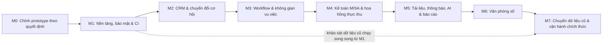

# 11. LỘ TRÌNH THỰC HIỆN & DANH SÁCH TÁC VỤ (TASKS & DOD)

> Cập nhật 30/10/2026 theo `14-decisions.md` và báo cáo QA 30/10 (D6, mục P2). Thay đổi chính so với bản trước:
> - Guard Need-to-know (TSK-11) và Audit log (TSK-12) chuyển từ Milestone 5 lên **Milestone 1** — mọi endpoint vụ việc cần chúng ngay từ đầu.
> - Thêm Milestone 0 (chỉnh prototype) và Milestone 7 (chuyển dữ liệu & vận hành chính thức).
> - Thêm TSK-16 → TSK-27. Mã TSK cũ giữ nguyên để không vỡ tham chiếu.
>
> **Cách giao việc:** mỗi TSK được Claude chia thành một hoặc nhiều task `handoff/tasks/TASK-NNN-*` (brief + test khoá) rồi giao cho Antigravity. "Lệnh xác minh tự động" dưới đây là điều kiện tối thiểu; brief có thể bổ sung test chi tiết hơn.

## 1. TỔNG QUAN CÁC CỘT MỐC



TSK-23 (khảo sát & ánh xạ dữ liệu cũ) nên bắt đầu song song từ M1 vì kết quả của nó có thể đòi sửa schema sớm.

---

## 2. CHI TIẾT TÁC VỤ

### MILESTONE 0: CHỈNH PROTOTYPE THEO QUYẾT ĐỊNH

Theo báo cáo `qa/reports/QA-REPORT-20261030-2318.md` mục 3 và 5. Đã có `handoff/tasks/TASK-001-don-dep-prototype` (A1).

| Việc | Nội dung | Xác minh |
| :--- | :--- | :--- |
| A1 | Mã đặc tả, emoji trong nút, `?role=` trên mọi link, tăng `?v=` assets | `bash handoff/tasks/TASK-001-*/verify.sh` |
| A2 | Header đúng người dùng theo vai trò; responsive 375/1024/1440; sidebar đóng mặc định trên điện thoại | Test trình duyệt headless |
| A3 | Bộ thành phần 4 trạng thái UI dùng chung, áp dụng các trang danh sách & form | Checker: mọi trang đủ 4 trạng thái |
| A4 | Ẩn hành động chuyên môn với vai trò Kế toán; ẩn Chấm công & Cổng khách hàng khỏi menu (DEC-04) | Test DOM theo vai trò |
| A5 | Tương phản WCAG AA cho chữ nhỏ ở Light & Dark | Script đo tương phản |
| A6 | Trang đăng nhập theo DEC-02: bỏ SSO, email `@asllaw.vn`, bước TOTP riêng, bỏ dòng demo | Test DOM |
| A7 | Màn hình mới/đổi: bước bổ sung task (template Linh hoạt), thu một phần ở Bàn làm việc Kế toán, chọn chế độ quy trình ở Workflow Builder | Review trực quan + checker |

---

### MILESTONE 1: NỀN TẢNG, BẢO MẬT & CI

#### Task TSK-01: Docker Compose cụm dịch vụ On-Premise
- **Mô tả:** `docker-compose.yml` gồm 9 container: `nginx`, `frontend`, `backend`, `celery_worker`, `celery_beat`, `postgres`, `neo4j`, `redis`, `clamav`. Network bridge nội bộ, chỉ `nginx` mở cổng; volume dữ liệu và mount NAS.
- **DoD:**
  - `docker compose up -d` thành công, mọi container `healthy`.
  - Nginx SSL nội bộ tại `https://localhost:443`; `postgres`, `neo4j`, `redis` không mở cổng ra host ở cấu hình production.
- **Lệnh xác minh tự động:**
  ```bash
  docker compose ps --format json | jq -e 'all(.Health == "healthy")'
  curl -k -s -o /dev/null -w "%{http_code}" https://localhost/api/v1/health | grep 200
  ```

#### Task TSK-16: Khung dự án, CI & dữ liệu seed
- **Mô tả:** Monorepo theo `09` §1; lint + typecheck + test cho backend (ruff, mypy, pytest) và frontend (eslint, tsc, vitest); workflow CI chạy trên mỗi push; fixture/seed cho 4 vai trò, 2 phòng ban, Giám đốc, Trưởng phòng, Kế toán, 3 Luật sư, 1 template mỗi chế độ.
- **DoD:** CI xanh trên nhánh trống; `make seed` tạo dữ liệu mẫu lặp lại được (chạy 2 lần không trùng).
- **Lệnh xác minh tự động:**
  ```bash
  make lint test
  make seed && make seed && docker compose exec backend python -m app.scripts.check_seed
  ```

#### Task TSK-02: Schema PostgreSQL, Neo4j & phân quyền DB
- **Mô tả:** Alembic migration toàn bộ bảng ở `06` §2 (trừ bảng thuộc M4–M7 có thể thêm dần); hai user DB `asl_owner`/`asl_app`; trigger chặn UPDATE/DELETE trên bảng bất biến; ràng buộc Neo4j (unique `id`).
- **DoD:**
  - `alembic upgrade head` và `alembic downgrade base` không lỗi.
  - `asl_app` không `UPDATE`/`DELETE` được `audit_logs`, `misa_transactions`, `commission_transactions`.
- **Lệnh xác minh tự động:**
  ```bash
  docker compose exec backend alembic upgrade head
  pytest backend/tests/test_schema_constraints.py -v
  ```

#### Task TSK-03: Xác thực nội bộ, phiên & thu hồi token
- **Mô tả:** `/auth/login`, `/auth/refresh` (xoay vòng), `/auth/logout`, `/auth/me`, `/auth/password`; Argon2id; cookie HttpOnly + CSRF; blocklist `jti` và `tokens_valid_after`; khoá tạm sau 5 lần sai; `must_reset_password`.
- **DoD:** TC-SEC-04, TC-SEC-05, TC-SEC-06, TC-SEC-07 (`13`) đạt.
- **Lệnh xác minh tự động:**
  ```bash
  pytest backend/tests/test_auth.py -v
  ```

#### Task TSK-17: Xác thực 2 lớp TOTP (DEC-02)
- **Mô tả:** `/auth/2fa/setup|enable|verify`, mã khôi phục, bắt buộc với `ADMIN`/`MANAGER`/`ACCOUNTANT`, reset 2FA bởi Quản trị viên khác có audit.
- **DoD:** TC-SEC-08, TC-SEC-09 đạt; bí mật TOTP không xuất hiện bản rõ trong DB/log.
- **Lệnh xác minh tự động:**
  ```bash
  pytest backend/tests/test_two_factor.py -v
  ```

#### Task TSK-11: Guard Need-to-know (Neo4j) dùng chung
- **Mô tả:** `verify_need_to_know(user, case_id, scope)` theo `06` §3.2–3.3: Cypher trả sự kiện, bảng chính sách trong `access_policy.py`; dependency FastAPI bắt buộc khai báo `scope` cho mọi router `/cases/{id}/…`; test kiểm tra không router vụ việc nào thiếu guard.
- **DoD:** TC-SEC-01, TC-SEC-02, TC-SEC-10 → TC-SEC-13 đạt; độ trễ guard p95 < 50 ms.
- **Lệnh xác minh tự động:**
  ```bash
  pytest backend/tests/test_need_to_know_guard.py backend/tests/test_access_policy.py -v
  ```

#### Task TSK-12: Nhật ký kiểm toán bất biến (SCR-13)
- **Mô tả:** Ghi audit qua service dùng chung (không interceptor ngầm đoán dữ liệu); chuỗi băm `prev_hash`/`row_hash`; job kiểm tra chuỗi hằng đêm; màn hình xem log cho Quản trị viên.
- **DoD:** TC-SEC-03, TC-SEC-14 đạt.
- **Lệnh xác minh tự động:**
  ```bash
  docker compose exec postgres psql -U asl_app -d asl_erp_prod -c "DELETE FROM audit_logs;" 2>&1 | grep -E "permission denied|không được phép"
  pytest backend/tests/test_audit_log.py -v
  ```

#### Task TSK-18: Người dùng, phòng ban & đồng bộ đồ thị (SCR-19)
- **Mô tả:** CRUD người dùng/phòng ban, đặt Giám đốc/Trưởng phòng, khoá tài khoản thu hồi mọi phiên; outbox `graph_sync`, job đối soát hằng đêm, lệnh `rebuild-graph` (`06` §4).
- **DoD:** Khoá tài khoản → request kế tiếp `401`; gỡ phân công → mất quyền ngay; `rebuild-graph` trên DB seed cho đồ thị giống hệt đồ thị đang chạy.
- **Lệnh xác minh tự động:**
  ```bash
  pytest backend/tests/test_users_departments.py backend/tests/test_graph_sync.py -v
  ```

---

### MILESTONE 2: CRM & CHUYỂN ĐỔI CƠ HỘI

#### Task TSK-04: Khách hàng & hồ sơ chi tiết (SCR-03, SCR-04)
- **Mô tả:** CRUD khách hàng doanh nghiệp/cá nhân/nước ngoài; chặn trùng MST và CCCD (qua hash); CCCD mã hoá, API chỉ trả 4 số cuối; dòng thời gian tương tác; kiểm tra xung đột lợi ích trả `warnings`.
- **DoD:** TC-CRM-01, TC-CRM-03, TC-CRM-04 đạt; giao diện đủ 4 trạng thái UI.
- **Lệnh xác minh tự động:**
  ```bash
  pytest backend/tests/test_crm_clients.py -v
  ```

#### Task TSK-05: Pipeline cơ hội & chuyển đổi 1-chạm (SCR-05)
- **Mô tả:** Kanban cơ hội theo `12` §1.1; chuyển đổi khi `WON` (có `Idempotency-Key`) tạo vụ việc `INITIALIZING` với mã `ASL-YYYY-XX-NNNN`, phiên bản template, lộ trình đợt thu, tỷ lệ hoa hồng mặc định, người mang khách về.
- **DoD:** TC-CRM-02, TC-CRM-05 đạt; tạo 50 vụ việc song song không trùng mã.
- **Lệnh xác minh tự động:**
  ```bash
  pytest backend/tests/test_opportunity_conversion.py -v
  ```

---

### MILESTONE 3: WORKFLOW & KHÔNG GIAN VỤ VIỆC

#### Task TSK-06: Trình thiết kế quy trình, chế độ & phiên bản (SCR-06)
- **Mô tả:** Admin cấu hình stage, task mẫu (SLA ngày làm việc, trọng số, task kích hoạt đợt thu), phụ thuộc, cổng duyệt, trường động; chọn chế độ `STRICT`/`FLEXIBLE`; phát hành phiên bản (kiểm tra không có chu trình phụ thuộc); bảng ngày nghỉ lễ.
- **DoD:** Tạo template 3 stage, 6 task, 2 trường động ở mỗi chế độ; sửa sau phát hành tạo phiên bản mới, vụ việc cũ không đổi (TC-WF-04).
- **Lệnh xác minh tự động:**
  ```bash
  pytest backend/tests/test_workflow_builder.py -v
  ```

#### Task TSK-07: Không gian vụ việc & bảng tác vụ (SCR-07, SCR-08, SCR-09)
- **Mô tả:** Danh sách vụ việc theo phạm vi; workspace: header tiến độ + cờ chặn stage, form trường động, lịch sử stage; phân công đa vai trò; Kanban/List có guard; Kế toán chỉ thấy tab tài chính.
- **DoD:** Kéo thả cập nhật trạng thái đúng `12` §1.4; vụ việc `ACTIVE` khi đủ phân công; TC-CASE-03 đạt.
- **Lệnh xác minh tự động:**
  ```bash
  pytest backend/tests/test_case_workspace.py -v
  ```

#### Task TSK-08: Guard phụ thuộc, khoá stage & phê duyệt thống nhất (SCR-10, SCR-16)
- **Mô tả:** Guard `case_task_dependencies` và khoá stage; bảng `approval_requests` dùng chung cho task, cổng giai đoạn, yêu cầu bổ sung; quy tắc người duyệt `12` §2.2; màn hình Duyệt nhanh.
- **DoD:** TC-CASE-01, TC-CASE-02, TC-CASE-04, TC-CASE-05 đạt.
- **Lệnh xác minh tự động:**
  ```bash
  pytest backend/tests/test_task_dependencies.py backend/tests/test_approvals.py -v
  ```

#### Task TSK-19: Yêu cầu bổ sung quy trình (DEC-07)
- **Mô tả:** `POST /cases/{id}/change-requests`; duyệt → tạo task/stage `is_ad_hoc`; chặn mọi đường tạo task/stage khác; nhãn "Bổ sung" trên Kanban.
- **DoD:** TC-WF-01, TC-WF-02, TC-WF-03 đạt.
- **Lệnh xác minh tự động:**
  ```bash
  pytest backend/tests/test_workflow_change_requests.py -v
  ```

---

### MILESTONE 4: KẾ TOÁN MISA & HOA HỒNG THỰC THU

#### Task TSK-09: Đợt thu & Bàn làm việc Kế toán (SCR-11)
- **Mô tả:** Máy trạng thái đợt thu `12` §1.5; phát tác vụ cho Kế toán khi `AWAITING_PAYMENT`; xác nhận nhiều lần (thu một phần), `bank_ref_code` UNIQUE, `Idempotency-Key`; mở khoá stage khi thu đủ; huỷ đợt thu.
- **DoD:** TC-MISA-01 → TC-MISA-05 đạt.
- **Lệnh xác minh tự động:**
  ```bash
  pytest backend/tests/test_misa_flow.py -v
  ```

#### Task TSK-10: Động cơ hoa hồng theo dòng tiền thực (SCR-12)
- **Mô tả:** Công thức `12` §3: tính trên từng lần xác nhận, chia trọng số task chưa phân bổ, dồn quỹ khi không có task, làm tròn xuống + phần lẻ lớn nhất, khoá chính sách sau lần thu đầu, không đảo; bảng kê và xuất Excel.
- **DoD:** TC-FIN-01 → TC-FIN-08 đạt; property-based test: với mọi $A$ và trọng số ngẫu nhiên, tổng phân bổ quỹ thực hiện = quỹ, không âm.
- **Lệnh xác minh tự động:**
  ```bash
  pytest backend/tests/test_commission_calculation.py -v
  ```

---

### MILESTONE 5: TÀI LIỆU, THÔNG BÁO, AI & BÁO CÁO

#### Task TSK-20: Tài liệu vụ việc (SCR-17 — DEC-04)
- **Mô tả:** Cây 4 thư mục, phiên bản, mã hoá envelope trên NAS, quét ClamAV, danh sách trắng định dạng, tải xuống ghi audit, phạm vi `finance` cho thư mục Hợp đồng.
- **DoD:** TC-DOC-01 → TC-DOC-04 đạt.
- **Lệnh xác minh tự động:**
  ```bash
  pytest backend/tests/test_documents.py -v
  ```

#### Task TSK-21: Trung tâm thông báo & cảnh báo đa kênh
- **Mô tả:** Bảng `notifications`/`notification_deliveries`, WebSocket chuông, Telegram (liên kết OTP), Zalo OA; quét hạn theo ngày làm việc, leo thang 2 cấp, chống gửi trùng; mẫu tin tối thiểu (DEC-03).
- **DoD:** TC-NOTIF-01 → TC-NOTIF-03 đạt.
- **Lệnh xác minh tự động:**
  ```bash
  pytest backend/tests/test_notifications.py -v
  ```

#### Task TSK-13: Trợ lý AI tra cứu (SCR-14)
- **Mô tả:** LLM (Gemini) + Tool Calling chạy trong phạm vi quyền người hỏi; lớp `pii_redactor` che định danh khách hàng trước khi gửi, khôi phục khi trả lời (`08` §4.2).
- **DoD:** TC-AI-01, TC-AI-02 đạt.
- **Lệnh xác minh tự động:**
  ```bash
  pytest backend/tests/test_ai_agent_tools.py backend/tests/test_pii_redaction.py -v
  ```

#### Task TSK-22: Báo cáo & thống kê (SCR-18 — DEC-04)
- **Mô tả:** Báo cáo doanh thu thực thu, hoa hồng, vận hành theo `02` Phân hệ 10; phạm vi dữ liệu theo vai trò; xuất Excel.
- **DoD:** Số liệu báo cáo khớp tổng `misa_transactions`/`commission_transactions` trên dữ liệu seed; TC-RPT-01 đạt.
- **Lệnh xác minh tự động:**
  ```bash
  pytest backend/tests/test_reports.py -v
  ```

---

### MILESTONE 6: VĂN PHÒNG SỐ

#### Task TSK-15: Văn phòng số trực quan (SCR-15 — FEAT-01)
- **Mô tả:**
  - Giao diện căn phòng 2.5D Isometric (`frontend/src/app/(dashboard)/operations/floorplan/page.tsx`, tham chiếu `prototype/operations/floorplan.html`).
  - Bàn Trưởng phòng, hàng đợi duyệt `[ 📝 X việc chờ duyệt ]` (lấy từ `approval_requests`), cụm bàn nhân sự tự xếp lưới.
  - Trạng thái `⚡ Đang làm`, `⏳ Chờ xử lý`, `☕ Đang nghỉ ngơi` (khi `in_progress_count == 0`).
  - Side Drawer xem việc, giao việc nhanh, nhắc nhở, ký duyệt trực tiếp.
  - WebSocket cập nhật thời gian thực.
- **DoD:**
  - Giám đốc xem mọi phòng; Trưởng phòng chỉ phòng mình (TC-FL-01).
  - Nhân sự gửi duyệt → avatar rời ghế xếp hàng; duyệt xong → về bàn.
  - WCAG 2.1 AA ở Light và Dark.
- **Lệnh xác minh tự động:**
  ```bash
  curl -s "http://localhost:8000/api/v1/operations/floorplan?department_id=$DEPT_IP_ID" \
    -H "Authorization: Bearer $EXECUTIVE_TOKEN" | jq -e '.data.department.name | test("Sở Hữu Trí Tuệ")'
  pytest backend/tests/test_virtual_floorplan_realtime.py -v
  ```

---

### MILESTONE 7: CHUYỂN DỮ LIỆU CŨ & VẬN HÀNH CHÍNH THỨC (DEC-05, DEC-08)

#### Task TSK-23: Khảo sát & ánh xạ dữ liệu hệ thống cũ (bắt đầu song song từ M1)
- **Mô tả:** Lập danh mục bảng/post type/custom field của hệ thống WordPress cũ (đọc mã trong `qlcvaslgate-old/`, **không** đọc `datacenter/secret.php`; thông tin kết nối DB do chủ dự án cấp); viết bảng ánh xạ trường cũ → bảng mới, ánh xạ vai trò cũ → 4 vai trò (chờ chốt câu hỏi Q1 về `foreign_partner`); liệt kê dữ liệu không ánh xạ được.
- **DoD:** Tài liệu `docs/features/legacy-migration.md` được chủ dự án duyệt; mọi thay đổi schema phát sinh đã cập nhật `06`.

#### Task TSK-24: Script ETL chuyển dữ liệu
- **Mô tả:** ETL chạy lặp lại được (idempotent qua `legacy_import_records`): người dùng (`must_reset_password`), khách hàng, đối tác, vụ việc (đang chạy gán template/`FLEXIBLE`; đã đóng `is_legacy`), task, tài liệu (mã hoá lại vào kho mới), tài chính & hoa hồng `LEGACY`.
- **DoD:** Chạy 2 lần liên tiếp không sinh bản ghi trùng; mọi bản ghi lỗi ghi vào báo cáo lỗi, không dừng cả lô.
- **Lệnh xác minh tự động:**
  ```bash
  pytest backend/tests/test_legacy_etl.py -v
  ```

#### Task TSK-25: Chạy thử & đối soát chuyển đổi
- **Mô tả:** Chạy ETL trên bản sao dữ liệu thật; đối soát số lượng bản ghi từng loại, tổng giá trị hợp đồng, tổng tiền đã thu, tổng hoa hồng đã chi, số tệp và checksum tài liệu.
- **DoD:** Biên bản đối soát chênh lệch = 0 (hoặc từng chênh lệch có giải thích được chủ dự án ký duyệt); TC-MIG-01, TC-MIG-02 đạt.

#### Task TSK-26: Sao lưu off-site & diễn tập khôi phục
- **Mô tả:** Script sao lưu hằng đêm vào NAS, bản mã hoá off-site hằng tuần, lưu giữ 30 ngày + 12 tháng; runbook khôi phục; diễn tập khôi phục vào máy trống.
- **DoD:** Khôi phục từ bản off-site trong ≤ 8 giờ; TC-OPS-01 đạt; biên bản diễn tập.
- **Lệnh xác minh tự động:**
  ```bash
  ./ops/backup.sh --dry-run && ./ops/restore-test.sh --target /tmp/restore-check
  ```

#### Task TSK-14: Kiểm thử E2E & nghiệm thu toàn hệ thống
- **Mô tả:** Kịch bản xuyên suốt: tạo khách hàng (có cảnh báo xung đột) → chuyển đổi → phân công → làm task, bổ sung task (template Linh hoạt) → chạm mốc thu → Kế toán xác nhận thu một phần rồi thu đủ → hoa hồng → Trợ lý AI tra cứu; chạy cho cả 4 vai trò và kiểm tra a11y tự động.
- **DoD:** Toàn bộ test case `13` đạt; tiêu chí bàn giao `13` §4.

#### Task TSK-27: Chuyển đổi chính thức (cutover)
- **Mô tả:** Runbook cutover: đóng băng hệ thống cũ (chỉ đọc) → chạy ETL lần cuối → đối soát → bật hệ thống mới → hướng dẫn đổi mật khẩu & bật 2FA → giữ hệ thống cũ chỉ đọc trong thời gian chủ dự án quy định.
- **DoD:** Runbook được chủ dự án duyệt; diễn tập cutover trên môi trường thử thành công.
