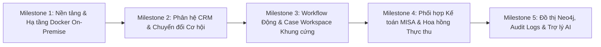

# 11. LỘ TRÌNH THỰC HIỆN & DANH SÁCH TÁC VỤ (TASKS & DOD)

## 1. TỔNG QUAN CÁC CỘT MỐC TRIỂN KHAI (MILESTONES OVERVIEW)



---

## 2. CHI TIẾT DANH MỤC TÁC VỤ & TIÊU CHUẨN NGHIỆM THU (TICKETS & DOD)

### MILESTONE 1: NỀN TẢNG HẠ TẦNG & XÁC THỰC BẢO MẬT

#### Task TSK-01: Thiết lập Docker Compose Cụm dịch vụ On-Premise
- **Mô tả:** Xây dựng file `docker-compose.yml` tích hợp 7 containers: `postgres`, `neo4j`, `redis`, `backend` (FastAPI), `frontend` (Next.js), `celery_worker`, `nginx`. Cấu hình network bridge cô lập nội bộ và volume mount an toàn.
- **Tiêu chuẩn Nghiệm thu (DoD):**
  - Chạy `docker compose up -d` thành công 100%, tất cả containers đạt trạng thái `healthy`.
  - Nginx cấu hình SSL tự ký / chứng chỉ nội bộ trỏ về `https://localhost:443`.
- **Lệnh xác minh tự động:**
  ```bash
  docker compose ps --filter "status=running"
  curl -k -I https://localhost/api/v1/health | grep "200 OK"
  ```

#### Task TSK-02: Thiết lập Schema PostgreSQL, Neo4j & Seed Data
- **Mô tả:** Tạo Alembic migrations khởi tạo toàn bộ bảng cơ sở dữ liệu PostgreSQL. Viết seed script khởi tạo tài khoản quản trị `admin@asllaw.vn`, cấu trúc phòng ban và đồ thị Neo4j mẫu.
- **Tiêu chuẩn Nghiệm thu (DoD):**
  - `alembic upgrade head` thực thi không lỗi.
  - Neo4j có sẵn các node `:Department` và `:User`.
- **Lệnh xác minh tự động:**
  ```bash
  docker compose exec postgres psql -U asl_admin -d asl_erp_prod -c "\dt"
  docker compose exec neo4j cypher-shell -u neo4j -p super_secure_neo4j_password_here "MATCH (n) RETURN count(n);"
  ```

#### Task TSK-03: Dịch vụ Xác thực Nội bộ & Thu hồi Token qua Redis
- **Mô tả:** Cài đặt API `/api/v1/auth/login`, `/api/v1/auth/refresh`, `/api/v1/auth/logout`. Băm mật khẩu bằng Argon2id. Quản lý token revocation qua Redis Blocklist. Xây dựng màn hình đăng nhập **SCR-01**.
- **Tiêu chuẩn Nghiệm thu (DoD):**
  - Đăng nhập đúng trả về JWT access token.
  - Đăng xuất đưa `jti` vào Redis, token bị từ chối ngay lập tức khi gọi API tiếp theo.
- **Lệnh xác minh tự động:**
  ```bash
  curl -s -X POST http://localhost:8000/api/v1/auth/login \
    -H "Content-Type: application/json" \
    -d '{"email":"admin@asllaw.vn","password":"AdminPassword123@"}' | jq .success
  ```

---

### MILESTONE 2: PHÂN HỆ KHÁCH HÀNG & CƠ HỘI KINH DOANH (CRM)

#### Task TSK-04: Module Quản lý Khách hàng & Hồ sơ Chi tiết (SCR-03, SCR-04)
- **Mô tả:** Xây dựng CRUD Khách hàng doanh nghiệp/cá nhân, kiểm tra trùng MST/CCCD, bảng danh mục khách hàng có phân trang, bộ lọc và màn hình chi tiết dòng thời gian tương tác (Timeline).
- **Tiêu chuẩn Nghiệm thu (DoD):**
  - Không cho phép tạo trùng MST với khách hàng đã có trong hệ thống.
  - Giao diện render đủ 4 trạng thái (Empty, Skeleton Loading, Success toast, Validation error).
- **Lệnh xác minh tự động:**
  ```bash
  pytest backend/tests/test_crm_clients.py -v
  ```

#### Task TSK-05: Pipeline Cơ hội & Luồng Chuyển đổi 1-Chạm sang Case (SCR-05)
- **Mô tả:** Quản lý cơ hội kinh doanh dạng Kanban. Khi cơ hội đạt trạng thái `WON`, kích hoạt API chuyển đổi tự động khởi tạo Vụ việc mới trong bảng `cases` và sao chép toàn bộ thông tin thân chủ.
- **Tiêu chuẩn Nghiệm thu (DoD):**
  - Bấm "Chuyển đổi" tự động sinh mã Case theo định dạng `ASL-YYYY-XX-NNNN`.
  - Bản ghi Opportunity được cập nhật trường `converted_case_id`.
- **Lệnh xác minh tự động:**
  ```bash
  curl -s -X POST http://localhost:8000/api/v1/crm/opportunities/{opp_id}/convert \
    -H "Authorization: Bearer $TOKEN" \
    -H "Content-Type: application/json" \
    -d '{"matter_type_id":"mt_uuid","contract_value":100000000}' | jq .data.case_id
  ```

---

### MILESTONE 3: TRÌNH THIẾT KẾ QUY TRÌNH & CASE WORKSPACE KHUNG CỨNG

#### Task TSK-06: Trình Thiết kế Quy trình Động No-code & Trường Động (SCR-06)
- **Mô tả:** Xây dựng giao diện kéo thả cho Super Admin cấu hình Stages, Tasks con, Approval Gates, Ràng buộc điều kiện và Dynamic Form Fields (lưu schema JSONB trong `matter_types`).
- **Tiêu chuẩn Nghiệm thu (DoD):**
  - Admin có thể tạo mới một Workflow Template có 3 stages, 6 tasks con và 2 trường động JSONB.
  - Dữ liệu schema lưu đúng định dạng chuẩn trong PostgreSQL.
- **Lệnh xác minh tự động:**
  ```bash
  pytest backend/tests/test_workflow_builder.py -v
  ```

#### Task TSK-07: Không gian Làm việc Vụ việc & Bảng Tác vụ Lai (SCR-07, SCR-08, SCR-09)
- **Mô tả:** Xây dựng giao diện Case Workspace tích hợp: Header tiến độ %, Form trường động JSONB, cây văn bản đính kèm, và Bảng Tác vụ Lai Kanban/Jira view. Áp dụng nguyên tắc **Khung cứng (Strict Governance)** - chỉ hiển thị các tác vụ sinh ra từ template.
- **Tiêu chuẩn Nghiệm thu (DoD):**
  - Kéo thả thẻ task giữa các cột Kanban cập nhật realtime trạng thái lên cơ sở dữ liệu.
  - Form động hiển thị chính xác các trường dữ liệu theo phân ngành pháp lý của Case.

#### Task TSK-08: Động cơ Kiểm soát Ràng buộc Tiên quyết & Modal Phê duyệt (SCR-10)
- **Mô tả:** Cài đặt Guard kiểm tra `case_task_dependencies`. Chặn chuyển trạng thái Task nếu task tiên quyết chưa xong. Xây dựng Modal Phê duyệt Cổng dành riêng cho `SUPERVISOR` hoặc `CASE_MANAGER`.
- **Tiêu chuẩn Nghiệm thu (DoD):**
  - Request cập nhật task vi phạm phụ thuộc bị từ chối với mã lỗi `422 Unprocessable Entity`.
  - Phê duyệt cổng thành công sẽ giải phóng giai đoạn tiếp theo của vụ việc.
- **Lệnh xác minh tự động:**
  ```bash
  pytest backend/tests/test_task_dependencies.py -v
  ```

---

### MILESTONE 4: PHỐI HỢP KẾ TOÁN MISA & CHIẾT TÍNH HOA HỒNG THỰC THU

#### Task TSK-09: Lộ trình Thanh toán & Bàn làm việc Kế toán MISA (SCR-11)
- **Mô tả:** Tự động phát sinh Tác vụ Tài chính vào hòm thư Kế toán khi vụ việc chạm mốc Milestone. Màn hình SCR-11 cho phép Kế toán nhập Số Hóa đơn MISA, Mã GD Ngân hàng và bấm "Xác nhận đã thu tiền".
- **Tiêu chuẩn Nghiệm thu (DoD):**
  - Bấm xác nhận tự động đổi trạng thái Milestone sang `PAID_CONFIRMED` và mở khóa (Unblock) giai đoạn tiếp theo cho các luật sư.
- **Lệnh xác minh tự động:**
  ```bash
  pytest backend/tests/test_misa_flow.py -v
  ```

#### Task TSK-10: Động cơ Chiết tính Hoa hồng Tự động theo Dòng tiền Thực (SCR-12)
- **Mô tả:** Kích hoạt thuật toán tính hoa hồng ngay khi Kế toán bấm xác nhận thu tiền cho đợt (Cash-basis). Phân bổ tỷ lệ % cho Sales, Lead Lawyer, và Luật sư thực hiện các task thuộc đợt. Xuất bảng kê hoa hồng nhân sự.
- **Tiêu chuẩn Nghiệm thu (DoD):**
  - Tổng số tiền hoa hồng tính ra khớp 100% với công thức cấu hình trong `commission_schemas`.
  - Dữ liệu ghi nhận vào bảng `commission_transactions` với đầy đủ liên kết tới `milestone_id`.
- **Lệnh xác minh tự động:**
  ```bash
  pytest backend/tests/test_commission_calculation.py -v
  ```

---

### MILESTONE 5: BẢO MẬT NEO4J, NHẬT KÝ KIỂM TOÁN & TRỢ LÝ AI

#### Task TSK-11: Phân quyền Đồ thị Neo4j & Need-to-know Middleware Guard
- **Mô tả:** Viết Middleware tự động kiểm tra quyền hạn truy cập vụ việc qua Cypher query trên Neo4j. Từ chối truy cập và trả về `403 Forbidden` nếu người dùng không được gán vào Case hoặc không phải Leader quản lý ban.
- **Tiêu chuẩn Nghiệm thu (DoD):**
  - Luật sư B không thể xem hồ sơ vụ việc của Luật sư A nếu không được gán vai trò.
  - Super Admin và Managing Partner xem được toàn bộ.
- **Lệnh xác minh tự động:**
  ```bash
  pytest backend/tests/test_neo4j_rbac_guard.py -v
  ```

#### Task TSK-12: Hệ thống Nhật ký Kiểm toán Bất biến (SCR-13: Audit Logs)
- **Mô tả:** Lớp interceptor tự động bắt mọi hành động đọc/ghi nhạy cảm và ghi vào bảng `audit_logs` của PostgreSQL kèm thông tin IP, User Agent, Actor, Before/After state. Giao diện xem log cho Admin.
- **Tiêu chuẩn Nghiệm thu (DoD):**
  - Không thể chạy lệnh `UPDATE` hoặc `DELETE` trên bảng `audit_logs`.
- **Lệnh xác minh tự động:**
  ```bash
  docker compose exec postgres psql -U asl_admin -d asl_erp_prod -c "DELETE FROM audit_logs;" | grep "permission denied"
  ```

#### Task TSK-13: Trợ lý Ảo AI Tra cứu Metadata & Cảnh báo Đa kênh (SCR-14)
- **Mô tả:** Tích hợp LLM API (Google Gemini) với Tool Calling để trả lời câu hỏi tra cứu thông tin vụ việc/deadline. Xây dựng Celery Worker quét deadline tự động đẩy cảnh báo qua Telegram Bot và Web Chuông.
- **Tiêu chuẩn Nghiệm thu (DoD):**
  - Trợ lý AI trả lời đúng thông tin task và deadline của user đang hỏi.
  - Celery Beat kích hoạt gửi tin nhắn Telegram thành công tới chat ID thử nghiệm.
- **Lệnh xác minh tự động:**
  ```bash
  pytest backend/tests/test_ai_agent_tools.py -v
  ```

#### Task TSK-14: E2E Integration Testing & Nghiệm thu Toàn diện Hệ thống
- **Mô tả:** Chạy kịch bản kiểm thử tích hợp xuyên suốt từ đầu đến cuối: Tạo khách hàng -> Ký hợp đồng chuyển thành Case -> Gán nhân sự -> Thực hiện task Kanban -> Chạm mốc thu tiền -> Kế toán xác nhận MISA -> Phân bổ hoa hồng -> Trợ lý AI tra cứu.
- **Tiêu chuẩn Nghiệm thu (DoD):** Toàn bộ bộ test cases trong `13-test-cases-and-qa.md` vượt qua 100%.

---

### MILESTONE 6: GIÁM SÁT & ĐIỀU HÀNH TRỰC QUAN (OPERATIONS WAR ROOM)

#### Task TSK-15: Xây dựng Văn Phòng Số Trực Quan (SCR-15: Virtual Office Floorplan - FEAT-01)
- **Mô tả:** 
  - Xây dựng giao diện căn phòng làm việc 2.5D Isometric (`prototype/operations/floorplan.html` & `frontend/src/app/(dashboard)/operations/floorplan/page.tsx`).
  - Dựng bàn Trưởng phòng, hàng đợi duyệt hồ sơ `[ 📝 X việc chờ duyệt ]`, các cụm bàn làm việc nhân sự thông minh tự động (Smart Auto-Grid).
  - Tự động nhận diện trạng thái `⚡ Đang làm`, `⏳ Chờ xử lý` và `☕ Đang nghỉ ngơi` khi `in_progress_count == 0`.
  - Tích hợp Side Drawer xem chi tiết công việc, nút giao việc nhanh, gửi nhắc nhở và hộp thoại ký duyệt điện tử trực tiếp trên phòng làm việc.
  - Tích hợp WebSockets Real-time Stream để phòng làm việc tự động cập nhật ngay khi nhân sự đổi trạng thái task hoặc nộp hồ sơ duyệt.
- **Tiêu chuẩn Nghiệm thu (DoD):**
  - Giám đốc xem được cả 4 phòng ban; Trưởng phòng chỉ xem được phòng của mình theo kiểm tra đồ thị Neo4j.
  - Khi nhân sự gửi hồ sơ duyệt, avatar tự động rời ghế đứng xếp hàng trước bàn Trưởng phòng. Khi Trưởng phòng ký duyệt xong, nhân sự tự động quay lại bàn làm việc.
  - Đạt chuẩn WCAG 2.1 AA trên cả Light Mode và Dark Mode.
- **Lệnh xác minh tự động:**
  ```bash
  curl -s -X GET "http://localhost:8000/api/v1/operations/floorplan?department_id=dept-ip-01" \
    -H "Authorization: Bearer $SUPER_ADMIN_TOKEN" | jq .data.department.name | grep "Sở Hữu Trí Tuệ"
  pytest backend/tests/test_virtual_floorplan_realtime.py -v
  ```

