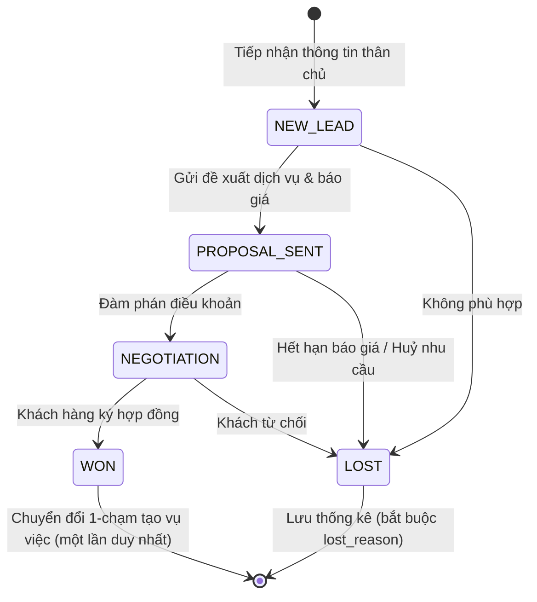
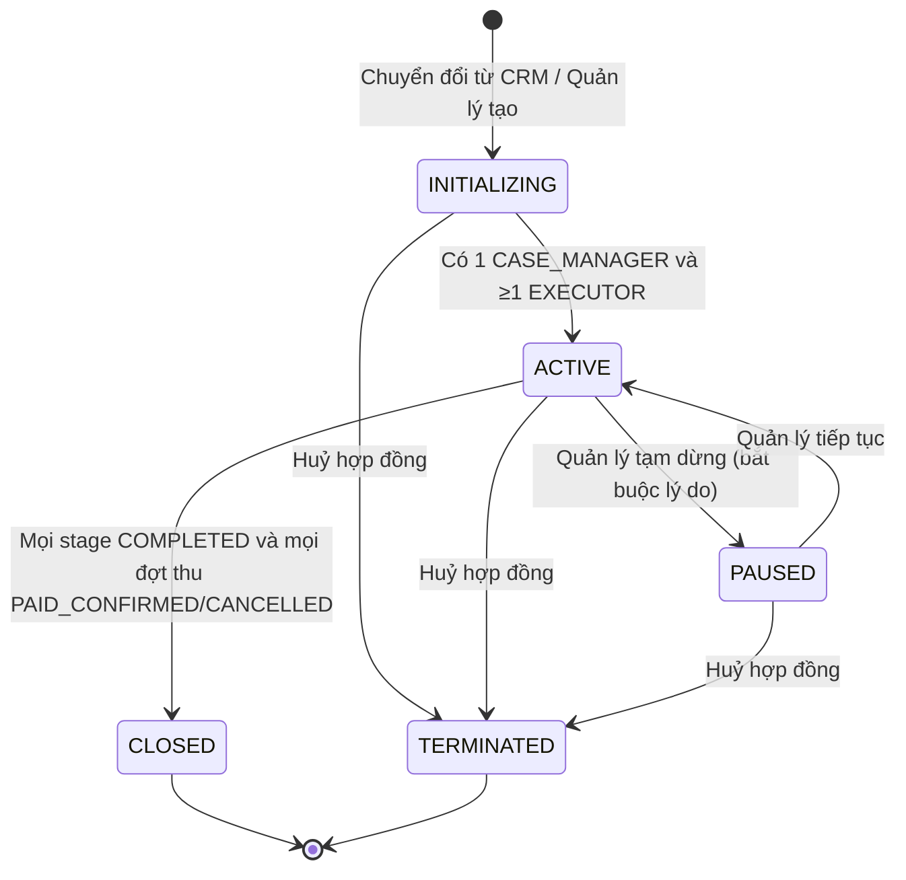
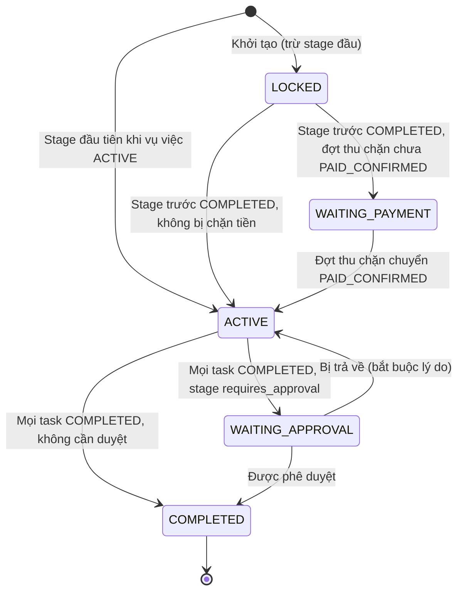
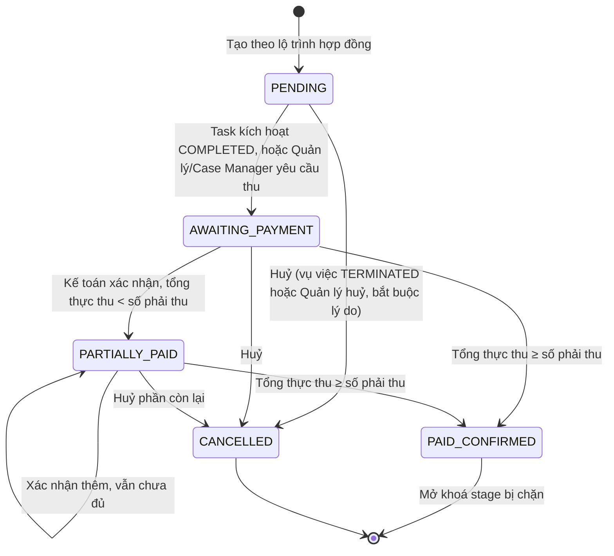
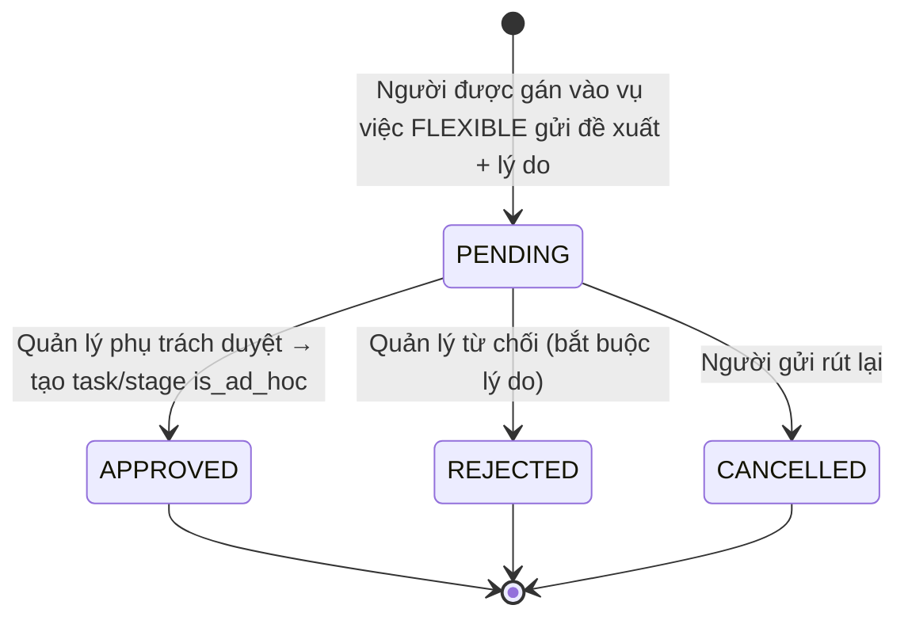

# 12. QUY TẮC NGHIỆP VỤ & MÁY TRẠNG THÁI (BUSINESS RULES & STATE MACHINES)

> Cập nhật 30/10/2026 theo `14-decisions.md` (DEC-01, DEC-06, DEC-07) và báo cáo QA 30/10 (B1–B7). Mã lỗi tham chiếu `07` §1.3.

## 1. HỆ THỐNG MÁY TRẠNG THÁI (STATE MACHINES)

Mọi chuyển trạng thái không có trong sơ đồ → `409 INVALID_STATE_TRANSITION`. Mọi chuyển trạng thái ghi `audit_logs`.

### 1.1. Cơ hội kinh doanh (Opportunity)

### 1.2. Vụ việc (Case) — vòng đời

Trạng thái **vòng đời** nằm ở `cases.status`. Việc vụ việc đang chờ duyệt hay chờ thu tiền là trạng thái của **stage hiện tại** (§1.3), nên một vụ việc không bao giờ phải chọn giữa "chờ duyệt" và "chờ tiền".

- `TERMINATED` (DEC-06): bắt buộc `termination_reason`; mọi đợt thu chưa `PAID_CONFIRMED` chuyển `CANCELLED`; task chưa xong giữ nguyên để tra cứu; **không** đảo hoa hồng đã ghi nhận — hoàn tiền xử lý ngoài hệ thống.
- `PAUSED`: không task nào được đổi trạng thái; cảnh báo SLA tạm ngưng.
- Vụ việc `is_legacy` (DEC-05) giữ trạng thái gốc từ hệ thống cũ và không chuyển trạng thái được.

### 1.3. Giai đoạn (Case Stage)

### 1.4. Tác vụ (Task)

```mermaid
stateDiagram-v2
    [*] --> TODO: Sinh từ template, hoặc từ yêu cầu bổ sung đã duyệt
    TODO --> IN_PROGRESS: [Guard §2.1 phụ thuộc, §2.3 stage ACTIVE]
    IN_PROGRESS --> WAITING_APPROVAL: Gửi duyệt (requires_approval)
    IN_PROGRESS --> COMPLETED: Hoàn thành (không cần duyệt)
    WAITING_APPROVAL --> COMPLETED: Được duyệt
    WAITING_APPROVAL --> IN_PROGRESS: Bị trả về (bắt buộc lý do)
    COMPLETED --> [*]: Mở khoá task phụ thuộc; nếu là task kích hoạt → đợt thu AWAITING_PAYMENT
```

### 1.5. Đợt thanh toán (Billing Milestone) — DEC-06

- Mỗi lần xác nhận là một dòng `misa_transactions`; **mỗi lần** đều kích hoạt tính hoa hồng trên số tiền của lần đó (§3).
- Chuyển sang `AWAITING_PAYMENT` phát tác vụ vào hòm thư Kế toán và thông báo.
- Đợt "tạm ứng khi ký hợp đồng" không có task kích hoạt: chuyển `AWAITING_PAYMENT` ngay khi vụ việc `ACTIVE`.

### 1.6. Yêu cầu bổ sung quy trình (Workflow Change Request) — DEC-07

---

## 2. CÁC RÀNG BUỘC CHUYỂN TRẠNG THÁI (TRANSITION GUARDS)

### 2.1. Phụ thuộc tác vụ
Task $T$ phụ thuộc tập $\{T_{p1}, T_{p2}, …\}$ trong `case_task_dependencies`. $T$ **không** được chuyển sang `IN_PROGRESS` hoặc `COMPLETED` nếu tồn tại $T_{pi}$ khác `COMPLETED` → `422 PREREQUISITE_TASK_NOT_COMPLETED`, `details.prerequisite_task_ids` liệt kê các task còn thiếu.

### 2.2. Phê duyệt (task, cổng giai đoạn, yêu cầu bổ sung)
| Loại | Người được duyệt |
| :--- | :--- |
| Task | `CASE_MANAGER` của vụ việc, hoặc Quản lý trong phạm vi |
| Cổng giai đoạn | `SUPERVISOR` của vụ việc; vụ việc không có Supervisor → Quản lý trong phạm vi |
| Yêu cầu bổ sung | Quản lý trong phạm vi (Giám đốc hoặc Trưởng phòng của phòng ban vụ việc) |

Không ai được duyệt yêu cầu do chính mình gửi → `403 APPROVAL_NOT_ALLOWED`. Trả về bắt buộc có lý do.

### 2.3. Khoá chờ thu tiền
Stage có `blocking_milestone_id` ở trạng thái `WAITING_PAYMENT` cho tới khi đợt thu đó `PAID_CONFIRMED`. Trong thời gian này mọi task của stage bị chặn đổi trạng thái → `409 STAGE_LOCKED`. **Thu một phần không mở khoá.**

### 2.4. Quy trình có kiểm soát (DEC-07)
- Không endpoint nào tạo trực tiếp task/stage trong vụ việc đang chạy.
- Vụ việc `STRICT`: gửi yêu cầu bổ sung → `403 STRICT_GOVERNANCE_VIOLATION`.
- Vụ việc `FLEXIBLE`: task/stage chỉ sinh ra khi yêu cầu bổ sung `APPROVED`; có `is_ad_hoc = true` và liên kết yêu cầu.
- Vụ việc gắn với phiên bản template lúc khởi tạo; phát hành phiên bản mới không thay đổi vụ việc đang chạy.

### 2.5. Phân công
- `case_tasks.assigned_to` phải là người đang được phân công vào vụ việc.
- Gỡ phân công người còn task `IN_PROGRESS`/`WAITING_APPROVAL` → bắt buộc chuyển giao task trước.
- Gỡ phân công / khoá tài khoản thu hồi quyền **ngay lập tức** (`06` §4).

### 2.6. Vụ việc lịch sử (DEC-05)
Vụ việc `is_legacy = true` chỉ đọc: mọi thao tác ghi → `409 LEGACY_CASE_READ_ONLY`.

---

## 3. CHIẾT TÍNH HOA HỒNG THEO DÒNG TIỀN THỰC THU (DEC-06)

### 3.1. Kích hoạt
- Mỗi lần Kế toán xác nhận một khoản tiền về (`misa_transactions`), với số tiền thực về $A$ của **lần đó** — kể cả thu một phần hoặc thu thừa.
- Tính trong cùng transaction với việc ghi xác nhận; lỗi ở bất kỳ bước nào → rollback toàn bộ.
- Tỷ lệ lấy từ `commission_policies` của vụ việc; chính sách **bị khoá** từ lần xác nhận đầu tiên.

### 3.2. Công thức
Với $R_o, R_m, R_e$ là tỷ lệ phát triển thị trường, quản lý, thực hiện; $s$ là phần của Supervisor trong quỹ quản lý:

1. **Phát triển thị trường:** $C_o = A \times R_o\%$ → người mang khách về (`opportunities.originator_id`). Vụ việc không có người mang khách về → không phân bổ khoản này.
2. **Quản lý:** $C_m = A \times R_m\%$; Supervisor nhận $C_m \times s\%$, Case Manager nhận phần còn lại. Không có Supervisor → Case Manager nhận toàn bộ.
3. **Thực hiện:** quỹ $F = A \times R_e\% + D$, trong đó $D$ là tổng quỹ đang dồn chưa dùng (§3.3).
   - **Task đủ điều kiện** = task `COMPLETED` của vụ việc **chưa từng được phân bổ** quỹ thực hiện.
   - $C_{task_i} = F \times \dfrac{W_i}{\sum W}$, $W_i$ = `complexity_weight` (1 cơ bản · 2 trung bình · 3 phức tạp · 4 rất phức tạp); trả cho người được giao task lúc hoàn thành.

### 3.3. Dồn quỹ thực hiện (đề xuất mặc định — câu hỏi mở Q2 trong `14`)
- Không có task đủ điều kiện ($\sum W = 0$, VD đợt tạm ứng khi ký): toàn bộ $F$ ghi vào `commission_carry_forwards`, **không** chia cho ai, không chia cho 0.
- Lần xác nhận kế tiếp có task đủ điều kiện dùng hết quỹ đang dồn.
- Vụ việc `CLOSED`/`TERMINATED` mà còn quỹ dồn: phân bổ theo trọng số cho **mọi** task `COMPLETED` của vụ việc; không có task nào → quỹ không phân bổ, báo cáo cho Quản lý.

### 3.4. Làm tròn — khớp từng đồng
1. Tính mọi giá trị bằng `Decimal`, không làm tròn trung gian.
2. Mỗi khoản quỹ ($C_o$, phần Supervisor, phần Case Manager, $F$) **làm tròn xuống** đến đồng.
3. Chia $F$ cho các task: làm tròn xuống từng phần, phần dư $r = F - \sum \lfloor C_{task_i} \rfloor$ (đồng) chia mỗi task 1 đồng theo **phần lẻ lớn nhất**; hoà nhau thì ưu tiên task hoàn thành sớm hơn, rồi theo `id`.
4. Bất biến: $\sum$ hoa hồng của một lần xác nhận $\le \lfloor A \times (R_o + R_m + R_e)\% \rfloor + D$, và $\sum C_{task_i} = F$ chính xác.

**Ví dụ:** $A$ = 33.333.333đ, $R_e$ = 8% → $F$ = 2.666.666đ; 3 task trọng số bằng nhau → 888.888,67đ mỗi task → làm tròn xuống 888.888đ × 3 = 2.666.664đ, dư 2đ → task 1 và 2 nhận 888.889đ, task 3 nhận 888.888đ.

### 3.5. Không đảo hoa hồng
Hoàn tiền, huỷ hợp đồng, thu thừa được trả lại: **không** sinh bút toán đảo trong hệ thống (DEC-06). `commission_transactions` chỉ thêm mới, không sửa/xoá. Chi trả hoa hồng làm ngoài hệ thống (DEC-09).

### 3.6. Hoa hồng lịch sử
Dữ liệu chuyển từ hệ thống cũ nhập nguyên số đã ghi nhận, `source = 'LEGACY'`, không tính lại.

---

## 4. QUY TẮC TOÀN VẸN DỮ LIỆU & GÓC KHUẤT

### 4.1. Xung đột lợi ích
- Khi tạo khách hàng hoặc thêm bên liên quan vào vụ việc, đối chiếu `normalized_name` và MST/hash CCCD với các bên `OPPOSING` của vụ việc `INITIALIZING`/`ACTIVE`/`PAUSED` (Cypher ở `06` §3.5).
- Trùng → **không chặn**, trả `warnings: [{code: "CONFLICT_OF_INTEREST", …}]`, thông báo cho Giám đốc và Trưởng phòng của phòng ban liên quan, ghi audit.

### 4.2. Hạn chót & leo thang (SLA)
- Hạn task tính theo **ngày làm việc** (thứ Hai–Sáu, trừ ngày trong bảng `holidays`, gồm Tết âm lịch).
- Còn ≤ 24 giờ làm việc mà task ở `TODO`/`IN_PROGRESS`: cảnh báo cấp 1 tới người thực hiện.
- Quá hạn > 4 giờ: cảnh báo cấp 2 tới `CASE_MANAGER` và `SUPERVISOR` của vụ việc.
- Mỗi (task, cấp, kênh) gửi **tối đa một lần** (`notification_deliveries.dedupe_key`). Vụ việc `PAUSED` không cảnh báo.

### 4.3. Tin nhắn ra dịch vụ ngoài (DEC-03)
Telegram/Zalo/Email chỉ chứa: mã vụ việc, tên task, hạn chót, deep-link. Không chứa tên khách hàng, tên vụ việc, tên nhãn hiệu/tài sản, số tiền, nội dung tài liệu.

---

## 5. QUY TẮC ĐIỀU HÀNH VĂN PHÒNG SỐ TRỰC QUAN (FLOORPLAN BUSINESS RULES)

### BR-FLOOR-01: Nhận diện Trạng thái Nhân sự Đang Nghỉ Ngơi
- Một nhân sự được xác định là đang nghỉ ngơi (`is_idle = true`) khi:
  $$\text{tasks\_in\_progress\_count} == 0$$
- Dù nhân sự đó có các task ở hàng đợi `TODO` nhưng chưa bấm bắt đầu, bàn làm việc vẫn hiển thị trạng thái thư giãn kèm biểu tượng `☕ Đang nghỉ ngơi` để Quản lý biết nhân sự đang sẵn sàng nhận việc mới.

### BR-FLOOR-02: Cơ chế Rời Bàn Xếp Hàng Chờ Phê Duyệt
- Khi nhân sự gửi ít nhất một yêu cầu phê duyệt cổng (`approval_requests.status = 'PENDING'`):
  - Avatar của nhân sự tạm thời rời khỏi ghế làm việc cá nhân và di chuyển đến vị trí Vạch Hàng Đợi (Approval Lane) trước bàn Trưởng phòng.
  - Trên đầu nhân sự xuất hiện huy hiệu: `[ 📝 X việc chờ duyệt ]`.
  - Bàn làm việc cá nhân của nhân sự hiển thị trạng thái ghế tạm vắng *"Đang trình duyệt tại bàn sếp"*.

### BR-FLOOR-03: Tự Động Hồi Vị Khi Hoàn Tất Ký Duyệt
- Ngay khi Trưởng phòng/Giám đốc thực hiện hành động ký duyệt hoặc từ chối yêu cầu cuối cùng của nhân sự trong hàng đợi:
  - Hệ thống phát sự kiện `EVENT_APPROVAL_DECIDED` qua WebSockets.
  - Avatar của nhân sự tự động biến mất khỏi hàng đợi và quay trở lại ngồi tại bàn làm việc cá nhân của mình.

### BR-FLOOR-04: Phân Quyền Giám Sát Need-to-Know Trực Quan
- **Giám đốc** (`MANAGER` có `is_executive`): xem và điều hành căn phòng của mọi phòng ban.
- **Trưởng phòng** (`MANAGER` có cạnh `(:User)-[:LEADS]->(:Department)`): chỉ phòng ban mình quản lý. Truy cập chéo phòng ban bị chặn với `403 NEED_TO_KNOW_DENIED`.
- Vai trò khác không truy cập được màn hình này.

