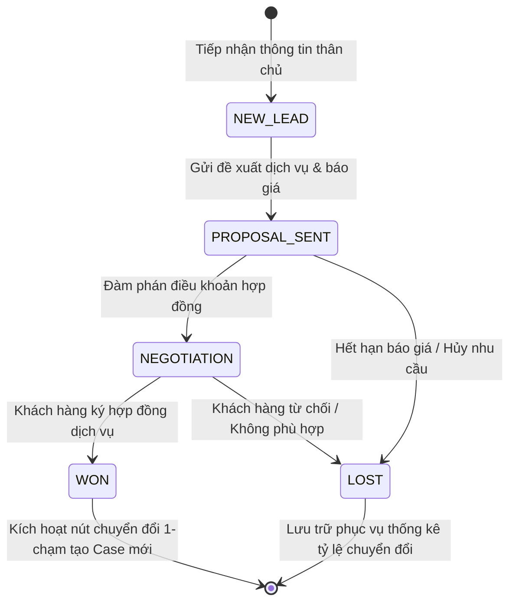
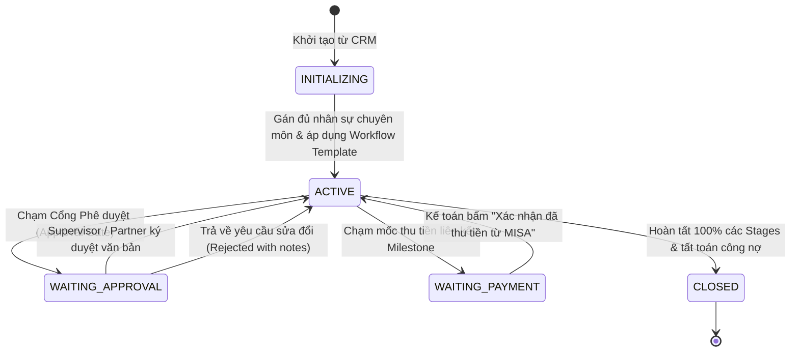
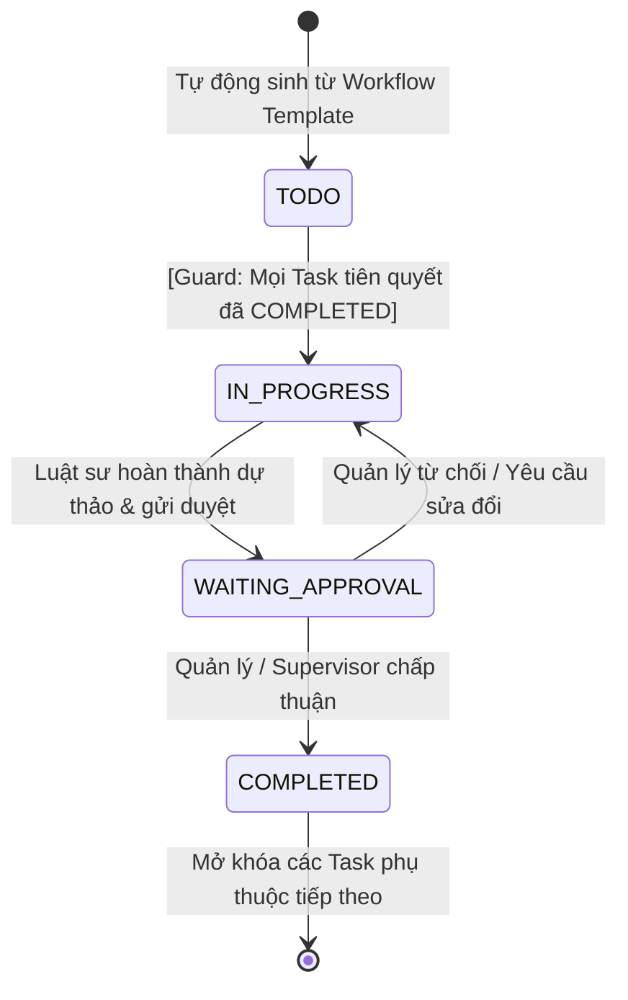
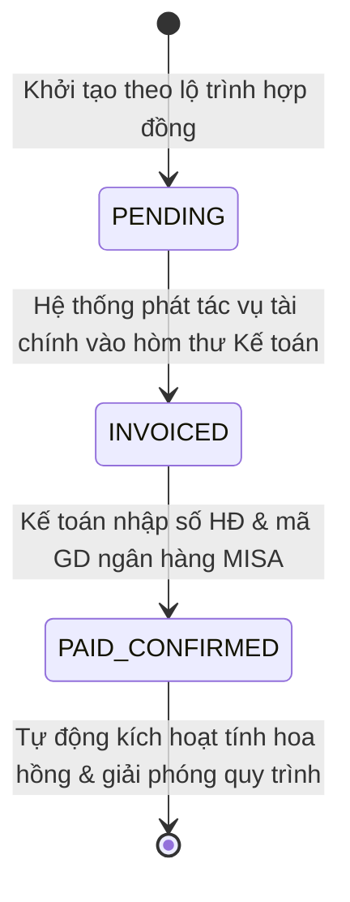

# 12. QUY TẮC NGHIỆP VỤ & MÁY TRẠNG THÁI (BUSINESS RULES & STATE MACHINES)

## 1. HỆ THỐNG MÁY TRẠNG THÁI (STATE MACHINES)

### 1.1. Máy Trạng thái Cơ hội Kinh doanh (Opportunity State Machine)

### 1.2. Máy Trạng thái Vụ việc (Case State Machine)

### 1.3. Máy Trạng thái Tác vụ Con (Task State Machine)

### 1.4. Máy Trạng thái Đợt thanh toán (Milestone State Machine)

---

## 2. CÁC RÀNG BUỘC CHUYỂN TRẠNG THÁI (TRANSITION GUARDS)

### 2.1. Ràng buộc Phụ thuộc Tác vụ (Task Dependency Guard)
- **Điều kiện:** Một tác vụ $T_{child}$ có quan hệ phụ thuộc vào tập hợp các tác vụ tiên quyết $\{T_{p1}, T_{p2}, ...\}$ trong bảng `case_task_dependencies`.
- **Quy tắc:**
  - $T_{child}$ **NGHIÊM CẤM** chuyển trạng thái từ `TODO` sang `IN_PROGRESS` hoặc `COMPLETED` nếu tồn tại ít nhất một $T_{pi}$ có trạng thái khác `COMPLETED`.
  - Nếu người dùng cố tình cập nhật, API chặn lại và trả về lỗi: `PREREQUISITE_TASK_NOT_COMPLETED`.

### 2.2. Ràng buộc Cổng Phê duyệt Giai đoạn (Approval Gate Guard)
- **Điều kiện:** Giai đoạn $S_k$ được gắn cờ `requires_approval = TRUE`.
- **Quy tắc:**
  - Vụ việc không được phép chuyển từ Giai đoạn $S_k$ sang Giai đoạn $S_{k+1}$ nếu chưa có bản ghi phê duyệt hợp lệ được ký bởi người dùng có vai trò tối thiểu là `SUPERVISOR` hoặc `CASE_MANAGER` phụ trách vụ việc đó.

### 2.3. Ràng buộc Tạm khóa Chờ Kế toán (MISA Payment Gate Guard)
- **Điều kiện:** Giai đoạn tiếp theo yêu cầu phải hoàn tất thu tiền Đợt $M_x$ (Ví dụ: Đợt nộp phí nhà nước).
- **Quy tắc:**
  - Hệ thống tự động khóa trạng thái của Case ở mức `WAITING_PAYMENT`.
  - Toàn bộ các thao tác nộp đơn hoặc chuyển tiếp chuyên môn bị phong tỏa cho đến khi Kế toán viên bấm **"Xác nhận đã thu tiền/Đã xuất hóa đơn"** thành công trên giao diện ERP.

---

## 3. CÔNG THỨC CHIẾT TÍNH HOA HỒNG DÒNG TIỀN THỰC THU (CASH-BASIS COMMISSION RULES)

### 3.1. Nguyên tắc Kích hoạt (Activation Trigger)
- Chỉ kích hoạt tính và ghi nhận hoa hồng khi và chỉ khi:
  $$\text{milestone.status} = \text{'PAID\_CONFIRMED'}$$
- Số tiền dùng làm căn cứ tính hoa hồng là **Số tiền thực tế tiền về tài khoản ngân hàng** ($A_{\text{actual}}$) do Kế toán ghi nhận, không dựa trên giá trị dự kiến.

### 3.2. Công thức Phân bổ Cụ thể
Cho một đợt thanh toán có số tiền thực thu là $A_{\text{actual}}$:

1. **Hoa hồng Kinh doanh (Sales Commission):**
   $$C_{\text{sales}} = A_{\text{actual}} \times R_{\text{sales}}\%$$
   *(Dành cho chuyên viên Sales được gán vào Opportunity khởi tạo vụ việc)*.

2. **Hoa hồng Quản lý Vụ việc (Management Commission):**
   $$C_{\text{mgmt}} = A_{\text{actual}} \times R_{\text{mgmt}}\%$$
   *(Được chia theo tỷ lệ thỏa thuận giữa Supervisor và Case Manager phụ trách)*.

3. **Hoa hồng Thực hiện Chuyên môn (Execution Commission):**
   $$C_{\text{exec}} = A_{\text{actual}} \times R_{\text{exec}}\%$$
   - Số tiền này được phân bổ cho các Luật sư / Trợ lý đã hoàn thành các tác vụ kỹ thuật gắn liền với Đợt thu tiền này:
   $$C_{\text{task\_}i} = C_{\text{exec}} \times \frac{W_i}{\sum W}$$
   *(Trong đó $W_i$ là hệ số trọng số độ phức tạp của Task $i$: Cơ bản = 1, Trung bình = 2, Phức tạp = 3, Rất phức tạp = 4)*.

4. **Quy tắc Làm tròn (Rounding Rule):**
   - Áp dụng làm tròn số nguyên tiền Việt Nam Đồng (VNĐ) theo chuẩn Banker's Rounding (Half to Even), đảm bảo tổng các khoản hoa hồng thành phần không bao giờ vượt quá tỷ lệ quỹ hoa hồng tối đa được duyệt của vụ việc.

---

## 4. QUY TẮC TOÀN VẸN DỮ LIỆU & XỬ LÝ GÓC KHUẤT (EDGE CASES)

### 4.1. Quy tắc Ngăn ngừa Xung đột Lợi ích (Conflict of Interest Prevention)
- Khi Sales nhập thông tin thân chủ mới hoặc tạo Vụ việc mới, hệ thống tự động kiểm tra trên Đồ thị Neo4j:
  - Nếu Tên thân chủ hoặc Mã số thuế trùng khớp với "Bên đối tụng / Bên bị khiếu nại" trong một vụ việc đang có hiệu lực (`ACTIVE`) của ASL Law -> Hệ thống phát cảnh báo đỏ tức thì cho Managing Partner: *"Cảnh báo Xung đột Lợi ích: Khách hàng này đang là bên đối nghịch trong Vụ việc XYZ"*.

### 4.2. Xử lý Trôi Hạn chót (Statute of Limitations SLA Escalation)
- Nếu một Task còn 24 giờ trước thời hạn (Due Date) mà vẫn ở trạng thái `TODO` hoặc `IN_PROGRESS`: Bắn cảnh báo cấp 1 tới Người thực hiện qua Telegram/Zalo.
- Nếu Task quá hạn (Overdue) quá 4 giờ: Bắn cảnh báo cấp 2 (Escalation) trực tiếp tới `CASE_MANAGER` và `SUPERVISOR` để can thiệp kịp thời, tránh tổn thất pháp lý cho khách hàng.

---

## 5. QUY TẮC ĐIỀU HÀNH VĂN PHÒNG SỐ TRỰC QUAN (FLOORPLAN BUSINESS RULES)

### BR-FLOOR-01: Nhận diện Trạng thái Nhân sự Đang Nghỉ Ngơi
- Một nhân sự được xác định là đang nghỉ ngơi (`is_idle = true`) khi:
  $$\text{tasks\_in\_progress\_count} == 0$$
- Dù nhân sự đó có các task ở hàng đợi `TODO` nhưng chưa bấm bắt đầu, bàn làm việc vẫn hiển thị trạng thái thư giãn kèm biểu tượng `☕ Đang nghỉ ngơi` để Quản lý biết nhân sự đang sẵn sàng nhận việc mới.

### BR-FLOOR-02: Cơ chế Rời Bàn Xếp Hàng Chờ Phê Duyệt
- Khi nhân sự gửi ít nhất một yêu cầu phê duyệt cổng (`approval_requests.status = 'PENDING'`):
  - Avatar của nhân sự tạm thời rời khỏi ghế làm việc cá nhân và di chuyển đến vị trí Vạch Hàng Đợi (Approval Lane) trước bàn Trưởng phòng.
  - Trên đầu nhân sự xuất hiện huy hiệu: `[ 📝 X việc chờ duyệt ]`.
  - Bàn làm việc cá nhân của nhân sự hiển thị trạng thái ghế tạm vắng *"Đang trình duyệt tại bàn sếp"*.

### BR-FLOOR-03: Tự Động Hồi Vị Khi Hoàn Tất Ký Duyệt
- Ngay khi Trưởng phòng/Giám đốc thực hiện hành động ký duyệt hoặc từ chối yêu cầu cuối cùng của nhân sự trong hàng đợi:
  - Hệ thống phát sự kiện `EVENT_APPROVAL_DECIDED` qua WebSockets.
  - Avatar của nhân sự tự động biến mất khỏi hàng đợi và quay trở lại ngồi tại bàn làm việc cá nhân của mình.

### BR-FLOOR-04: Phân Quyền Giám Sát Need-to-Know Trực Quan
- **Giám đốc điều hành (Managing Partner):** Có quyền chuyển đổi xem căn phòng làm việc của tất cả các phòng ban trong hãng luật.
- **Trưởng ban (Supervisor / Leader):** Chỉ có quyền truy cập và điều hành căn phòng của phòng ban mình phụ trách theo quan hệ Neo4j `(:User)-[:LEADS]->(:Department)`. Bất kỳ truy cập chéo phòng ban nào sẽ bị chặn với mã `403 Forbidden`.

