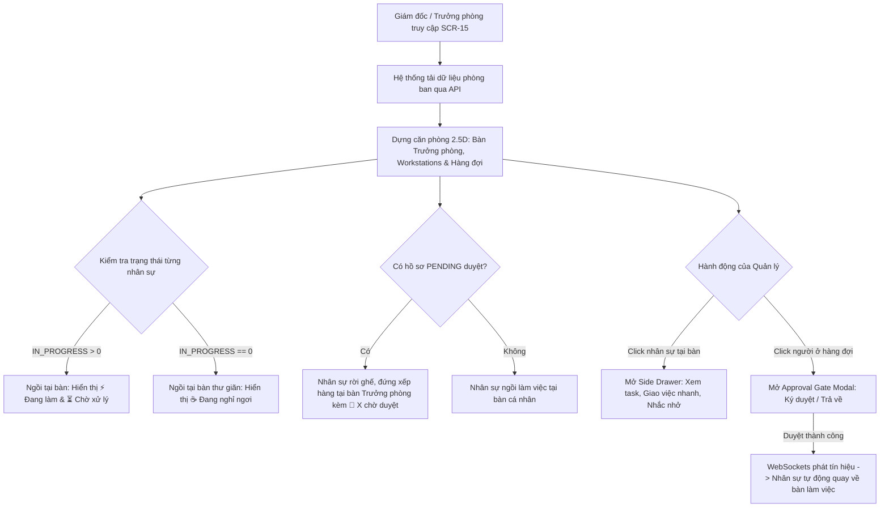

# Đặc tả Tính năng: Văn Phòng Số Trực Quan (FEAT-01: Virtual Office Floorplan)

## 1. Tổng quan & Mục tiêu Nghiệp vụ
- **Mã tính năng:** `FEAT-01`
- **Mã màn hình:** `SCR-15`
- **Tên màn hình:** Văn Phòng Số Trực Quan (Virtual Office Floorplan)
- **Mục tiêu:** Cung cấp cho Giám đốc và Trưởng phòng (cùng vai trò `MANAGER` — DEC-01) một "Trung tâm Chỉ huy Trực quan (Visual War Room)" mô phỏng căn phòng làm việc 2.5D của từng phòng ban trong hãng luật ASL LAW. Hệ thống hiển thị đầy đủ bàn ghế, nhân sự đang ngồi làm việc, chỉ số công việc theo thời gian thực (real-time), tự động nhận diện ai đang bận, ai đang rảnh rỗi nghỉ ngơi, và ai đang mang hồ sơ đứng xếp hàng trước bàn Trưởng phòng để chờ ký duyệt.
- **Giá trị mang lại:**
  - Nắm bắt tức thì tải trọng công việc (Workload Distribution) của từng phòng ban trong 3 giây mà không cần đọc báo cáo phức tạp.
  - Xóa bỏ điểm nghẽn phê duyệt (Approval Bottlenecks): Nhìn thấy ngay hàng đợi trước bàn Trưởng phòng để ký duyệt điện tử 1 chạm.
  - Tối ưu phân bổ nhân sự: Nhận diện ngay nhân sự đang rảnh việc (`☕ Đang nghỉ ngơi`) để giao việc nhanh.

---

## 2. Sơ đồ Luồng Tương tác (Sequence & Flowchart)



---

## 3. Đặc tả Giao diện & Ma trận 4 Trạng thái (UI Specs & Stitch Prompts)

### 3.1. Bố cục Giao diện (2.5D Isometric Layout)
1. **Header & Control Bar:**
   - Dropdown chọn phòng ban: *Phòng Sở Hữu Trí Tuệ*, *Phòng Tranh Tụng*, *Phòng Doanh Nghiệp & M&A*, *Phòng Kế Toán*.
   - Chỉ số tổng quan phòng: Tổng nhân sự, Tỷ lệ đang làm việc (Occupancy Rate), Số hồ sơ chờ sếp duyệt.
   - Nút bật/tắt chế độ Live Sync (WebSockets).
2. **Khu vực Bàn Trưởng Phòng (Executive Station):**
   - Bàn gỗ cao cấp đặt phía trên cùng trung tâm, có biển tên và avatar Trưởng phòng.
   - **Vạch Hàng Đợi (Approval Lane):** Dành cho nhân sự có hồ sơ đang trình duyệt xếp hàng nối đuôi nhau, hiển thị huy hiệu `[ 📝 X việc chờ duyệt ]`.
3. **Các Dãy Bàn Nhân Viên (Workstations - Smart Auto-Grid với Đồ Họa 2.5D Hình Người Thật):**
   - **Hình người thật (Real Human Cutout Figures):** Mỗi nhân sự và lãnh đạo đều được đại diện bằng chân dung ảnh người thật trang phục vest luật sư chuyên nghiệp, có hiệu ứng đổ bóng 2.5D (drop-shadow), viền sáng phản quang (rim-light) và độ nổi theo góc nhìn isometric.
   - Bàn làm việc có màn hình máy tính, thiết bị trạm trực tuyến, chỉ số tải trọng.
   - **Dưới chân nhân sự:** Bảng tên nhân sự + chức danh chuyên môn (ví dụ: *"LS. Mai Linh • Luật sư Cấp cao • SHTT"*).
   - **Trên đầu nhân sự:** Cặp huy hiệu nổi 3D:
     - `[ ⚡ X Đang làm ]`: Màu xanh cerulean (Task `IN_PROGRESS`).
     - `[ ⏳ Y Chờ xử lý ]`: Màu xám slate (Task `TODO`).
     - Khi `X = 0`: Avatar ảnh người thật thư giãn kèm huy hiệu `[ ☕ Đang nghỉ ngơi ]` (Màu xanh ngọc dịu).
   - **Khi có hồ sơ chờ duyệt:** Avatar ảnh người thật tạm rời bàn làm việc và đứng xếp hàng trực tiếp trước bàn Trưởng phòng tại Vạch Hàng Đợi; bàn làm việc cá nhân chuyển sang ghế tạm vắng mờ.
4. **Ngăn kéo Chi tiết Nhân sự (Side Drawer):**
   - Trượt từ cạnh phải khi click vào nhân sự:
     - Thông tin chi tiết, giờ làm trong ngày, tiến độ KPIs.
     - Danh sách các vụ việc/task đang phụ trách.
     - Bộ 3 nút hành động nhanh: `[ + Giao việc nhanh ]`, `[ 💬 Nhắn tin / Nhắc nhở ]`, `[ 📊 Xem Hồ sơ 360° ]`.

### 3.2. Ma trận 4 Trạng thái Giao diện (UI 4-States)
- **Loading:** Khung bàn ghế 2.5D dạng Skeleton mờ với hiệu ứng pulse mượt mà.
- **Empty:** Phòng ban chưa có nhân sự $\to$ Phòng làm việc ấm cúng với thông báo *"Chưa có nhân sự nào được phân công vào phòng ban này"*.
- **Error:** Mất kết nối WebSockets / Server $\to$ Banner cảnh báo cam đỏ kèm nút *"Kết nối lại"*.
- **Success:** Phòng làm việc 2.5D sống động, đầy đủ nhân sự, avatar, huy hiệu sắc nét, hỗ trợ mượt mà cả Light Mode và Dark Mode.

### 3.3. Google Stitch Design Prompt
```text
A modern 2.5D isometric digital office floorplan dashboard for a prestigious law firm (ASL LAW). Executive desk at the top center with an approval queue lane in front where avatars wait with glowing approval badges. Smart grid of clean workstations with computer monitors and office chairs. Above each seated lawyer, floating pill badges show active tasks (lightning icon) and pending tasks (hourglass icon), or a chill coffee cup icon for resting employees. Lawyer name and title displayed at desk bases. Right-side collapsible slide-over drawer showing detailed case assignments and quick action buttons. Rich navy blue (#002D54), ASL cerulean (#0082B4), warm orange (#FF7A00), and dark slate aesthetic with complete dark mode support.
```

---

## 4. Tác động Cơ sở Dữ liệu & Đồ thị (Database & Graph Impact)

### 4.1. PostgreSQL Schema
- **Bảng `departments`:** Đã có sẵn. Bổ sung trường cấu hình nếu cần:
  - `floorplan_config`: `JSONB` (lưu trữ tùy chọn phòng ban nếu cần mở rộng).
- **Bảng `tasks`:** Sử dụng sẵn trường `status` (`TODO`, `IN_PROGRESS`, `DONE`, `BLOCKED`) và `assignee_id`.
- **Bảng `approval_requests`:** Sử dụng sẵn trường `status` (`PENDING`, `APPROVED`, `REJECTED`) và `requester_id`, `approver_id`.

### 4.2. Neo4j Graph RBAC
- Kiểm tra quyền lãnh đạo phòng ban của Trưởng phòng:
  ```cypher
  MATCH (u:User {id: $user_id})-[:LEADS]->(d:Department {id: $dept_id})
  RETURN count(d) > 0 AS is_leader
  ```
- Giám đốc là `(:User {system_role: 'MANAGER', is_executive: true})`, truy cập được tất cả phòng ban. Truy vấn chuẩn ở `06` §3.4.

---

## 5. Hợp đồng Dữ liệu API / WebSockets Contracts

### 5.1. REST Endpoints
* **`GET /api/v1/operations/floorplan`**
  - **Query Params:** `department_id` (UUID, optional nếu là Leader)
  - **Response 200 OK:**
    ```json
    {
      "department": {
        "id": "dept-ip-01",
        "name": "Phòng Sở Hữu Trí Tuệ",
        "leader": {
          "id": "usr-01",
          "name": "LS. Nguyễn Văn An",
          "title": "Trưởng Ban SHTT",
          "avatar": "NA"
        }
      },
      "stats": {
        "total_staff": 8,
        "working_count": 6,
        "resting_count": 2,
        "pending_approvals_count": 3
      },
      "approval_queue": [
        {
          "user": {
            "id": "usr-02",
            "name": "LS. Mai Linh",
            "title": "Luật sư Cấp cao",
            "avatar": "ML"
          },
          "pending_count": 2,
          "requests": [
            {
              "id": "appr-101",
              "case_code": "ASL-2026-TM109",
              "title": "Tờ khai đăng ký nhãn hiệu 9OUTFIT",
              "requested_at": "2026-10-30T09:15:00Z"
            }
          ]
        }
      ],
      "workstations": [
        {
          "desk_index": 1,
          "user": {
            "id": "usr-03",
            "name": "Trần Thu Hà",
            "title": "Chuyên viên Pháp lý",
            "avatar": "TH"
          },
          "in_progress_count": 3,
          "todo_count": 2,
          "is_idle": false,
          "is_in_queue": false
        },
        {
          "desk_index": 2,
          "user": {
            "id": "usr-04",
            "name": "Lê Hoàng Nam",
            "title": "Trợ lý Luật sư",
            "avatar": "HN"
          },
          "in_progress_count": 0,
          "todo_count": 1,
          "is_idle": true,
          "is_in_queue": false
        }
      ]
    }
    ```

* **`POST /api/v1/approvals/{id}/decide`**
  - **Body:** `{ "action": "APPROVE" | "REJECT", "comment": "string" }`
  - **Response 200 OK:** `{ "success": true, "message": "Đã phê duyệt hồ sơ thành công" }`

### 5.2. WebSockets Real-time Stream
* **`WS /ws/operations/floorplan?department_id={id}`**
  - Nhận các sự kiện từ Redis Pub/Sub:
    - `EVENT_TASK_STATUS_UPDATED`: Cập nhật số việc đang làm / đang chờ của nhân sự.
    - `EVENT_APPROVAL_SUBMITTED`: Đưa nhân sự vào hàng đợi tại bàn sếp.
    - `EVENT_APPROVAL_DECIDED`: Rút nhân sự khỏi hàng đợi về lại bàn làm việc.

---

## 6. Quy tắc Nghiệp vụ & Máy Trạng thái (Business Rules)

* **BR-FLOOR-01 (Xác định Trạng thái Đang Nghỉ Ngơi):**
  Nhân sự được đánh dấu `is_idle = true` khi `in_progress_count == 0`. Bàn làm việc tự động hiển thị hiệu ứng thư giãn kèm icon `☕ Đang nghỉ ngơi`.
* **BR-FLOOR-02 (Cơ chế Rời Bàn Xếp Hàng Duyệt):**
  Khi nhân sự có ít nhất 1 hồ sơ ở trạng thái `PENDING_APPROVAL`, avatar nhân sự sẽ di chuyển lên đứng tại khu vực Vạch Hàng Đợi trước bàn Trưởng phòng. Ghế tại bàn cá nhân mờ đi kèm thông báo *"Đang trình duyệt"*.
* **BR-FLOOR-03 (Tự Động Hồi Vị Khi Duyệt Xong):**
  Khi Trưởng phòng ký duyệt hoặc từ chối hồ sơ cuối cùng trong hàng đợi của nhân sự, nhân sự lập tức rời khỏi hàng đợi và quay trở lại ngồi tại bàn làm việc cá nhân.
* **BR-FLOOR-04 (Bảo Mật Need-to-Know Trực Quan):**
  Trưởng phòng chỉ được xem phòng ban mình phụ trách. Giám đốc được xem tất cả. Người ngoài phòng ban không có quyền truy cập màn hình floorplan của phòng ban khác.

---

## 7. Ma trận Ca Kiểm thử (Test Cases)

| Mã test | Tên ca kiểm thử | Điều kiện kiểm tra | Kết quả mong đợi |
| :--- | :--- | :--- | :--- |
| **TC-FL-01** | Tải danh sách phòng ban cho Giám đốc | User `MANAGER` có `is_executive = true` | Dropdown hiển thị đủ 4 phòng ban, chuyển phòng mượt mà. |
| **TC-FL-02** | Phân quyền Leader phòng ban | User là Trưởng phòng SHTT | Mặc định chỉ mở phòng SHTT, không xem được phòng Tranh tụng. |
| **TC-FL-03** | Hiển thị huy hiệu task trên đầu nhân sự | Nhân sự có 3 task In Progress, 2 task Todo | Icon sấm sét hiển thị `3`, icon đồng hồ cát hiển thị `2`. |
| **TC-FL-04** | Nhận diện nhân sự rảnh rỗi | Nhân sự có 0 task In Progress | Hiển thị huy hiệu `☕ Đang nghỉ ngơi` màu xanh ngọc. |
| **TC-FL-05** | Xếp hàng tại bàn Trưởng phòng | Nhân sự gửi 1 Gate Approval | Nhân sự xuất hiện ở hàng đợi với huy hiệu `📝 1 việc chờ duyệt`, ghế cá nhân tạm vắng. |
| **TC-FL-06** | Phê duyệt cổng trực tiếp trên phòng | Trưởng phòng bấm "Ký duyệt" trên modal | API trả về 200, nhân sự biến mất khỏi hàng đợi và quay lại ghế. |
| **TC-FL-07** | Đồng bộ thời gian thực WebSockets | Nhân sự bắt đầu 1 task ở tab khác | Màn hình Giám đốc nhảy số lượng task ngay lập tức không cần F5. |

---

## 8. Kế hoạch Triển khai & Tiêu chuẩn Nghiệm thu (Tasks & DoD)

* **Task 1: Tạo Mockup Giao diện Prototype (`prototype/operations/floorplan.html`)**
  - Dựng phòng 2.5D Isometric đầy đủ bàn sếp, hàng đợi, cụm bàn nhân viên, Side Drawer, Modal duyệt.
  - Hỗ trợ hoàn hảo Dark/Light mode và icon Lucide đồng nhất.
  - **DoD:** Mở trên trình duyệt hiển thị đúng tỷ lệ, click tương tác mượt mà, không lỗi CSS/JS console.
* **Task 2: API Endpoints & Service Layer (`backend/app/api/v1/operations.py`)**
  - Viết endpoint `GET /floorplan` và `POST /approvals/{id}/decide`.
  - **DoD:** `curl -X GET http://localhost:8000/api/v1/operations/floorplan?department_id=...` trả về HTTP 200 JSON đúng schema.
* **Task 3: Tích hợp Frontend Next.js 15 (`frontend/src/app/(dashboard)/operations/floorplan/page.tsx`)**
  - Chuyển giao code từ prototype sang React Component, kết nối Zustand & TanStack Query.
  - **DoD:** `pnpm build` và `pnpm test` pass 100%.
